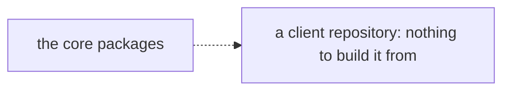
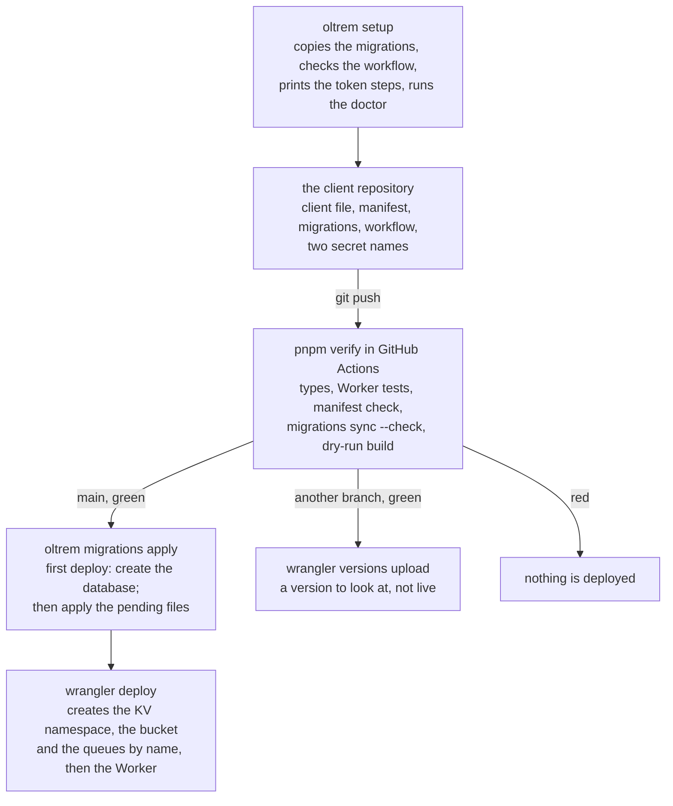

# Phase 1: the client template and the setup command

> **In plain words.** A client's portal is its own small repository. This commit writes the
> model of that repository: one file that says who the client is, one list of the resources the
> Worker may have (one database, one key-value store, one bucket, one queue, with no account id
> anywhere), the kit's database migrations copied in with a checksum so nobody edits them, one
> workflow that checks everything and then deploys, and a short contract for the agent that
> works there. The tool gained the commands that go with it: `oltrem setup` prepares a new
> repository and prints the steps for the one token the deploy needs; `oltrem migrations sync`
> keeps the migrations in step with the kit; `oltrem migrations apply` runs them on the client's
> account before each deploy, and creates the database on the very first one. Nothing is
> deployed yet: the first real deploy waits on the sandbox repository and the fresh Cloudflare
> account, the owner's two steps.

## What changed, and why

| What | Why |
|---|---|
| **`templates/client/`**, the model of a client repository: `oltrem.config.ts`, `wrangler.jsonc`, `oltrem.manifest.json`, `migrations/`, `src/index.ts`, the deploy workflow, `tokens.registry.json`, its own `ai.md`, tests | Plan 15.1: a client repository is a thin configuration layer on the kit. It is a workspace package here, so `pnpm verify` tests it like any other |
| **Resources declared by name only**: no `database_id`, no KV id, no account id in any file | Plan 9.2 and the phase's done-when: wrangler creates what does not exist on the first deploy and finds it by name after; the repository stays free of identifiers (R-04) |
| **`defineClient`** in `@oltrem/core-config`: the client file, layer L1, validated and frozen | Plan 5.1: who the client is, the brand, the modules on; a bad value fails the build, not the first request |
| **`ownerOnly`** in `@oltrem/core-http`: the own-account authorizer | Plan 15.4: until the Access door and the permission module exist, the owner's address holds every capability and nobody else holds any |
| **The CLIENT_ID guard**: a Worker whose `CLIENT_ID` differs from its client file answers 503 to everything | Plan 5.4 and 15.1: a client's code can never run under another client's name |
| **`oltrem migrations sync`** and `migrations/kit.json` | Plan 10: the kit's migrations are copied, never edited; the checksum makes an edit a verify failure |
| **`oltrem migrations apply`** | Plan 14.1: a migration is live before the code that needs it, on the first deploy too, when the database does not exist yet |
| **`oltrem setup`** and three doctor checks (`MIG-01`, `WF-01`, `TOKEN-01`) | Plan 15.3: a new repository is prepared by one idempotent command; what cannot be automated (the token) is printed as steps |
| **The deploy workflow**: verify, then migrations, then deploy, on `main` only; a version upload on any other branch | Plan 14.1 (the owner's choice: GitHub Actions is the gate) and 14.2 (a look on the phone before it is live) |
| **wrangler** in the catalog with its row | The template's build is a dry-run deploy, which bundles and validates the Worker without an account |
| The mirror job copies a template's README too | So the index's link to the template opens on the public mirror |

## Decisions taken while building

- **The template is a workspace package, not a folder of files.** Its Worker tests run inside
  the Workers runtime, its manifest is checked and its bundle is built on every `pnpm verify`.
  A template that is only copied is a template that rots.
- **The database is created by the migration step, the rest by the deploy.** wrangler creates
  a KV namespace, a bucket and queues by name when it deploys, but it cannot apply migrations to
  a database that does not exist, and the kit's rule is migration first. So
  `oltrem migrations apply` asks wrangler whether the database exists, creates it when not, and
  applies. After the first deploy the create step never runs again.
- **Checksums use the integrity notation** (`sha256-` then base64), as a browser writes them,
  rather than a hex digest: the identifier scan keeps refusing long hex strings everywhere.
- **The token is created by hand and nowhere else.** A token cannot create itself. `setup`
  prints the five permissions and the two `gh secret set` commands; the two names have rows in
  the client's registry; no third secret exists.
- **The template's own `ai.md` is short.** It says that the kit's contract applies in full and
  lists only what is particular to a client repository: five rules, four commands, where each
  thing is.
- **Own-account mode is the default.** The template ships with the owner's address as the one
  account; the Access door is the owner's dashboard step later, and the permission module
  replaces the authorizer when it lands.

## Impact on each service

None. Nothing is deployed and the first client's platform is not touched. The sandbox client,
once its repository and account exist, is this template with its client file filled in.

## Before and after

Before this commit the kit had packages and no shape for the repository that uses them.

Now a client repository is the template, and a push is the whole release:

## How it was verified

- `pnpm verify` passed locally with all twelve gates; the summary line is quoted in the commit
  message. The `manifest` gate now runs on the client template as well.
- The tool's tests on Node (37): `migrations sync` copies, writes `kit.json`, is idempotent, and
  refuses an edited copy, a shared number, a kit number in a client file and a stale `kit.json`;
  `--check` reports and writes nothing; `migrations apply` against a fake wrangler creates the
  database only when it is missing and reports a failed apply; the three doctor checks fail and
  pass on the fixture; `setup` prints the copies, the workflow line, the token steps and the
  doctor's lines.
- The template's tests inside the Workers runtime (4): the health route and its request id; an
  anonymous request is 401, a stranger and the owner alike get 404 on an unknown route; a
  `CLIENT_ID` mismatch is 503 with the kit's error code; the three kit tables exist after the
  migrations.
- By hand: `oltrem manifest check` passes on the template with no id in its configuration; the
  dry-run deploy bundles it and lists the seven bindings and vars; `oltrem migrations apply` run
  without credentials reached wrangler and was refused for lack of a token, with the tool's own
  line after it, as designed.
- The identifier scan passes on the template: no id, no hex string, no personal address.

## What is left in phase 1

The first real deploy: the sandbox repository (this template, filled in) and the fresh
Cloudflare account are the owner's steps; the workflow, the creation of the resources by name
and the deploy itself are untested until then. The kit packages are consumed from the workspace
here; a client repository outside it installs them from the private package registry, which
phase 6 sets up. Then `oltrem docs`, the three Zag.js widgets, and the measurement of the first
screens in the sandbox.
