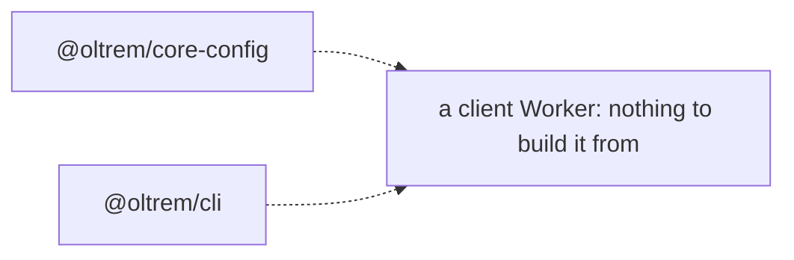
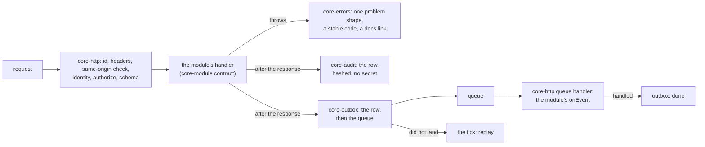

# Phase 1: the core runtime, from errors to the audit log

> **In plain words.** On 2026-10-20 the owner said "begin, and go through the phases one by
> one", so the heart of a client's Worker was built: the five small packages every feature
> will stand on. One defines every error the kit can raise, with a stable code and a page in
> the docs. One is the contract a feature module signs, checked when the code is built so a
> badly declared route never reaches a deploy. One is the request pipeline itself: it gives
> every request an id, sets the security headers, reads who the door let in, checks that they
> may do what they ask, checks the input, and answers every failure in one shape. One is the
> outbox: everything that should happen later is written down before it is sent, and sent
> again if it did not land. One is the audit log: who did what, written after the answer so
> it costs nothing, each row hashed so a changed row is found, and never a secret in it.
> Nothing is deployed; everything runs in the kit's own tests inside the Workers runtime.

## What changed, and why

| What | Why |
|---|---|
| **`@oltrem/core-errors`**: `defineErrors`, `KitError`, the RFC 9457 problem response, the core codes `KIT-E-0401` to `0503` and `1001` to `1006` | Plan 4.2: errors are data with a stable code and a docs link; a duplicate code or a missing sentence fails the build |
| **`@oltrem/core-module`**: `defineModule` with routes, capability, schema, event types and the scheduled hook; the Standard Schema interface; the event envelope | Plan 4.3: one manifest per feature, validated at definition; any schema library through one interface, so the pipeline depends on none |
| **`@oltrem/core-http`**: `createApp` (Hono) and `createWorker` (`fetch`, `scheduled`, `queue`) | Plan 4.2 and 11: one pipeline, no crypto in the request (Access verified the person), audit and outbox work after the response |
| **`@oltrem/core-outbox`**: `oltrem_outbox` (migration `0002`), enqueue, complete, release, replay, stats | Plan 9.1, 10 and 15.4: write the attempt row first, then send, replay what did not land; `held` for a provider with no key yet |
| **`@oltrem/core-audit`**: `oltrem_audit_log` (migration `0003`), record, after, list, verify | Plan 10, 11 and 13: one writer, one table, after the response, hashed rows, no secret ever written |
| **`createWorker` gained `onHandled`** | The place the outbox marks a handled event done, before the message is acknowledged |
| **`oltrem manifest check` takes several directories**; the `manifest` gate now checks the three packages with a test Worker binding | Each package that owns a table has its own test Worker and manifest; the gate checks them all in one call |
| **hono** in the catalog, with its registry row (4.x; 5.0 is a release candidate) | The one request pipeline; the only runtime dependency these five packages add |
| `allowImportingTsExtensions` in the shared TypeScript base | Packages import each other's source by its `.ts` path, as the Workers runtime does |

## Decisions taken while building

- **Every mutation needs same-origin proof.** Hono's CSRF middleware refuses a POST, PUT, PATCH
  or DELETE whose `Origin` or `Sec-Fetch-Site` does not match, and a request without either.
  The portal's own screens always send one; a script from elsewhere cannot. The error has its
  own code, `KIT-E-0440`, so the message says what to fix.
- **Identity is read, not verified, in the request.** The pipeline trusts the two headers
  Cloudflare Access adds after it verified the person at the edge; the IAM module (phase 2)
  adds the audience check on the token. Until IAM exists, a client's authorizer is
  "the one owner email holds every capability".
- **Error codes are blocks.** The core owns `0400` to `0599` and `1001` to `1099`; the audit log
  `1100` to `1199`; the outbox `1200` to `1299`; modules claim a block from `2000` in their
  README. The registry refuses a duplicate across the whole kit.
- **The outbox trusts idempotent consumers.** A replay that overlaps a live send, or a
  confirmation that did not land, costs one duplicate delivery; the consumer, idempotent by the
  envelope's key, ignores it. Claiming a row by its attempt count stops two replays sending it.
  A row is dead after five failures (one minute, five, thirty, two hours, twelve hours apart).
- **The audit log refuses credential-looking fields** by name (`password`, `token`, `apiKey`,
  `client_secret` and the like, at any depth, as a suffix too) rather than scanning values,
  which would guess. `tokenCount` and `keyName` pass; a value is never inspected. Details are
  capped at 4 KB and stored as canonical JSON so the hash is stable.
- **Per-row hashes now, the chain later.** Each row's hash covers every field but its sequence
  number, so `verify` finds a changed row today; the daily seal that chains rows and writes the
  head to the bucket is the audit module's (phase 5), designed so two Workers cannot race on it.
- **A package's migration depends on no other package's table.** `0002` and `0003` create their
  own table only; a client's `oltrem upgrade` copies them into one numbered folder.

## Impact on each service

None. Nothing is deployed, no account exists, and the first client's platform is not touched.
In a client repository, these packages are what `createWorker` is built from; the template
(next in phase 1) wires them.

## Before and after

Before this commit the kit had a configuration store and a command-line tool, and no Worker
could be built from it: there was no pipeline, no error shape, no outbox and no audit log.

Now one request runs through one pipeline, and the work after the response has its two homes:

## How it was verified

- `pnpm verify` passed locally with all twelve gates; the summary line is quoted in the commit
  message. The `manifest` gate passed on the three test Workers in one call.
- Inside the Workers runtime: the error registry (a duplicate code, a bad status, a missing
  sentence refused; the problem document's fields; a plain error hidden behind `KIT-E-0500`);
  the module contract (each refusal above, by code); the pipeline (the health route, the
  request id on every response including a handler's own, the security headers, a missing
  identity, a capability the caller lacks, a query and a body validated with the field names
  in the answer, a bare cross-site mutation refused, a module's own error code passed through,
  a leaked message hidden and reported); the three handlers (the tick runs every module and
  survives one failing, an envelope dispatched and acknowledged, an unknown type and a bad
  envelope retried toward the dead-letter queue, `onHandled` before the ack and its failure
  reported); the outbox and the audit log as their READMEs list.
- The identifier scan and the agents' copied-facts check pass on every new file; the
  dependency gate accepts the one new row; every new README is indexed and its links resolve.

## What is left in phase 1

`@oltrem/core-ui` (the tokens and the primitives of plan 12), the client template with
`oltrem setup` and `oltrem docs`, moving the agents and tokens checks into the tool, and the
first deploy in the sandbox client, which waits on the fresh Cloudflare account and the sandbox
repository, the owner's two steps. The index page carries the live state.
