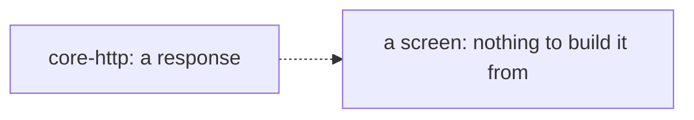
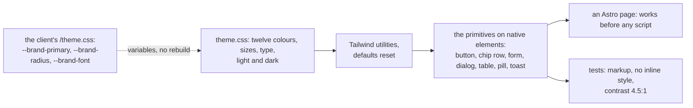

# Phase 1: the design kit, the tokens and the primitives

> **In plain words.** Every client portal will look and behave the same way, and this is the
> package that makes it so. It holds the short list of colours, sizes and type the screens may
> use, with the client's brand coming in through four variables, and the building blocks of
> every screen: buttons, the sideways rows of options, forms, dialogs that slide up from the
> bottom on a phone, tables that turn into cards on a phone, status pills, toasts, empty
> states. Each one is built on what the browser already provides, so pages work before any
> script runs, and each one is checked by a test: that it never writes a style the security
> policy would block, that every text colour reads clearly on its background in light and in
> dark, that a destructive button is last and never focused first. Nothing is deployed yet.

## What changed, and why

| What | Why |
|---|---|
| **`@oltrem/core-ui`**, a new package: `theme.css` and the primitives | Plan 12 and phase 1's list: the tokens and the primitives |
| **The theme**: twelve semantic colours with their `-fg` pairs, the brand variables, the named sizes (gutter 16, rows 44 and 56, touch 44), four radii, six type sizes, three weights, two shadows, two durations, light and dark | Plan 12.5's token list, as written; Tailwind's defaults are reset so only these exist |
| **Twenty-five primitives** on native elements: `<button>`, `<dialog>`, the popover API, the browser's `command` attributes, `<table>`, `<nav>` | Plan 12.3 (the owner's choice, card 25): own primitives on native elements; the three hard widgets on Zag.js come next |
| **Tests on Node**: markup read back for every primitive, no `style` attribute anywhere, the theme compiled, the contrast ratios computed | Plan 12.6 wants the screens checked; without an app yet, the markup and the colours are what can be checked, and they are |
| **preact 11, lucide-preact, tailwindcss, @tailwindcss/node, preact-render-to-string** in the catalog with their rows | The renderer, the icons, the styling (cards 9 and 24); two of them only for the tests |
| The linter covers `.tsx` | The primitives are JSX |

## Decisions taken while building

- **Preact 11.** Every library the kit uses (the Astro integration, lucide, the signals, Zag's
  adapter, the string renderer) declares support for the 11 line, so the kit starts on it
  rather than migrating later.
- **The default palette is reset, not extended.** With `--color-*: initial` a screen cannot
  reach for `bg-blue-500`; it has the twelve names or nothing. The same for the type scale,
  the radii and the shadows. An agent cannot drift from the kit's look by accident.
- **Dialogs open without a script.** Buttons carry the browser's `commandfor` and `command`
  attributes (`show-modal`, `close`), toasts hide through `popovertarget`, popovers open
  through the popover API. A page with a dialog ships no JavaScript for it. Where a browser
  lacks the command attributes, the island layer (later) adds the two lines of script; the
  markup does not change.
- **Contrast is computed, not eyeballed.** The test converts each OKLCH value to relative
  luminance and checks every text-on-colour pair against 4.5:1, in both schemes. A colour
  change that breaks a pair fails verify.
- **A switch is a checkbox.** With `role="switch"` on a native checkbox the control works in a
  form with no script and reads as a switch to assistive technology.
- **The table refuses a card with more than three data points** and a definition without one
  title column, at render time, so the phone rule holds by construction.
- **Words are the caller's.** No primitive carries a sentence of its own; the page passes the
  labels in its language, so Spanish and English are the page's concern, not the kit's.

## Impact on each service

None. Nothing is deployed and the first client's platform is not touched. The client template
(next) imports the theme and the primitives; the gallery page and the screen gates of plan
12.6 follow once there is an Astro app to run them against.

## Before and after

Before this commit the kit had a runtime and no way to draw a screen.

Now a screen is tokens plus primitives, with the brand applied at the edge:

## How it was verified

- `pnpm verify` passed locally with all twelve gates; the summary line is quoted in the commit
  message.
- On Node: every primitive rendered and read back (type and busy on buttons, the label on an
  icon button, the current chip, the destructive command last with the command attributes, the
  field's ids and `aria-invalid`, the alert summary, the native switch, the dialog's labelling
  and `closedby`, the confirm dialog's focus, order, form and typed word, the popover target,
  tabs and pagination, the table and its cards with the limits refused, the four pill states
  with an icon, the toast's live region and hide button, the skeleton hidden, the three empty
  kinds); no `style` attribute in any of them; the theme compiled with the semantic utilities
  present and the defaults absent; the contrast of twelve pairs in light and in dark; the two
  dark blocks equal.
- The identifier scan and the agents' copied-facts check pass on every new file; the dependency
  gate accepts the five new rows.

## What is left in phase 1

The three Zag.js widgets (combobox, menu, date range), the client template with
`oltrem setup` and `oltrem docs`, and the first deploy in the sandbox client, which waits on the
fresh Cloudflare account and the sandbox repository, the owner's two steps.
