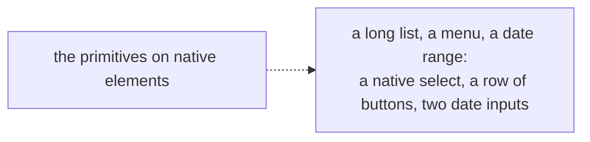
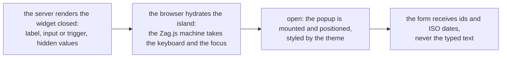

# Phase 1: the three widgets on Zag.js

> **In plain words.** Three controls on a screen are hard to get right by hand: a box that
> filters a long list as you type, a menu of commands that can open further menus, and a pair
> of dates picked on one calendar. The design kit now has all three, built on Zag.js, a library
> of state machines that handles the keyboard, the focus and what a screen reader hears, while
> the kit keeps its own look and its own words. Each renders closed on the server, so a page is
> complete before any script runs, and a form receives plain values: the chosen ids, the two
> dates in the international format. This completes the design kit's list for phase 1; nothing
> is on a screen yet, because no portal exists until the sandbox client does.

## What changed, and why

| What | Why |
|---|---|
| **`Combobox`, `Menu`, `DateRange`** in `@oltrem/core-ui`, on `@zag-js/combobox`, `@zag-js/menu` and `@zag-js/date-picker` through `@zag-js/preact` | Plan 12.3 (the owner's choice, card 25): own primitives on native elements, Zag.js for the three hard widgets |
| **`@internationalized/date`** with them | The date picker machine requires it for calendar arithmetic across locales and time zones |
| **Styles for the popup, its rows and the calendar** in the theme | One look for every list that opens; cells of 44 px; the range drawn in the brand colour |
| **The label class** shared by the form field and the widgets | So the three widgets' labels match the form's |
| A table test made independent of attribute order | Zag's adapter loads Preact's compatibility layer, which changes the order attributes are written in; the test now checks the attribute, not its position |

## Decisions taken while building

- **Closed on the server, mounted when open.** The machine positions a popup with a style object,
  which the browser applies through the CSSOM and the content security policy allows; the same
  style written into server HTML would be an inline style the policy blocks. So the server never
  renders an open popup, and the kit's rule of no inline style holds for the whole page.
- **The form sees values, not text.** A combobox submits one hidden input per selected id; a
  date range submits `<name>_start` and `<name>_end` as ISO dates, whatever the locale shows in
  the typed inputs. A handler never parses a localised string.
- **Words are the caller's**, as for every primitive: the combobox takes its three sentences, the
  date range its six words, the menu its label. The machine's English defaults are never shown.
- **Destructive commands last** in a menu, by the same ordering rule as the command row.
- **Submenus are nested inside the parent's popup**, not portalled to the body: a portal has no
  place to render on the server, and the machine positions a nested popup correctly from its
  trigger. The popup has no overflow clipping for that reason; only the combobox's list scrolls.
- **One narrowing cast** turns the machine's input props (typed with every input type) into the
  kit's accessible input type, in one file with the reason, rather than loosening the kit's types.

## Impact on each service

None. Nothing is deployed and the first client's platform is not touched. The sandbox client
will be the first screen these render on.

## Before and after

Before this commit a screen had the primitives and no way to pick from a long list, open a menu
of commands, or choose a date range.

Now the three widgets sit on the same theme, closed on the server and alive in the browser:

## How it was verified

- `pnpm verify` passed locally with all twelve gates; the summary line is quoted in the commit
  message.
- The design kit's tests on Node (30): the three widgets rendered closed carry no inline style
  and no open list, menu or grid; the combobox input has the combobox role, is labelled, shows
  the chosen label and submits one hidden input per value, two for a multiple one, with no clear
  button when required; the filter is by label and case-insensitive; the menu trigger owns a
  closed menu and the items are not in the HTML; destructive commands are ordered last; the date
  range shows the two dates in the Spanish format, submits them in ISO, names its calendar button
  with the caller's word, and submits empty values when empty; the earlier primitive and theme
  tests still pass.
- The identifier scan and the dependency gate accept the five new rows.

## What is left in phase 1

`oltrem docs`, then the first deploy in the sandbox client, which waits on the sandbox repository
and the fresh Cloudflare account, the owner's two steps. The widgets are first seen on a phone
there.
