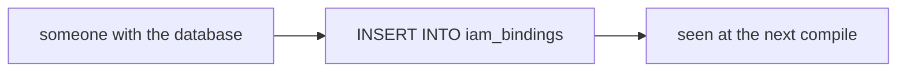
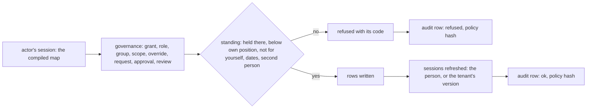

# Phase 2: governance

> **In plain words.** Until now the permission rows could only be written by hand. This step adds
> the writes themselves, with the rules the plan sets for them. Someone may give a role only if
> they hold the right to give roles there, and only roles below their own; nobody changes their
> own access; every grant but an Owner's runs out, after ninety days unless said otherwise and
> after a year at most; making or unmaking an Owner needs a second Owner's approval, given for
> that one change and good for an hour; the last Owner can never be removed. A person who needs
> more can ask, and whoever could have given it decides. A manager can open a review of every
> grant under their part of the company and mark each one keep or remove. Every one of these
> changes, and every refusal, is written to the audit log with the exact permission state the
> person was judged under, and the people affected see the change on their very next request.

## What changed, and why

| What | Why |
|---|---|
| **`createGovernance` in `@oltrem/iam`**: grant and end, activate an eligible grant, roles, groups and members, scopes, overrides, access requests, approvals, reviews; each checks the actor's standing, writes, refreshes the sessions it affects and records itself | Plan 7.3: permissions as data a client's Owners manage themselves, under rules the code enforces rather than a manual |
| **The standing map** (`rank` in the compiled access, `rankAt`, `bestRank`): the best role position held at each scope, compiled with the rest | "Bind only below your position" needs the actor's position at the scope at hand, from the map already in their session, with no extra query |
| **Migration `0005`**: `activated_from` on `iam_bindings`; `iam_access_requests`, `iam_approvals`, `iam_reviews`, `iam_review_items` | The plan's requests, second-person approvals and quarterly reviews need rows of their own; an activation is a grant that remembers where it came from |
| **Seven error codes**, `KIT-E-2007` to `2013`: not yours to grant, not for yourself, the last Owner, a bad grant, approval needed, a bad approval, a review unfinished | Every refusal names its reason and its remedy (plan 4.4) |
| **The audit log as a dependency of the module** | Every governance write, and every refusal, is one row with the policy hash the actor was decided under (plan 10) |

## Decisions taken while building

- **The standing is the best role position held at the scope or above it.** A manager at a
  location grants clerks there and in its teams; a director at the root grants managers anywhere.
  The Vendor stands at `-1`, above the Owner's `0`, so it can act for a client without being one.
- **An Owner is the one exception to "strictly below".** An Owner makes and unmakes Owners, their
  equals; the control there is the second person, not the position. The Owner role is never
  denied or eligible, never deleted, and edited by the Vendor alone.
- **A capability enters a role only if the actor holds it wherever the role is in force.** Roles
  are tenant-wide and bound at several scopes; adding a capability to one widens every grant of
  it, so the actor must hold the capability at each of those scopes. A role not granted yet needs
  the capability held anywhere.
- **An activation is a grant of its own.** It names its holder as the grantor, runs one to twelve
  hours, keeps its reason, and points back to the eligible grant it came from, so the history
  reads as the plan's eligible-then-activated pair.
- **Approvals are tied to one exact change.** The request hashes the change (keys sorted at every
  level, so the same facts always hash the same); the use hashes it again and must match the
  capability, the scope, the action and the hash. The same table serves modules' own
  `secondPerson` capabilities.
- **A request is decided by whoever could have made the grant**, under the same rules with the
  requester as the subject, and the grant is made in the decider's name with the request's reason.
- **A review changes nothing until it closes**, and it cannot close while a grant is undecided;
  closing ends the grants marked remove. An Owner is never removed in a review.
- **Things with history stay.** A role, group or scope that ever had a grant is never deleted:
  the audit trail and the review items point at those rows. Grants are ended, never deleted.
- **One hour for an approval, a week for a request, two weeks for a review.** The plan's
  "within the hour" for the second person; the other two are defaults a later step can make
  settings of.
- **Deferred.** The routes and screens that call these functions come with the phone screens;
  the emails the plan sends on a change of access come with phase 4's notifications; opening the
  quarterly review on a schedule comes with the module manifest's scheduled hook.

## Impact on each service

None. Nothing is deployed and the first client's platform is not touched. The governance runs in
the module's tests only; the client template still has its own-account authorizer.

## Before and after

Before this commit the permission rows were written by whoever had the database, with no rule
between the writer and the row:

Now every change goes through one function that judges the actor from their own session,
writes, refreshes and records:

## How it was verified

- `pnpm verify` green locally, its twelve gates; the module's thirty-eight tests pass inside the
  Workers runtime against migrations 0003 to 0005.
- The eighteen governance tests put a tenant of four scopes, four roles and twelve people through
  every rule, refused and then obeyed: a manager grants a clerk in her location for ninety days
  and the clerk's next request sees it; the same grant outside her scopes, at her own level, to
  herself, to her own group, to an inactive account or an unknown role is refused and the refusal
  is in the log with its code; the dates (a year at most, never open-ended but for the Owner, a
  start after the end); a director grants a manager but not a director; an Owner is made only
  with a second Owner's approval that fits the change and is spent once, and unmade the same way;
  an eligible grant is activated for two hours with a reason and has lapsed three hours on; roles
  are created and edited only with capabilities held wherever the role is granted, below the
  maker's position, and a role with history is not deleted; a group holds a role and its members
  are placed only by someone with the standing over the group's grants; Owners shape the tree to
  four levels and the root stays; a deny override beats the role and an allow override gives one
  capability early; an access request is decided by whoever could grant it and the grant carries
  the decider's name, while a withdrawn, refused or week-old request is not decided; a module's
  second-person approval is given by another holder within the hour for that exact action; a
  review of a team lists its one grant, cannot close undecided, and closing ends the removed; an
  Owner is never removed in a review; the audit row lands after the response when `waitUntil` is
  given; and the Vendor unmakes an Owner with an Owner's approval but not the last one.
- Not verified: no route calls the governance yet, so nothing is measured on a request; the
  notices to the people affected and the scheduled quarterly review are later steps.
