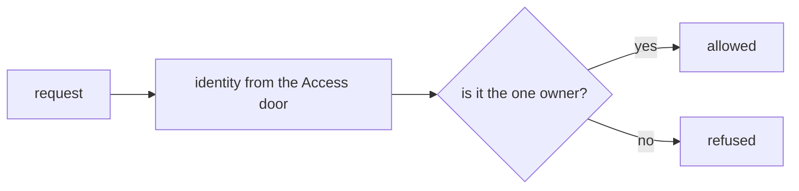
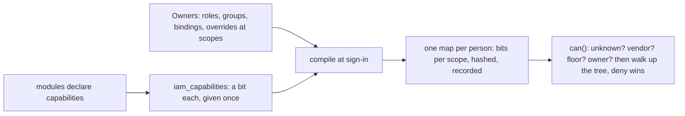

# Phase 2: the permission model and the access check

> **In plain words.** Phase 2 is about who may do what. The kit now has the data model for it:
> each feature declares what it lets people do, a client's Owners bundle those into roles and
> give the roles to people or groups at one place in the company tree (the whole company, one
> site, one department), with "no" always beating "yes". When someone signs in, the kit boils all
> of that down to one small map, and every later check is a handful of lookups with no trip to
> the database. A synthetic company of forty people was built in the tests and three hundred
> and twenty random questions were put to both the fast check and a slow, obvious one that reads
> the rows each time; they agree on every one. Signing in, the screens, and the rules about who
> may grant what come next.

## What changed, and why

| What | Why |
|---|---|
| **`@oltrem/iam`**, the first module under `modules/`, with migration `0004` and twelve `iam_*` tables | Plan 7.1: everything a client creates is a row; the only built-in principal is the Vendor |
| **The capability registry**: `defineCapabilities` checked at load, `registerCapabilities` at deploy, bits given once per module plane and never reused | Research 12 §7.3: ids are the truth and bits an encoding; a retired capability keeps its bit so nothing is ever renumbered |
| **The compiler**: one batch of queries into a map of bits per scope and module, hashed and recorded | Plan 7.2: the map rides in the session; every compile leaves a row so a decision can be replayed |
| **The check**: unknown capability or scope refused first, then the Vendor, the vendor floor, the Owner, then the walk up the tree with deny winning | Plan 7.2 and R-10: fail closed, deny beats allow, a few lookups and one bit test |
| **A plain reference evaluator in the tests**, and a synthetic tenant | Plan 18, phase 2: every decision of a 300-case table reproduced over the compiled map |

## Decisions taken while building

- **An unknown scope is refused for everyone**, the Vendor and an Owner included. The plan lists
  the Owner's allow first; a request for a place that does not exist is a bad request, and the
  compiled check and the plain evaluator disagreed on exactly that case until the rule was made
  explicit. Refusing is the safer reading.
- **Floors are applied when compiling, not when checking.** A capability on the owner floor
  enters a person's bits only from the Owner role; an override can never grant one. The check
  then needs no extra plane for floors.
- **The Owner is the Owner role at the root.** The same role bound lower in the tree is an
  ordinary binding: it grants the role's capabilities there, floors included, but not the
  Owner's shortcut over the whole tree.
- **Flat groups** (the owner's choice, card 11): one join, no recursion; the compiler walks
  nothing deeper.
- **The Vendor is compiled against the one tenant of the database**; with several tenants in one
  database (not version 1) it would need a map per tenant.
- **The timing budget is not measured here.** The test runtime freezes its clock during a check,
  so the plan's `can()` budget is measured on the sandbox with Workers Observability, as plan 11
  says for every budget.

## Impact on each service

None. Nothing is deployed and the first client's platform is not touched. The module runs in no
Worker yet; the client template does not wire it until sessions and the authorizer exist.

## Before and after

Before this commit a client Worker had one rule: the one owner named in the client file may do
everything, everyone else nothing (own-account mode).

Now the data for real permissions exists, with the compiler and the check that will replace that
rule once sessions carry the map.

## How it was verified

- `pnpm verify` green locally, its twelve gates, the manifest gate now on the module's test
  Worker too; the module's eleven tests pass inside the Workers runtime against the real
  migration.
- The 320-case table: generated from a fixed seed over forty people, twelve roles, six groups,
  one hundred and twelve bindings (some expired, future, eligible or denying) and twenty
  overrides; the compiled check and the plain evaluator agree on every case, with both answers
  well represented.
- Not verified: no Worker runs the module yet, so nothing has been measured on a request; the
  timing budget waits for the sandbox.
