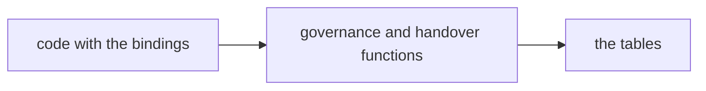
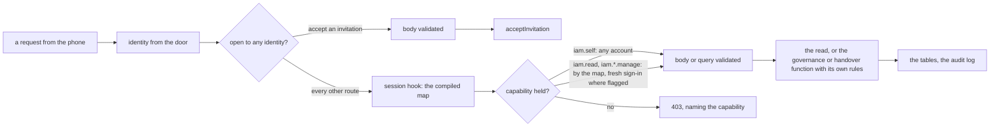

# Phase 2: the routes

> **In plain words.** Until now the permission model could be driven only from code: a test, or a
> script with the database. This step gives it its doors. Every list a screen will show (people,
> groups, roles, the company tree, the grants, the requests, the reviews) and every change (grant,
> invite, approve, review, let the Vendor in) is now a web address under `/api/iam`, each guarded
> by the permission it needs, with the rules of the earlier steps behind it. One door is open to
> anyone the sign-in has let through: the one where an invited person, who has no account yet,
> takes their invitation. The screens that call these doors from a phone are the next step; the
> owner has been asked whether to build them now or after the sandbox measures what a screen costs.

## What changed, and why

| What | Why |
|---|---|
| **`createIam` in `@oltrem/iam`**: one call that builds the sessions, the governance and the handover on one set of bindings and returns the module manifest with them | A client Worker wires the permission model in three lines; the pieces share one clock and one id generator |
| **Fifty-four JSON routes under `/api/iam`**, each naming the capability the pipeline checks, with the governance or handover function behind it enforcing the rest | Plan 7.5: the screens need every list and every change as a route; the capability on the route is the first gate, the function's own rules the second |
| **The read queries** (`createReads`): the company, the registry, people, groups, roles, scopes, grants, overrides, invitations, requests, approvals and reviews, scoped to the tenant and paged, rows in camel case and never a hash | What the screens list; a token hash or a payload hash is nobody's to read |
| **`iam.self`**, the capability every account holds by having a session, answered by the authorizer and carried by no role | The routes about one's own things (my session, my devices, my grants, my requests, my approvals) need a gate the pipeline can check without a grant, and a reader of the manifest must see what each route asks for |
| **A route open to any identity** (`access: 'identity'` in `@oltrem/core-module`, honoured by `@oltrem/core-http`): the pipeline loads no session and checks no capability; POST only, so the body is validated and the same-origin check applies; such a route names no capability | The invited person has no account, so the session hook would refuse them (`KIT-E-2005`); the exception is written in the manifest, where a reviewer reads it, and the contract refuses it anywhere but a POST |
| **`sessions.devices`** and an audited `iam.device-end` | A person sees their own sign-ins on the phone and ends one |
| **The optional fields of the governance and handover inputs now accept `undefined`**, and `RolePatch` replaces `Partial<RoleInput>` | What a validated body carries under exact optional property types; no runtime change |
| **`zod` joins `@oltrem/iam`** (the Mini build, already in the catalog for the settings) | The route schemas; one validation library across the kit, registered once (R-09) |

## Decisions taken while building

- **The capability on a route is the widest question; the function narrows.** `iam.read` lists
  everything of the company; `iam.bindings.manage` covers grants, overrides, invitations,
  requests and reviews, since the governance decides each by the actor's standing at the scope
  at hand; roles, groups and the tree each have their own. The authorizer still adds the fresh
  sign-in where the capability is flagged.
- **`iam.self` is not a row of the registry.** Were it declared, deploy would add it to the Owner
  role and the screens would offer to grant it; it means nothing to grant. The authorizer alone
  answers it, with yes for any current session, and only the IAM module may name it (a route's
  capability must carry its own module's prefix).
- **The incident and the window's closing name `iam.self`, not `iam.tenant.manage`.** Under
  `incident_only` and `approval` the check refuses the Vendor every capability, the very reason it
  needs a way to declare the incident; the handover functions decide who may open and close by the
  mode, and the incident route's handler lets only the Vendor through. The Owner's window keeps
  `iam.tenant.manage` with its fresh sign-in.
- **One route open to any identity, and the contract makes it loud.** It is POST only, names no
  capability (nothing would check one) and reads `access: 'identity'` in the manifest. The
  pipeline fails closed on a session route without a capability even though the contract already
  refuses one.
- **Reads are not audited.** Every write goes through the governance or the handover, which are;
  the one write outside them, ending a sign-in, is recorded as `iam.device-end`.
- **Deferred:** the phone screens (the owner's call: Astro now, or after the sandbox measures a
  screen's cost); the `users` module (deactivating a person, service accounts, Access group
  sync); wiring the module into the client template, which comes with the module system of
  phase 3 (migrations and bindings collected from the manifests); the quarterly review on a
  schedule; the email with the invitation link (phase 4).
- **Found, not fixed:** a review of the root scope includes the Owners' own grants, which no
  Owner may decide (`KIT-E-2008`), so with one Owner such a review cannot close. A review at a
  scope below the root works as designed. Whether an Owner's grant should sit in a review at all,
  or be decided by another Owner only, is a governance question for the owner.

## Impact on each service

None. Nothing is deployed and the first client's platform is not touched. The routes run in the
module's tests only; the client template keeps its own-account authorizer until the module system
of phase 3 wires modules in.

## Before and after

Before this commit the permission model answered only code: a test or a script with the database
in hand called the governance functions directly, and no person could reach them.

Now every list and every change is a route under `/api/iam`, each through the pipeline's gates:

## How it was verified

- `pnpm verify` green locally, its twelve gates; the IAM module's fifty-five tests pass inside the
  Workers runtime against migrations 0003 to 0006, and the pipeline's twenty-one and the
  contract's six pass with them.
- The contract's test refuses a route open to any identity that is not POST or that names a
  capability, and an unknown `access` value; the pipeline's test runs such a route for a stranger
  the session hook would refuse, with the body validated and the hook never called, while the
  module's other route still goes through the hook.
- The eight route tests run end to end through `createApp` from an empty portal: the manifest
  holds fifty-four routes with one open and every other naming an `iam.` capability; a stranger is
  refused `/me` with `KIT-E-2005` and cannot create a company; the Vendor creates it over its
  route; the first Owner is refused with a wrong token (`KIT-E-2015`), another address
  (`KIT-E-2016`) and an empty body (`KIT-E-0422`), then accepts, and `/me` shows the Owner; the
  company, the registry, each list and one person answer with their shapes, without the token
  hash or the Access subject, and a page of zero is refused; the Owner adds and renames a scope,
  refuses a bad kind, makes, changes and deletes roles, makes and renames a group; an invited
  clerk accepts, reads the people, is refused `iam.roles.manage` by name, joins and leaves the
  group; a withdrawn invitation lists as revoked; an eligible grant is made, activated by the
  clerk and ended, an override made, listed and ended, a request made, decided into a grant,
  another withdrawn, an approval asked, listed without its hash and refused to the clerk
  (`KIT-E-2007`); a review of the root decides every grant but the Owner's own and cannot close
  (`KIT-E-2013`), a review of a location closes; under `incident_only` the Vendor is refused the
  lists, a clerk cannot declare the incident, the Vendor declares it and is let in until it closes
  the window; under `approval` the Owner opens a window and closes it, and cannot declare an
  incident; the Vendor cannot set its own access; a sign-in is listed, an unknown one is not found,
  the current one is ended and refused from then on (`KIT-E-2006`), and a new sign-in is let in.
- Not verified: no Worker serves the routes, so the problem shapes and the capability refusals
  are seen in tests only, the time a route costs on a request is unmeasured until the sandbox,
  and no screen calls them yet.
