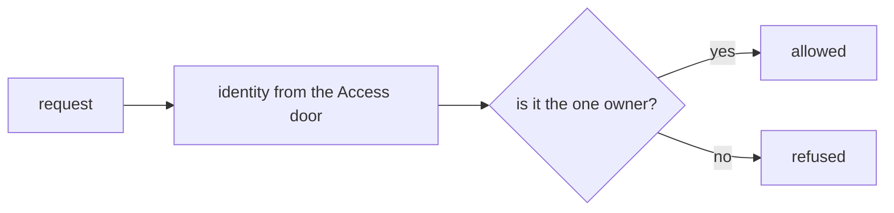
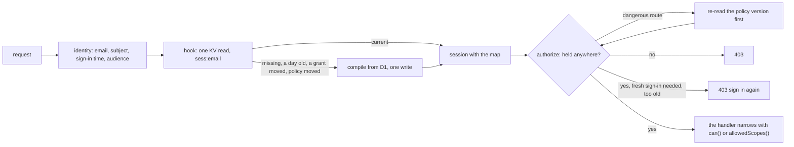

# Phase 2: sessions and the authorizer

> **In plain words.** The permission map built in the previous step now travels with the person
> from one request to the next. Cloudflare's door signs the person in; on each request the kit
> reads one small record for that person, with their map inside, and decides in memory whether
> the action is allowed. The record is written only when something changes: the first request,
> a new sign-in, a grant that started or ended, a day gone by, a change an Owner made. That keeps
> the kit inside the free plan's thousand writes a day. Taking someone's access away shows on
> their very next request; for a dangerous action the kit double-checks against the database
> first; and a dangerous action also needs a sign-in from the last ten minutes. The request
> pipeline gained the hook that loads the session, and every handler can read it.

## What changed, and why

| What | Why |
|---|---|
| **The pipeline's session hook** (`@oltrem/core-http`): `createApp({ session })`, run after the identity and before the capability check; its value reaches the authorizer and the handler as `session` | Plan 4.2 and 7.2: the compiled map rides inside the session, so the pipeline needs one place that loads it |
| **The identity carries the token's claims**: `subject`, `signedInAt` and `audience`, decoded from the header Access adds; a token that does not parse is no identity | Plan 6.1 and 11: Access verified the person at the edge, the Worker does no crypto; the fresh sign-in gate and the audience check need the claims |
| **`createSessions` in `@oltrem/iam`**: one KV record per person under `sess:<email>`, written on change only; the hook, the authorizer, `invalidate`, `invalidateTenant`, `revokeDevice` | Plan 6.2 and 9: KV's 1,000 writes a day are the scarcest quota, so no write per request; a revoke visible on the next request |
| **`holdsAnywhere`**: the route-level check, the capability at the root or at any scope with a grant | Plan 7.2: a route is the widest question; the handler narrows with `can()` or `allowedScopes()` |
| **Three error codes**, `KIT-E-2004` to `2006`: fresh sign-in needed, no account here, sign-in ended | Every refusal names its reason and its remedy (plan 4.4) |

## Decisions taken while building

- **A device is one sign-in at the door, not a cookie of the kit's.** Access keeps its own cookie
  and sends the same token for the whole of a sign-in; the token's issue time therefore names the
  sign-in, and differs between browsers. The plan's `__Host-` cookie was the session cookie of a
  design where the kit mints sessions; with Access for Workers in front it would only repeat the
  door's. A cookie-less caller (a script with the person's token) therefore costs one write per
  sign-in, not one per request. Own-account mode's magic link (plan 6.6), when it comes, is the
  one path that will need a cookie of its own.
- **Ending a sign-in refuses that sign-in until the person signs in again.** The door still holds
  the person signed in; the kit cannot end the door's session, so it refuses the token until a
  newer one arrives.
- **A hard expiry of a day from the compile, no sliding window.** The plan allows a sliding TTL
  refreshed every few minutes; each refresh is a write, and a day's hard expiry with a recompile
  needs none. The compile is cheap (one batch of queries) and leaves its row in the audit trail.
- **The policy version is re-read every five minutes per isolate, and at once on a dangerous
  route.** Plan 7.2 step 6 names the dangerous routes; the periodic re-read bounds how long a
  shared change (a role edited, a group changed) can go unseen on an ordinary route, at the cost
  of one single-row read a few times an hour per person. A change to one person's own grants goes
  through `invalidate` and is seen on the next request.
- **The capability index is loaded once per isolate**, from the rows `registerCapabilities`
  wrote at deploy; a deploy brings new isolates, so nothing goes stale.
- **No session, no access.** An authorizer given no session (the hook not wired) refuses, by R-10.
- **The audience check decodes, it does not verify.** The Worker reads the token's `aud`; the
  signature is the door's business at the edge. A token for another application is refused with
  the core's `KIT-E-0401`.

## Impact on each service

None. Nothing is deployed and the first client's platform is not touched. The client template
keeps its own-account authorizer until the governance step can create a tenant and its first
Owner; the sessions run in the module's tests only.

## Before and after

Before this commit a client Worker read the identity and asked one rule, with nothing kept
between requests:

Now the pipeline loads the person's session and the IAM module decides from the map inside it:

## How it was verified

- `pnpm verify` green locally, its twelve gates; the pipeline's twenty tests and the module's
  twenty pass inside the Workers runtime against the real migration.
- The session tests count the KV writes: one on the first request and none on the next; one more
  per new sign-in, the list capped at ten; a grant ending at half past twelve recompiles on the
  first request after it and not before; a day later the record is rebuilt; a dangerous route
  re-reads the policy version and recompiles while a plain route waits for the recheck window;
  `invalidate` is seen on the next request and removes the record of an account switched off;
  `invalidateTenant` is seen at once in the isolate that called it and within the window in
  another; an ended sign-in is refused and a later one is a new device; and the whole pipeline,
  from the Access headers to the problem codes, answers each case with its code.
- Not verified: no Worker runs the sessions yet, so the KV read's latency on a request, the
  write count over a real day and the fresh sign-in flow through the door's own sign-out are
  unmeasured until the sandbox client exists.
