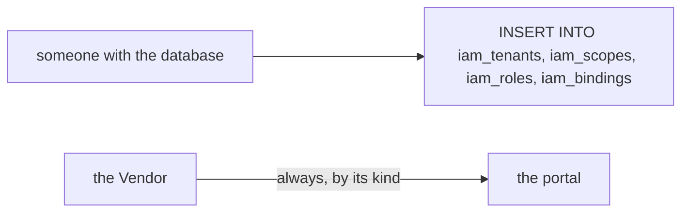
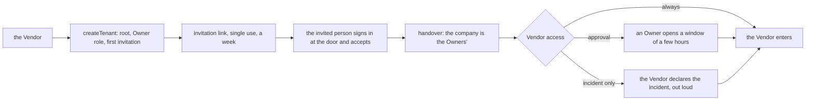

# Phase 2: the Vendor and the handover

> **In plain words.** A new portal starts with nobody in it but the Vendor, the company that
> runs the kit. This step lets the Vendor create the client's company inside the portal, with
> its Owner role holding every power but the Vendor's own, and send the first Owner a single-use
> invitation that lasts a week. The moment that person signs in and accepts, the company is
> theirs: from then on an Owner is made or unmade only with a second Owner's approval, the Vendor
> holds no role of the company's, and the company decides how the Vendor may enter at all: at
> any time, only in a window an Owner opens for a few hours, or only in an emergency the Vendor
> declares out loud. Every one of these actions is written to the audit log.

## What changed, and why

| What | Why |
|---|---|
| **`createHandover` in `@oltrem/iam`**: `createTenant` (the Vendor's), `acceptInvitation` (on the identity alone), `setVendorAccess`, `openVendorWindow`, `closeVendorWindow` | Plan 7.4: only the Vendor creates a tenant; the handover is the first Owner's acceptance; the tenant controls Vendor access |
| **Invitations in the governance**: `invite` and `revokeInvitation`, under the grant rules, with the second person for the Owner role after the handover | One role at one scope for one address, single use, a week: the way a person who has no account yet gets one |
| **Migration `0006`**: `handed_over_at`, `vendor_window_until` and `vendor_window_reason` on `iam_tenants`; the table `iam_invitations` | The handover is a moment the rules read; the window is state the compiler reads; the invitation keeps the hash of its token |
| **The compiler reads the window**: the Vendor's map says `always` while it is open and is rebuilt when it ends | So the check stays the same few lookups: the mode is decided at compile time, as everything else |
| **The Vendor is never a subject**: no grant, group or override names it | Its access is its kind; a role on top would survive a change of mode and defeat the company's control |
| **The Owner role keeps a minimum, and new capabilities join it at deploy** (`OWNER_MINIMUM`, `registerCapabilities`) | Plan 7.4's protected minimum; a new module's screens should open to the Owners without a hand step |
| **Three error codes**, `KIT-E-2014` to `2016`: a second company, an invitation that cannot be used, an invitation taken with another address | Every refusal names its reason and its remedy (plan 4.4) |
| **One audit wrapper** (`recorded`) shared by the governance and the handover | The acceptance has no session to take the policy hash from; one wrapper handles both shapes |

## Decisions taken while building

- **One company per portal.** The plan builds one Worker per client, and the Vendor's own map is
  compiled against "the one tenant of this database". A second `createTenant` is refused rather
  than silently making the compiler's choice ambiguous.
- **The Vendor holds no role, before or after the handover.** The plan forbids it after the
  handover; before it the Vendor already has every capability by its kind, so a role would add
  nothing and could outlive the company's later decision to narrow its access. Stricter than the
  plan, and nothing is lost.
- **Before the handover, the Vendor alone makes Owners, and the record says so.** Nobody else
  could approve; the audit row carries `secondPerson: 'none available'` on the company's creation,
  and an Owner invited before the handover may still accept after it (the decision was taken when
  it was allowed; the first Owner can withdraw it).
- **The invitation's token is kept hashed and shown once.** The row holds enough to make the grant
  (role, scope, when it ends, who invited) and never the token itself.
- **Acceptance runs on the identity, not a session.** The person has no account, so the session
  hook would refuse them; the function takes the door's identity, checks the audience itself, and
  the route that calls it (the screens step) will be the one route the pipeline lets through
  without a session.
- **The window is one mechanism for two modes.** Under `approval` an Owner opens it; under
  `incident_only` the Vendor opens it itself with a reason, and the audit row says `incident`.
  One to twelve hours, four by default, the same bounds as an eligible grant's activation.
- **The Vendor cannot set its own access.** `setVendorAccess` and the `approval` window are an
  Owner's (`iam.tenant.manage`, on the owner floor); the Vendor passes every other check by its
  kind, so the refusal is explicit.
- **Deferred.** The emails to the Owners on each Vendor action and the invitation email come
  with phase 4's notifications; the seal with phase 5's audit module; the route and screen that
  accept an invitation with the phone screens.

## Impact on each service

None. Nothing is deployed and the first client's platform is not touched. The handover runs in
the module's tests only; the client template still has its own-account authorizer until the
screens step wires the module in.

## Before and after

Before this commit a company and its Owner could only be rows written by hand, and the Vendor's
access was a fixed fact of its kind:

Now the company is created once by the Vendor, taken over by its first Owner, and decides how
the Vendor enters:

## How it was verified

- `pnpm verify` green locally, its twelve gates; the module's forty-seven tests pass inside the
  Workers runtime against migrations 0003 to 0006.
- The nine handover tests start from an empty portal: the Vendor's map has no company and the
  Vendor refuses bad ids, names, addresses and modes; it creates the company with its root, its
  Owner role holding every capability but the Vendor's, and an invitation whose row holds a hash
  and not the token; a second company is refused; the Vendor alone invites a second Owner before
  the handover; the first Owner's acceptance is refused for another address, another audience and
  a wrong token, then creates the account and the grant, stamps the handover and is refused a
  second time; an Owner cannot create a company; the second Owner's earlier invitation is still
  taken, while a third Owner now needs a second person's approval and a withdrawn invitation is
  refused; an ordinary invitation follows the grant rules, makes a dated grant in the inviter's
  name, can be repeated for a known person and is gone after a week; the Vendor is refused every
  role, group and override; the Owner role keeps its minimum and a new module's capability joins
  it at deploy while a removed one stays out; under `approval` the Vendor is refused until an
  Owner opens a window, which the Vendor cannot open or set for itself, and which closes early or
  runs out by itself; under `incident_only` only the Vendor opens it, with a reason, as a loud
  audit row; under `always` no window is needed.
- Not verified: no route accepts an invitation and no email carries one yet, so the whole path
  from the Vendor's setup to the first Owner's phone is untested until the screens step and the
  sandbox client exist.
