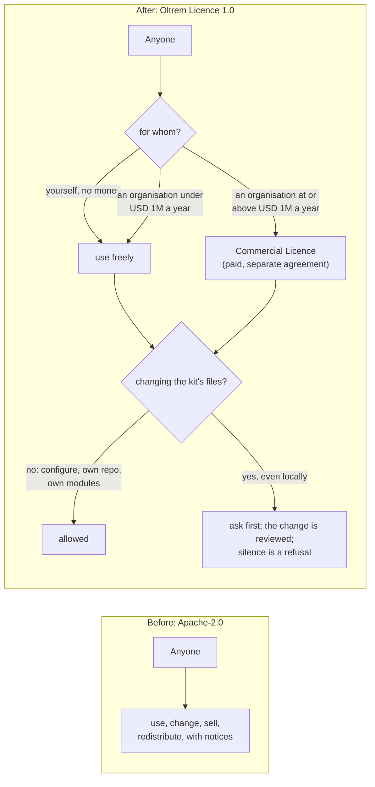

# The licence change: from Apache-2.0 to the Oltrem Licence

> **In plain words.** The kit started under the Apache License 2.0, the owner's answer to card 19
> of the plan on 2026-10-18. On 2026-10-20 he changed his mind: anyone may use the kit for
> personal use; a business may use it for free until it makes more than one million a year, then
> it pays; and nobody may change the code, even privately, without asking and having the change
> reviewed. No published licence says all three, so the kit now carries its own, the Oltrem
> Licence 1.0, written in plain words. Nothing had been shared under Apache-2.0, so nobody holds
> the kit under the old terms.

## What changed, and why

| What | Why |
|---|---|
| `LICENSE` is the Oltrem Licence, version 1.0 | The owner's instruction of 2026-10-20 04:07: personal use free, a revenue ceiling for commercial use, and no changes without permission and review, even local |
| `package.json` and every package's `license` field say `SEE LICENSE IN LICENSE` | The registry format for a licence that has no standard identifier; the test in `scripts/licence.test.mjs` keeps every package file and `LICENSE` in agreement |
| The README names the licence and links the plain-words page | A reader should know before cloning that the kit is source-available, not open source |
| [docs/licence.md](../licence.md), the licence in plain words | The legal text is short, but a reader on a phone should not have to parse it to know what is allowed |
| The plan's card 19 is overridden in its decisions log | The plan is the record of the owner's decisions; the override is written there with the date and his words |

## The terms, and who chose them

The owner asked on 2026-10-20 16:31 for the recommended option on every open point. These are
the choices made for him, each reversible by editing `LICENSE` and bumping its version:

| Point | Choice |
|---|---|
| The ceiling | One million United States dollars of gross revenue in the previous twelve months, counting parent, subsidiary and sister companies; a non-profit's, school's or public body's income counts as revenue. The same figure the PolyForm Small Business licence uses |
| Who the licensor is | The copyright holder named in the notice at the top of `LICENSE`: today the owner, by the name of his repository account. A legal or company name replaces it when he gives one |
| Which law applies | No governing-law clause, like the PolyForm and Elastic licences; the courts apply their ordinary rules. A country can be added later if a lawyer advises it |
| A client's own code on top of the kit | Use, not change: configuring, creating a client repository from the template, and writing modules against the documented interfaces are allowed without permission. Without this the kit could not be used at all |
| Where to ask | The contact address published on oltrem.com or in the README, so it can change without the licence changing |
| An agency running the kit for others | That is the agency's own commercial use; its revenue is what counts |
| Permitted changes | Belong to the kit too: the person keeps their copyright and grants the licensor the right to fold the change into the kit |
| The cure period | Thirty days for a first breach, except a change or a sale, which end the licence outright |

## Impact on each service

None. Nothing is deployed, and nobody holds a copy under the old licence. The owner's own clients
are governed by their service agreement, not by this licence, so nothing changes for them.

## Before and after

## How it was verified

- `pnpm verify` passed with its ten gates; `scripts/licence.test.mjs` asserts that `LICENSE`
  opens with the licence's name and version and that every package file's `license` field
  points at it.
- The identifiers gate and the docs gate pass on the new files; the plain-words page and this
  record are indexed, and every relative link resolves.
- The owner's two messages are quoted in the plan's decisions log, with the time of each.

## What still needs doing

- **A legal review** of `LICENSE` before the kit is shared with anyone outside the owner's own
  clients. The text was drafted by an AI agent in plain words so that review is cheap, and the
  decisions above are the ones a lawyer is most likely to question.
- **The contact address** on oltrem.com or in the README, so that permission and Commercial
  Licence requests have somewhere to go.
- **The Commercial Licence itself**, the paid agreement and its pricing, a separate document.
