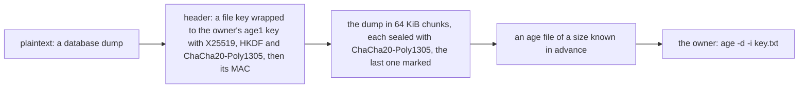

# Phase 5: the age format for backup copies

> **In plain words.** Every backup copy will be locked before it is stored, in the same standard
> format the owner already uses: age. The Worker holds only the public half of the key, so a
> copy can be locked but never unlocked in Cloudflare; the owner opens one with the free age
> tool and the private key kept offline. This commit writes that lock. Nothing is backed up yet:
> the nightly copy comes next.

## What changed, and why

| What | Why |
|---|---|
| **`@oltrem/core-crypto/age`**: the age file format, encryption to one X25519 recipient, as a stream in 64 KiB chunks, with the file's size known before any byte is written | Plan 9.3: a backup is encrypted before it reaches the bucket, so a bucket leak is not a data leak |
| **Error `KIT-E-1307`**: a recipient that is not an `age1…` key | A wrong key is refused before anything is written |
| **The `nodejs_compat` flag** on the package's test Worker | The cipher age uses is only in `node:crypto` (below) |

## Decisions taken while building

- **The standard format, written by the kit.** The plan's first choice was the `age-encryption`
  package, and its fallback a format written with Web Crypto alone. The fallback cannot be age:
  Web Crypto has no ChaCha20-Poly1305, the cipher age uses. The runtime does have it, natively,
  in `node:crypto` behind the `nodejs_compat` flag; a probe inside the Workers runtime sealed and
  opened a 64 KiB chunk with it before this was written. So the kit writes the age format itself:
  Web Crypto for X25519, HKDF and HMAC, the native cipher for the rest.
- **No package.** The age library for JavaScript brings five packages and runs its cipher in
  plain JavaScript, which spends far more of a Worker's CPU time than the native cipher on a
  large copy. Writing the format is about two hundred lines, checked against the real tool.
- **A separate entry.** Only `@oltrem/core-crypto/age` imports `node:crypto`, so a Worker that
  uses the envelope alone needs no flag; one that mounts the backup module turns it on.
- **Encryption only.** The private key stays with the owner, offline; nothing in the kit
  decrypts, and the restore drill uses the age tool.
- **The size is known first.** A stream stored in the bucket needs its length in advance; the
  header has a fixed length for one recipient, and each chunk adds a 16-byte tag.

## Impact on each service

None. Nothing is deployed and the first client's platform is not touched.

## Before and after

Before this commit, nothing in the kit could lock a backup copy. Now:

## How it was verified

- `pnpm verify` green locally, its twelve gates; the package's nine tests pass inside the Workers
  runtime.
- The real age tool (version 1.1.1), with a throwaway key made by `age-keygen`, decrypted files
  this code wrote for plaintexts of 0, 1, 65,535, 65,536, 65,537, 131,072 and 200,000 bytes,
  each equal to its plaintext, and refused a file with one byte changed. The known-answer file
  in the tests was decrypted the same way; the tests pin its digest, inside the Workers runtime,
  so the runtime writes the very bytes the tool opened.
- Not verified: no copy was taken of a real database and no Worker was deployed with the flag.
