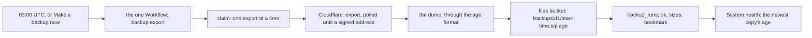

# Phase 5: the backup module and the one Workflow

> **In plain words.** Every night the portal will ask Cloudflare for a full copy of its
> database, lock it with the owner's age key on the way through, and keep it in the files
> bucket. Each copy is a row on the backup list, and System health says how old the newest one
> is: green up to a day, amber up to two, red after that. Anyone allowed can make a copy now, or
> note the database's restore point before a risky change. This commit writes the module and
> the one Workflow that runs long jobs step by step. No real database is copied yet: that needs
> the sandbox, with its token and key.

## What changed, and why

| What | Why |
|---|---|
| **Flows on the module manifest** (`@oltrem/core-module`): an id, a summary, a `run` given a `step`, and a schedule of five cron fields | Plan 4.3: work longer than the tick's ten milliseconds runs in the one Workflow, step by step |
| **The flows runner** (`@oltrem/core-jobs`): `createFlows` for the client's one Workflow class, `startFlow` to start one by hand | Plan 9.1: one Workflow, `JOBS`, and a new kind of work is a new flow, never a new resource |
| **`@oltrem/backup`**: the export flow, the `backup_runs` table (migration `0012`), three routes, the freshness check, two settings, two key recipes, error codes `KIT-E-1601` to `1604` on bit plane 4 | Plan 4.4 and 9.3: the nightly export, encrypted, recorded, with a run by hand and the Time Travel bookmark |
| **`@oltrem/core-crypto/age`** loads `node:crypto` when it first encrypts | A module that imports it then needs no Node type declarations of its own |

## Decisions taken while building

- **One Workflow class for every flow.** A schedule on the Workflow binding starts every flow
  that names it, with no cron trigger spent; a start by hand names one flow by its id. Each step
  is named after its flow, so two flows on one schedule never share a step Cloudflare kept.
- **Cloudflare's export API, as wrangler uses it.** The flow asks for the export, polls it once
  a second until Cloudflare hands back a signed address, and downloads the dump from there. The
  token goes to Cloudflare's API only, never to the signed address, and neither ever goes into
  an error or a row.
- **Encrypted on the way through.** A dump that comes with its length is streamed through the
  age format straight into the bucket at its known final size; one without is held in memory.
  The bytes are the same either way, and nothing is written unencrypted.
- **One export at a time.** A run takes its slot with one conditional write; another export
  that started less than thirty minutes ago and still runs makes the new one `skipped`. A
  replayed instance finds its own row, so it never copies twice.
- **The account and database as settings.** The plan keeps only three identity values as
  variables, so the account and the database the export asks for are two sensitive settings
  only the vendor writes; `oltrem setup` will write them.
- **The copy's name is its start time**, so the bucket lock never has to refuse a write.

## Impact on each service

None. Nothing is deployed and the first client's platform is not touched.

## Before and after

Before this commit the kit could lock a copy but never made one. Now:

## How it was verified

- `pnpm verify` green locally, its twelve gates.
- The backup module's ten tests pass inside the Workers runtime, three runs in a row, with
  Cloudflare's API and the signed address as a scripted fetch and the Workflow as a stand-in. A
  backup made by hand is audited, exported, polled and stored; the stored copy equals the age
  format's own output, which the age tool opened in the previous record. A dump without its
  length gives the same bytes. Also covered: a replayed instance, the capabilities, one export
  at a time, each refusal without the token or the signed address, the bookmark and the check's
  thresholds.
- The module contract's ten tests and the flows runner's four pass.
- Not verified: no real export was asked of Cloudflare, no Workflow ran on a schedule, and how
  much CPU a large dump costs is measured on the sandbox. The bucket lock, the lifecycle rule,
  the settings writer and the Workflow class in the client template come with the template.
