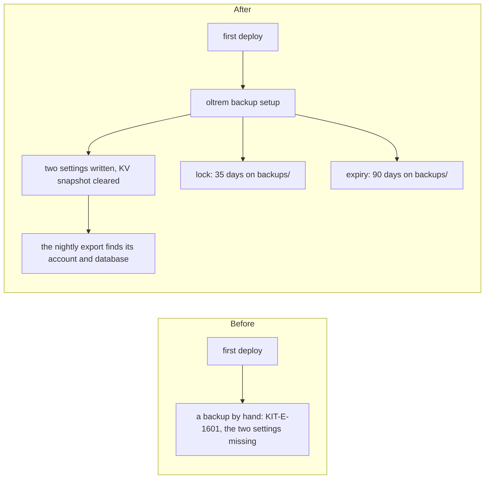

# Phase 5: the backup's setup on the client's account

> **In plain words.** The nightly backup needs to know which account and which database to copy,
> and the plan wants the copies protected: nobody may delete one for 35 days, and old ones are
> removed on their own. None of that can be written before the first deploy, because the
> database and the bucket do not exist yet. One new command, `oltrem backup setup`, does all of
> it once after the first deploy. Running it again changes nothing.

## What changed

- **`oltrem backup setup [dir]`** (`packages/cli/src/backup-setup.ts`). With wrangler signed in
  to the client's account, it:
  1. finds the account: `CLOUDFLARE_ACCOUNT_ID`, or the one account wrangler reaches;
  2. finds the database id with `wrangler d1 info <name> --json`;
  3. writes `backup.account_id` and `backup.database_id` into the settings store while each is
     empty, with the same three statements as the Worker's own save: a new configuration
     version, the row, and its history row, by `vendor`;
  4. after a write, deletes the settings snapshot in KV, so the Worker rereads D1 within a
     minute;
  5. adds the bucket lock `oltrem-backups-lock` on `backups/` for 35 days, and the lifecycle rule
     `oltrem-backups-expire` on `backups/` that deletes a copy after 90 days, each only when a
     rule of that name is not there yet.
- **The client template's README** names it beside `oltrem vendor set`, as the second step after
  the first deploy.
- **The backup module's README** says how its two settings and the rules come to exist.

## Decisions

- **A command run once by hand, not a step of every deploy.** It needs the account and the
  database, which exist only after the first deploy, and it is needed once. A deploy step would
  spend GitHub Actions minutes on every push to find nothing to do, and the deploy token would
  need R2 rights only for this. It sits beside `oltrem vendor set`, which has the same timing.
- **Only adds, never replaces.** A setting that holds another value is reported, not
  overwritten. A rule is found by its name, and a rule of another name is never touched.
  `wrangler r2 bucket lock add` appends to the bucket's rules, so the command lists them first.
- **The snapshot is deleted, not rebuilt.** The Worker builds its snapshot from the kit's
  registry and the client's file, which the command does not load. With the key gone, the
  Worker's next read misses and rebuilds it from D1.
- **90 days of copies, by default.** The research suggested about 400 days. Copies are not
  compressed yet, and the free plan has 10 GB of storage, so 90 days keeps a small portal well
  inside it. The owner was asked on a card (2026-10-21) and work went on with 90.

## Not done here

- Nothing has run against a real account. The sandbox's first deploy is that run.
- The free plan's R2 storage is not one of System health's budgets yet.

## How it was verified

- The twelve gates pass locally.
- `oltrem backup setup`'s five tests on Node, with a stand-in for wrangler: D1 commands run
  against the settings store's real migration in SQLite, and the bucket's rules are printed the
  way the pinned wrangler prints them, colours included.
  - A fresh account: both settings written as JSON with versions 1 and 2 and two history rows,
    the snapshot deleted, both rules added beside another rule that stays. A second run writes
    and adds nothing.
  - A setting with another value is left as it is and reported, and the rules are still added.
  - `CLOUDFLARE_ACCOUNT_ID` is used without asking wrangler; several accounts without it, or a
    malformed one, are refused.
  - A database wrangler cannot find, settings it cannot read, a snapshot it cannot delete and a
    rule it cannot add each give their own message.
  - The exit codes: 0 when done, 1 with a problem, 3 when it cannot start.
- The pinned wrangler's source was read for the arguments and output of `d1 info --json`,
  `whoami --json`, `kv key delete`, and `r2 bucket lock|lifecycle list|add`.
