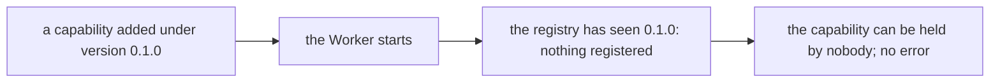
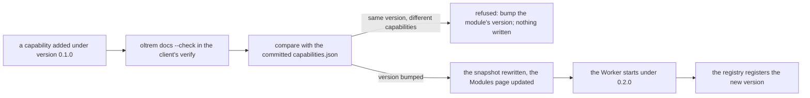

# Phase 3: the capability version gate

> **In plain words.** A module says what it lets people do: its capabilities. The permission
> system learns them when the Worker starts, but only once per version of the module, so that a
> start stays cheap and nothing changes under running code. That rule left a hole: someone adds or
> renames a capability, forgets to raise the module's version, and the new capability never reaches
> the permission system, with no error anywhere. Now a client's repository keeps a small generated
> file listing each module's capabilities under its version. The tool that writes the reference
> compares the modules with that file on every check and refuses a change made under the same
> version, naming the module and asking for the bump. A forgotten bump fails the repository's
> checks before the code ships.

## What changed, and why

| What | Why |
|---|---|
| **`capabilities.json`** among the generated files of a client (`docs/_generated/`): each module's id, version, bit plane and capabilities as data, sorted | The committed snapshot the gate compares against; generated, never written by hand (R-06) |
| **The gate in `oltrem docs`**: a module whose bit plane or capabilities differ from the snapshot under an unchanged version is refused, the module named and the bump asked for, and nothing is written | The registry copies a module's capabilities once per version ([the capabilities record](2026-10-21-module-capabilities.md)); without this, a change under the same version was silent |
| **A snapshot that is not the list** the command writes is reported with the repair: delete it and run `oltrem docs` | Fail closed on a file the gate cannot read (R-10) |
| **The generator writes the snapshot too**, with the Modules page | A new module's entry exists the moment the module does |
| The command's messages count **files**, not pages | One of the seven is not a page |

## Decisions taken while building

- **A committed snapshot, not a registry query.** The tool runs in a repository check, where no
  account is reachable; the committed file is the memory of what the last green verify saw.
  Comparing with the live registry would need a credential and a network, and would miss a module
  whose Worker has not started yet.
- **JSON, not a table.** The comparison is of data; a table is for a reader. The Modules page
  shows the same capabilities for the reader, and the file holds them for the gate.
- **The whole declaration, not the ids.** A changed floor, class, label or flag matters as much as
  a new id, since the registry copies all of it once per version; the bit plane is compared too.
- **A new module needs no bump.** A module the snapshot does not know is new, and its entry is
  written. A module that left the code leaves the file.
- **Refuse, do not rewrite.** Under an unchanged version the tool writes nothing, not even the
  other files, so the repository never carries a snapshot that agrees with code the registry will
  not see. Once the version moves, the same run rewrites the snapshot.

## Impact on each service

None. Nothing is deployed and the first client's platform is not touched. A client's `verify`
runs `oltrem docs --check`, which now also compares the capabilities with the snapshot.

## Before and after

Before this commit a change to a module's capabilities under the same version reached nothing, and
nothing said so:

Now the repository's checks refuse it first:

## How it was verified

- `pnpm verify` green locally, its twelve gates; the command-line tool's sixty-three tests pass on
  Node, among them: a copy of the client template with a generated module, a capability added to
  it under the same version refused with the module named and nothing written; the same change
  accepted once the version moves, `capabilities.json` holding the module's version, bit plane and
  capability, and the Modules page showing it; the generator writing the snapshot for a new module;
  the fixture's and the template's seven files re-rendered and held current.
- The client template's five tests pass inside the Workers runtime.
- Not verified: no Worker has registered a capability from a client's module, so the gate stands
  in for the registry's once-per-version rule until the sandbox runs one; a snapshot edited by
  hand is caught by the reference check (its committed copy differs from what the command renders),
  not by the gate.
