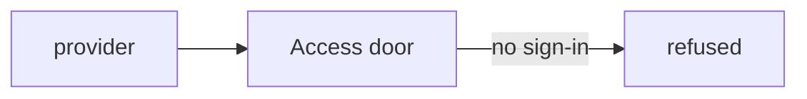
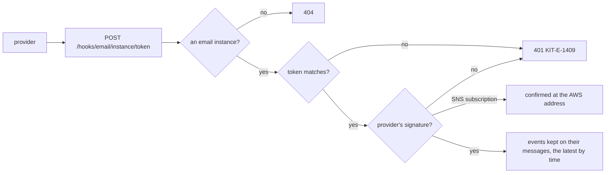

# Phase 4: the delivery reports' address

> **In plain words.** Email providers tell the portal what became of each message: delivered,
> bounced, marked as spam. Until now they had nowhere to say it, because the Cloudflare sign-in
> door turns away anyone who cannot sign in, and a provider cannot. On the owner's yes, the portal
> now has one public address per provider, `/hooks/email/...`, that skips the sign-in for these
> reports only. Every report is checked twice, by a secret code in the address and by the
> provider's own signature, before it is kept on its message.

## What changed, and why

| What | Why |
|---|---|
| **Public hooks in the module contract** (`hooks`, `@oltrem/core-module`) and the pipeline (`@oltrem/core-http`): `POST /hooks/<module><path>`, mounted before the identity is read, the body read once and capped at 512 KiB | The owner's card of 2026-10-21, "Open /hooks/": a provider cannot pass the Access door |
| **A secret token per instance**, sealed with its credential (`HOOK_FIELD`), made when a key is first pasted and kept when one is pasted again | A second guard beside each signature, and the only one for Brevo, which signs nothing |
| **`registry.instance(db, id)`** | The public address names the instance; its tenant comes from the row |
| **The email module's hook** `/:instanceId/:token`: the token, then the signature, then each event kept on its message as `last_event` | Plan 8.3: bounces and complaints reach the portal, the sensor for a provider that changed |
| **`GET /instances/:id/hook`** (`email.manage`), audited as `email.hook` | A person pastes the address into the provider's dashboard; reading a secret is recorded |

## Decisions taken while building

- **A hook is POST only and is its own check.** No session, capability or same-origin check runs
  on `/hooks/`; the contract says so on every hook, and the pipeline hands the handler the exact
  bytes a signature covers.
- **The token is compared before the signature**, in constant time, and a wrong one is
  `KIT-E-1409`; an unknown instance is a plain 404.
- **The token is sealed, not stored in the clear**, so reading the database does not give the
  address; the screen that shows it needs `email.manage`, a fresh sign-in, and leaves an audit row.
- **The latest event wins by its time**, not by its arrival: an older report arriving late does
  not overwrite a newer one, so a repeated report changes nothing and needs no table of its own.
- **SendGrid's ids are matched by prefix at a dot**, through the message-id index, because its
  reports add a suffix to the id its send returned.
- **Reports are only kept for now.** Suppressing an address that bounced or complained comes with
  the screens.

## Impact on each service

None. Nothing is deployed and the first client's platform is not touched. When a client is set
up, its Access application needs a Bypass policy on `/hooks/`, the owner's dashboard step beside
the door itself.

## Before and after

Before this commit a report had no address to reach, and the door refused any request without a
sign-in:

Now `/hooks/` goes past the door to its own checks:

## How it was verified

- `pnpm verify` green locally, its twelve gates. The pipeline's tests: a hook reached with no
  identity and no origin, given the exact body and its parameters, answered `no-store`; a
  refusal as a problem; a body over the cap, a GET and a shorter path never reach the handler. The
  contract refuses a bad hook path, a missing summary and a hook declared twice. The providers
  module: the token sealed with the key, never in a response, kept when a key is pasted again;
  the lookup by id. The email module, three runs in a row: the address shown to a manager,
  refused to a reader, audited without the token; Brevo reports posted with no sign-in kept on
  their message, an older one ignored, a suffixed id matched, an unmapped event counted; a wrong
  token, an unknown instance and an unsigned Resend report refused; an SNS subscription confirmed.
- Not verified: no real provider has posted a report, and no Access application has a Bypass
  policy yet; both come with the sandbox.
