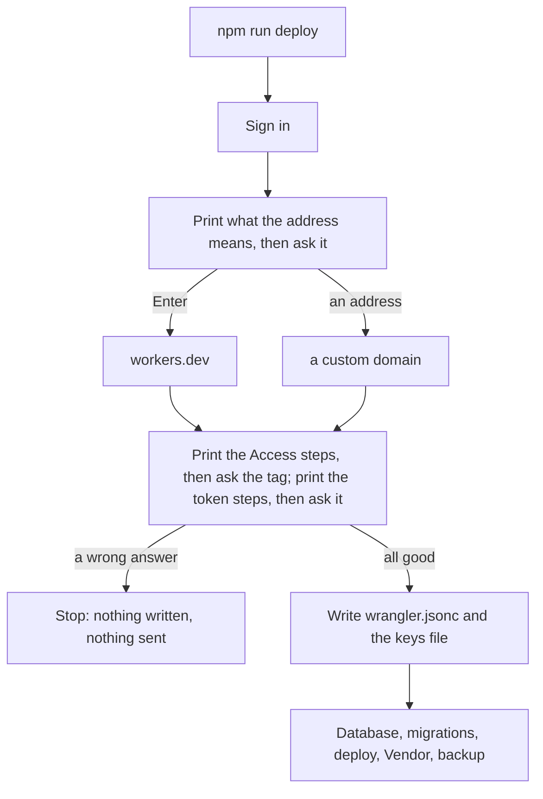
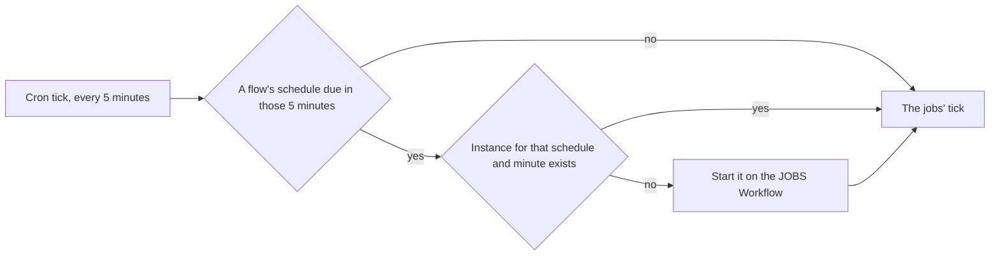

# Deploy, after its first real run

> **In plain words.** The owner ran `npm run deploy` on a fresh Cloudflare account. The sign-in
> worked, but the instructions for each question appeared only after the program stopped, so
> the questions were answered blind and the program wrote a wrong address into a file before it
> stopped. Now each instruction appears before its question, nothing is written until every
> answer is good, and a person with no domain of their own can press Enter for the free
> `workers.dev` address Cloudflare gives every account.

## What changed, and why

| What | Why |
|---|---|
| Each step prints as it happens (`say` on the deploy's tools) | The steps printed after the run, so the questions came first |
| `wrangler.jsonc` is written once every answer is good, before the database and the deploy | A refused answer had already written a wrong address into it |
| An empty address serves the portal on `workers.dev` (`workers_dev` turned on) | A fresh account may hold no domain; Access protects `workers.dev` too |
| The Access steps use the dashboard's Protect all Workers | It works before the Worker exists and on either address; the account is the client's alone |
| A failed deploy says how to undo a wrong address | A valid address on a domain the account lacks fails only at the deploy |

## How it works

Before, every step and instruction printed at the end, and the address was written into
`wrangler.jsonc` as soon as it was typed.

## How it was verified

`@oltrem/cli`'s deploy test: each question asked after the steps it needs, the printed steps the
same as the result's, the `workers.dev` run and a second run that asks nothing, a `workers.dev`
address typed by hand refused, and `wrangler.jsonc` unchanged after a refused answer; the twelve
gates pass. Not verified: the run on the owner's account and the dashboard's wording of Protect
all Workers, read from Cloudflare's documentation of 2026-10-12.

## Later the same night: the nightly copy without a scheduled Workflow

The owner's run deployed the Worker, then wrangler stopped: "scheduled Workflows require a paid
Workers plan". The `JOBS` binding no longer names a schedule. The five-minute tick starts each
flow whose schedule fell due in its five minutes (`flows.startDue` in `@oltrem/core-jobs`), one
instance per schedule and minute, named after both, so a second tick starts none. A run that
deployed but stopped before the Vendor's address shows the door step again.

Verified: core-jobs' tests of the cron fields and of `startDue` (late by two minutes, twice on
one tick, an unreadable schedule reported); the template's test on the real `JOBS` binding (the
binding names no schedule, the 03:00 copy started once); `@oltrem/cli`'s deploy test of a run that
stopped after the deploy; the twelve gates pass. Not verified: a nightly copy on the owner's
account.
