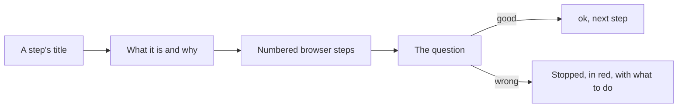

# Deploy screen, explained questions

> **In plain words.** After the first real run the owner asked two things: say what each
> question means (they had no idea what an AUD tag is), and make the screen look better. Now
> `npm run deploy` shows six numbered steps, each with a title, and every question comes after a
> few lines saying what it is and why the portal needs it, then the browser steps that get the
> answer. Finished lines are marked ok, a stop is marked in red, and colour is used only where the
> terminal shows it.

## What changed, and why

| What | Why |
|---|---|
| Six titled steps, "Step n of 6", shown on every run, "ok" where nothing is left to do | The person always knows where they are |
| "What it is" and "What we need" before the door's tag and the ops token | The owner did not know what an AUD tag was |
| Each line has a kind (title, text, instruction, ok) and the terminal lays it out | The look belongs to the terminal; the steps stay plain text for the tests |
| Colour only in a terminal, never with `NO_COLOR` | Plain text in logs and in other programs |

## How it works

Before, each question was one line with no explanation, and the lines carried a `deploy:`
prefix with no layout.

## How it was verified

`@oltrem/cli`'s deploy test: the six titles in order on a first run and on a later one, the
door explained before its tag is asked, each question after its last line of explanation, "the
door is set" and "the key is set" on a later run; the screen read once with stand-ins for
wrangler; the twelve gates pass. Not verified: the colours in the owner's PowerShell window.
