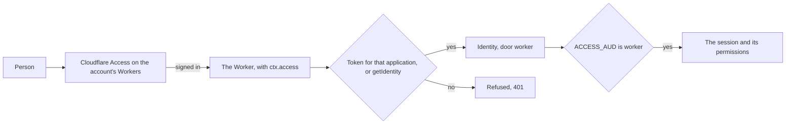

# The door, nothing copied

> **In plain words.** On their run the owner pasted the wrong value where `npm run deploy`
> asked for the door's AUD tag, and asked why the command cannot do it all by itself. The sign-in
> that `npm run deploy` uses cannot create Access applications, so one switch in the browser
> stays: "Protect all Workers". Everything after it is automatic now. The person turns the switch
> on, presses Enter, and the portal trusts what Cloudflare tells it on every visit: that its own
> door let this person in. There is nothing to find or paste.

## What changed, and why

| What | Why |
|---|---|
| Step 3 asks for Enter once the door is on; `ACCESS_AUD` becomes `worker` | The tag was the step the owner could not get right, and it is not needed |
| `@oltrem/core-http` reads `ctx.access`, which the runtime gives a Worker that Access protects | Cloudflare vouches for the sign-in on each request, naming its own application |
| Such a sign-in is marked `door: 'worker'`; the IAM's audience `worker` accepts only that mark | A token that merely names `worker` is refused, and a hostname door's tag still works |
| A tag typed at step 3 is still taken | A client with a hostname Access application keeps that choice |

The ops token is still pasted: the same sign-in cannot create API tokens either, and the screen
says so.

## How it works

Before, step 3 printed the steps to make a self-hosted Access application, and the person copied
its Application Audience tag back into the terminal; the portal compared every token's audience
with it.

## How it was verified

`@oltrem/core-http`'s identity test (a token for the runtime's application is marked, another is
left plain, the `getIdentity()` copy read whole or not at all) and its pipeline test (the same
request let in with `ctx.access` and refused without it); the IAM's session test (the `worker`
audience accepts only the mark, and a hostname door refuses the mark); `@oltrem/cli`'s deploy test
(Enter sends `worker`, a typed value that is not a tag stops before anything is written); the
twelve gates pass. Not verified, and first seen on the owner's run: that "Protect all Workers"
gives the Worker `ctx.access` on `workers.dev` with the email, subject and sign-in time described
in Cloudflare's documentation.
