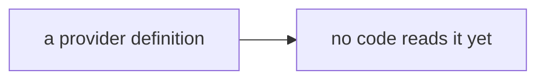
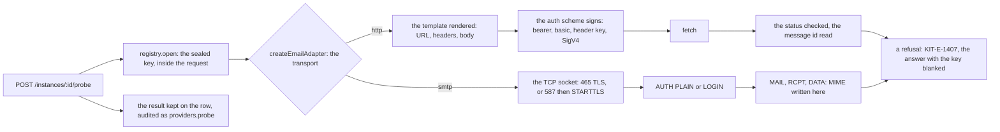

# Phase 4: the email adapters

> **In plain words.** The previous step described each email provider as a page of data. This
> step writes the two pieces of code that read those pages and actually send: one for providers
> reached over the web (Resend, Brevo, Postmark, SendGrid, Mailgun, Amazon SES) and one for any
> mail server reached the old way (SMTP). Neither knows a provider by name. A new button, **probe**,
> checks that a pasted key works and keeps the answer on the screen. Keys never travel without
> encryption and never appear in an error message: if a provider repeats the key back, the
> portal blanks it.

## What changed, and why

| What | Why |
|---|---|
| **The template engine** (`renderTemplate`, `renderString`, `readPath`): a definition's URL, headers and body rendered against `secret`, `config` and `message`; a missing value removes its key, and an object left empty goes too | Plan 8.1: one code path for every HTTP provider; the language was fixed with the definitions and is implemented here |
| **The auth schemes**: bearer, basic, a key in a header, none, and AWS Signature Version 4 with WebCrypto | Plan 8.1: a credential becomes headers in one place; SES needs SigV4, which no small library on the allowed list provides |
| **The HTTP adapter**: the rendered request signed and sent, the answer checked against the expected status, the message id read by JSONPath or from a header | Plan 8.2: the first of the two email adapters |
| **The SMTP client** over the Workers TCP socket: 465 TLS, 587 STARTTLS, AUTH PLAIN and LOGIN, MIME written here | Plan 8.2: the second adapter, for a client whose mail server is its own |
| **`createEmailAdapter`**: one `send` and one `probe` for every email definition, by transport | The email module of a later slice calls this and never names a provider |
| **`POST /instances/:id/probe`**, the twelfth route: the sealed key opened, the provider reached, the result kept on the row and audited | Plan 8.4: a person sees at once whether a pasted key works |
| **Two error codes**: `KIT-E-1407` the provider did not take the message, `KIT-E-1408` the definition asks for what this kit version cannot do | A refusal names the provider's answer; an unimplemented scheme is refused by name instead of half-signing a request |

## Decisions taken while building

- **No credential in the clear on SMTP.** On port 587 the client upgrades to TLS before AUTH and
  refuses a server that does not offer STARTTLS, or that sends bytes before the handshake (bytes
  that arrived unencrypted and could be an attacker's). Port 25 is refused: Cloudflare blocks it.
- **No secret in an error.** A provider's answer is kept, cut to one line, with every secret value
  of the instance replaced by `[secret]`; the SMTP client names the failed command, never its
  argument. A probe never throws, so a screen always has a result to show.
- **The message is checked once, before any request.** Addresses, at most fifty recipients, no
  line break where a header goes, no header the transport writes itself (`From`, `Bcc`,
  `Message-ID` and the like), so a header injection never reaches a provider.
- **SigV4 written here, not imported.** The dependency rules keep the list short, and the
  signature is fifty lines of WebCrypto; it is checked against AWS's published vector and a
  second vector computed apart in Python, so the code is not its own oracle. The test splits each
  expected signature into three parts because the identifier scan refuses a 64-character hex
  string, the right call for every other file.
- **OAuth2 client credentials is refused, not guessed.** No kit definition uses it yet; the first
  one that does brings its code and its test.
- **The SMTP message id is the kit's.** The client writes `Message-ID` from the kit's message key,
  so a bounce that quotes it is matched without asking the server.
- **The socket behind an interface.** `connect` is injectable: the Workers socket in production,
  a scripted server in the tests. The socket module is imported when first used, so the module
  still loads on Node for the generated references.

## Impact on each service

None. Nothing is deployed and the first client's platform is not touched. The module is mounted
in no Worker yet; the client template mounts it with the email module.

## Before and after

Before this commit a definition was data that nothing read:

Now two adapters read every definition, and a probe shows a person whether the key works:

## How it was verified

- `pnpm verify` green locally, its twelve gates; the providers module's twenty-eight tests pass
  inside the Workers runtime. The template engine renders every kit HTTP definition with the
  sample message and nothing left, and every placeholder names a message field or a field the
  definition lists. Each of the six HTTP providers sends its reference's request shape to a
  scripted fetch. A refusal keeps the provider's words with the key blanked; a header injection is
  refused before any request; SigV4 matches both vectors; the SMTP client, against a scripted
  server on a fake socket, upgrades before AUTH on 587, is TLS from the start on 465, signs in
  with PLAIN and LOGIN, sends no credential without TLS, and writes the expected MIME; the probe
  route keeps its result on the row and audits it.
- A bug found on the way: the template engine's global pattern kept its position between calls,
  and `matchAll` copies it, so a missing value could go unnoticed; the pattern used to test is no
  longer global, and the Mailgun test caught it.
- Not verified: no request reached a real provider and no socket a real server; the TLS handshake
  is the runtime's. The acceptance of this phase sends through two providers on the sandbox.
