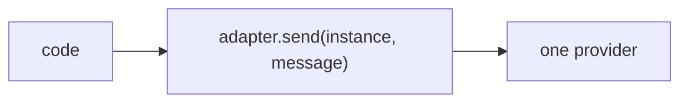
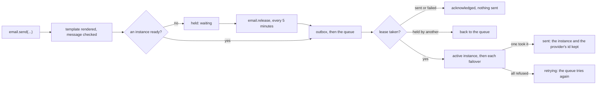

# Phase 4: the email module

> **In plain words.** The portal can now send an email the way it will in production. A
> message is checked the moment it is asked for, so a mistake shows at once instead of failing
> later. It is then sent through the provider that is switched on; if that provider is down, the
> next one in line sends it. The same message is never sent twice, even when the system delivers
> the request twice. With no provider set up yet, messages wait and go out once one is. Before a
> provider is switched on, a person can send themselves a test through it. The health page warns
> when messages wait and fails when every provider refused one.

## What changed, and why

| What | Why |
|---|---|
| **A new module, `@oltrem/email`**, with its table `email_messages` (migration `0011`) | Plan 8.1: the kit keeps its own lease per message key, whatever each provider promises |
| **Typed templates** (`defineTemplate`) and an `html` tag that escapes every value | Plan 8.1: templates compiled at build time, never a provider's own; a guest's input never becomes markup |
| **`send`**: render and check now, then queue through the outbox, held while no instance is ready | A mistake is the caller's answer; plan 15.4: a missing provider holds the message rather than losing it |
| **`deliver`**, the `email.send` consumer: the lease, then the active instance and each failover in order | Plan 8.3: the previous active instance becomes the failover, and a send proves it |
| **`POST /canary`** and **`GET /messages`** | Plan 8.3: a canary proves an instance before it sends; the screens show what became of each message |
| **The job `email.release`** and **the health check `email.sending`** | Held messages go out once a provider is ready; a stuck message shows on the health page |
| **A boundary rule**: the email module may import `@oltrem/providers` | It sends through the registry's instances and the adapters; no other module may |

## Decisions taken while building

- **The lease is one upsert.** A new key, or one that waits, retries or whose two-minute lease
  ran out, is taken in one statement; a `sent` or `failed` key is acknowledged without a send,
  and a live lease is `KIT-E-1502`, so the queue brings the message back later.
- **What is permanent is acknowledged.** An unknown template, data that no longer matches its
  schema, or an address refused as such is `failed` and never retried: retrying would not change
  it. A provider's refusal moves on to the next instance; when all refused, the queue retries.
- **The subject and the body are never stored.** The row keeps the addresses, which the screens
  and the delivery reports need; the outbox keeps the template's data until the message is done.
- **The canary goes to the person who asked**, through the instance named, whether or not it is
  active, and its result is kept on the instance as its last probe, marked as a canary.
- **The sending address is the client's** (`from`), read from its own settings; a setting for
  it, suppression and a daily cap come with the screens.
- **One release for every tenant.** The outbox releases held messages by type; a tenant still
  without a provider sees its messages wait again. With one company per client this is the case
  that matters.

## Impact on each service

None. Nothing is deployed and the first client's platform is not touched; no Worker mounts the
module yet. The client template mounts it with the IAM module, and its tick does not yet run the
outbox replay that sends what the job released.

## Before and after

Before this commit the adapters could send one message, and nothing decided which instance, kept
a message from going twice, or waited for a provider:

Now a message is asked for once and delivered by the queue:

## How it was verified

- `pnpm verify` green locally, its twelve gates; the email module's fourteen tests pass inside
  the Workers runtime, five runs in a row, with the real outbox, the providers module and the IAM
  pipeline: a message refused before it is queued for each of its four checks; held with no
  provider, the health check warning, and released once an instance is active; sent through
  Resend with the rendered message; sent once when delivered twice or asked for twice; failed
  over to Brevo; a live lease left alone and an expired one taken over; every provider refusing,
  the health check failing, and the retry sending it; a message that can never be sent failed
  for good; the two routes refused to someone without the capability; the canary kept on the
  instance and audited.
- Not verified: no real provider took a message, and no queue carried one; the sandbox's
  acceptance sends through two providers.
