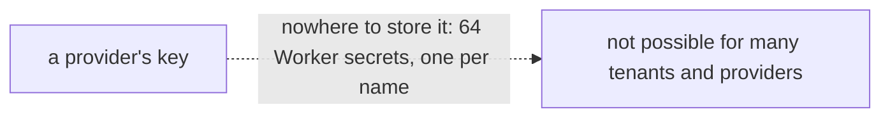
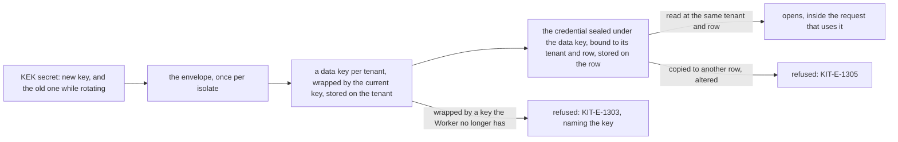

# Phase 4: envelope encryption

> **In plain words.** A client's portal will hold credentials for outside services: the key of
> the email provider, later others. A Worker may hold only a few secrets of its own, and a
> platform with several tenants and several providers has more credentials than that, so they
> live in the database. They cannot sit there in the clear. This package seals each one: a Worker
> holds one master key as its secret; from it, each tenant gets its own data key, stored wrapped;
> each credential is encrypted under the tenant's data key and tied to the exact row it is stored
> in, so a copy pasted into another row refuses to open. Changing the master key needs no second
> secret: the old key rides beside the new one for as long as the change takes.

## What changed, and why

| What | Why |
|---|---|
| **`@oltrem/core-crypto`**, a core package with no dependency beyond the kit's error codes: `createEnvelope`, `generateKek`, and the sealed-string formats | Plan 8.4: envelope encryption in D1, the one key-encryption key as a Worker secret, the rest as rows |
| **A data key per tenant**, random AES-256, wrapped by the current key-encryption key and stored as a string that names the key that wrapped it | Rotation rewraps a few data keys instead of every credential; a tenant's key can be dropped on its own |
| **Each value sealed with AES-GCM under the data key, a random 96-bit IV, and the tenant and row as additional authenticated data** | A ciphertext moved between rows, or altered, is refused by the cipher itself (research 13, section 5) |
| **One secret name for the rotation**: `KEK` holds the new key and, while rotating, the old one after a space; the first wraps, any unwraps | R-09, zero growth of variables: no `KEK_PREVIOUS`; the plan's dual-key window with one name |
| **Six error codes in the 13xx block**, two of them 503 (no secret; a key this Worker lacks) | A missing or lost key is an operations fault the doctor and the health page can show, not a bug |
| **The manifest gate covers the package's test Worker** | Every test Worker configuration is checked against its manifest (R-09) |

## Decisions taken while building

- **Web Crypto, no library.** The primitive is sixty lines of SubtleCrypto; a dependency would
  need a registry row and a reason, and there is none to give (R-09).
- **Encrypt the raw data key, rather than the wrap API.** `encrypt` and `decrypt` with AES-GCM are
  the same cipher the values use and are supported everywhere the Worker runs; the wrap and unwrap
  calls add nothing here.
- **The secret names its keys by a fingerprint.** A wrapped data key carries twelve hex characters
  of the SHA-256 of the key that wrapped it, so a Worker knows which configured key to use and
  can say which one it lacks, without ever writing a key.
- **Two keys at most.** A rotation is one step: new beside old, rewrap, remove old. A third key
  would mean two rotations at once, which the package refuses.
- **The caller carries the address.** The package does not know tenants or rows; the module that
  stores a credential passes the tenant and the row to seal and to open, and that is what makes a
  moved value fail. Both are required, and an empty one is refused.
- **No audit row here.** The envelope has no actor; the providers module writes the audit rows for
  create, rotate and failed use, with the person or job that did it. The README says so.
- **Unwrapped data keys are cached per isolate**, sixty-four at most, never across isolates and
  never written anywhere.

## Impact on each service

None. Nothing is deployed and the first client's platform is not touched. The `KEK` secret is
already a planned row of the token registry; no new name was added.

## Before and after

Before this commit the kit had no place for a provider's credential:

Now a credential is a sealed string in its row:

## How it was verified

- `pnpm verify` green locally, its twelve gates, the manifest gate on the crypto package's test
  Worker too; the package's four tests pass inside the Workers runtime: a value sealed and opened
  at its address, two seals of the same value different, the empty value allowed; refused at
  another tenant, another row, altered, under another data key, malformed, or without its address;
  a data key wrapped under one key-encryption key opened under the next with the old one beside
  it, rewrapped to the new one, then refused once the old key is gone; the secret refused when
  missing, malformed, repeated or three keys long.
- Not verified: no Worker holds a `KEK` secret and no credential is stored, so the rotation
  procedure is proven in a test, not on a deploy; what the unwrap costs per request is unmeasured
  until the sandbox.
