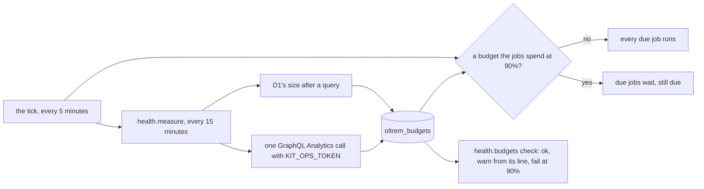

# Phase 5: the free plan's budgets on System health

> **In plain words.** Cloudflare's free plan has daily limits: how much the database may read and
> write, how many key-value writes, queue operations and requests, how much CPU each request may
> use, and how big the database may grow. System health now measures each one every fifteen
> minutes, warns when one gets close, and fails when one is nearly spent. While a limit that
> background jobs use is nearly spent, those jobs wait until it resets, so the portal itself keeps
> working for people.

## What changed

- **`@oltrem/core-health`, `budgets.ts`**: seven budgets, each with the free plan's limit, the
  line it warns from and whether the jobs pause for it. A job, `health.measure`, measures them,
  and a check, `health.budgets`, judges them. The scheduler gets a `pause` from it, and
  `budgets(env)` gives the figures for the page to come. All of it is switched on by one option,
  `budgets`, on `createHealth`; without it, nothing changes.
- **Migration `0014_budgets.sql`**: `oltrem_budgets`, one row per budget with its last figure,
  its UTC day, when it was measured and why the last try could not. It is copied into the client
  template (`kit.json` updated).
- **`@oltrem/core-jobs`**: `pause` on the scheduler. A tick with a due job asks it once; while it
  gives a reason, every due job but the exempt ones waits and stays due. A pause that cannot be
  read is reported and the jobs run.
- **The ops token**, `KIT_OPS_TOKEN`: its recipe moved to `@oltrem/core-health`, which the backup
  module now imports, and it gained a second permission, Account Analytics Read. The token
  registry row is widened, not doubled (R-05).

Before this change there was no budget anywhere: a job could spend the day's writes and the
portal would stop writing for everyone until midnight UTC, with nothing on System health to say
why.

## Decisions

- **One call for every figure.** Cloudflare's GraphQL Analytics API answers the day's D1 rows,
  KV operations, queue operations, Worker requests and CPU time for the whole account in one
  request. The account is the client's alone (one account per client), so its totals are the
  client's. The database's size needs no call at all: D1 reports it after every query.
- **The same token, widened.** The Worker already holds one Cloudflare token for the backup. A
  second token inside the Worker would double what can leak; one more read-only permission on the
  existing one does not.
- **Fail-open pause.** A pause that cannot be read lets the jobs run. A broken measurement must
  not stop the portal's work; the check shows the problem instead.
- **What pauses.** Only budgets a job can spend. CPU time is per request, so it warns and fails
  but never pauses. System health's own two jobs never wait, since they are what lifts a pause.
  The nightly backup runs as a Workflow, not a job, so it still runs.
- **A daily figure counts only on its day.** After midnight UTC, yesterday's figure stops
  counting and the check warns until the first measure of the day, rather than show a spent
  budget that has already reset.
- **A figure that could not be refreshed is kept and flagged.** The check warns with the reason,
  so a token that stops working shows up on System health the same day.

## Not done here

- **The template does not pass `budgets` yet.** The client template's wiring (the account
  setting, the token, the scheduler's pause) comes with its next change, with the backup's.
- **GitHub Actions minutes.** The plan's build-minute budget was written for Workers Builds; the
  kit deploys from GitHub Actions, whose 2,000 free minutes are shared by the account. Plan
  section 10 has `oltrem doctor` show them; that is still owed.
- **Owed to the sandbox:** that a KV write's `actionType` is `write`, and that the CPU quantile
  is in microseconds, as Cloudflare's documentation says. Both are read the documented way and
  checked on the first real measurement.

## How it was verified

- The twelve gates pass locally.
- `packages/core-health/test/budgets.test.ts`, five tests inside the Workers runtime against the
  real migrations, three runs in a row, with a stand-in for Cloudflare's API: nothing added
  without the option; one call with the token and the UTC day, and every figure read from it,
  only KV writes counted, CPU time in milliseconds, the size from D1; the check warning at 75%
  and failing at 95%; the other jobs paused through the real scheduler while the health jobs
  run, and running again after midnight UTC; a 403 keeping the last figure with its reason; a
  missing token named once for the budgets it leaves unmeasured; the token in no reading; and
  every analytics error named.
- `packages/core-jobs/test/jobs.test.ts`: the pause holding due jobs while an exempt one runs,
  lifting, not asked when nothing is due, and asked once per tick when it cannot be read.
- The backup module's eleven tests pass with the recipe imported from core.
- Not verified here: a measurement against a real account. The sandbox is that run.
