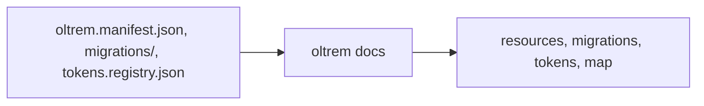
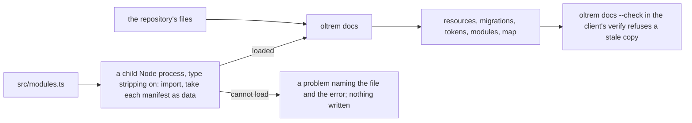

# Phase 3: the generated references

> **In plain words.** A client's repository carries a few reference pages that nobody writes by
> hand: the tool writes them from the files that exist, and the repository's checks refuse a stale
> copy. Until now those pages covered the resources, the migrations, the credentials and a map of
> the files. Now they also describe the client's own modules: for each one, what it lets people do,
> its web routes, its timed jobs, its health checks, its database changes, its settings with their
> defaults, and its error codes with their text. The tool reads this from the modules themselves,
> so the page cannot say something the code does not; when a module cannot be read, the tool says
> which file and why, and writes nothing. Two small repairs came with it: a package of the kit
> that Node could not load, and a library the generated module needs that a new client's
> repository did not yet have.

## What changed, and why

| What | Why |
|---|---|
| **A Modules page** in `oltrem docs`, from `src/modules.ts`: per module its capabilities (or the note that own-account mode declares none), routes with their capability, jobs, checks, migrations, settings with default, layer, editor and effect, and errors with status and text | Plan 15.5: routes, capabilities, settings keys and error codes are generated, never written by hand; a client's verify holds the page current |
| **Read by importing the code**: a child Node process with type stripping imports `src/modules.ts` and prints each manifest as data; no handler, job or check runs | The manifest is the one description of a module (plan 4.3); reading it as data from the running code is the only way the page cannot drift |
| **A file Node cannot load is a problem that names it**, and nothing is written; a client without `src/modules.ts` has no module yet | A stale page silently kept would be worse than a loud refusal |
| **`@oltrem/core-config`'s relative imports name their `.ts` files** | Node's module loader has no extension search; the other packages already did this |
| **`zod` among the client template's dependencies** | The generated module's schemas use it; without it, "deploys with no edits" was not true |
| **The generator writes the Modules page too**, since it refreshes the reference | A new module's page exists the moment the module does |

## Decisions taken while building

- **Import, not parse.** A static reading of the TypeScript would have to understand every way a
  manifest can be written; importing the module and taking the frozen manifest understands them
  all. The cost is a rule: module code must load in Node, with no Workers-only global at module
  scope. The kit's packages respect it, and the sample module shows the shape.
- **A child process, not an in-process import.** The tool runs on whatever Node the client has;
  the child is started with type stripping on, so Node 22.12 and newer read the `.ts` files, and a
  module's load error cannot take the tool down with it.
- **The client's own modules only.** The kit's modules (`health`, later `iam` and `users`) are
  documented in the kit; a client's page is about what is particular to that client. The page says
  so.
- **One page, not three.** Routes, settings and errors sit under each module rather than in three
  flat tables, because a reader asks "what does this module have" more often than "every setting
  of every module"; the flat views are a later rendering of the same data.
- **Published packages must be importable.** In the kit the `@oltrem` packages resolve through
  workspace links to their sources, outside `node_modules`, where Node strips types. A published
  package under `node_modules` is not stripped, so the release pipeline of phase 6 ships code Node
  can import. Noted for that phase.

## Impact on each service

None. Nothing is deployed and the first client's platform is not touched. A client's `verify`
runs `oltrem docs --check`, which now imports the client's modules once per run.

## Before and after

Before this commit the reference knew the files that exist and nothing of what the modules do:

Now it reads the modules themselves:

## How it was verified

- `pnpm verify` green locally, its twelve gates; the command-line tool's sixty-two tests pass on
  Node, among them: the Modules page of a client with no module yet; a copy of the client template
  with a module written by the generator, whose page shows the route, the job, the check, the
  migration, the setting with its default and the error with its text, and whose committed copy is
  what the generator wrote; a `src/modules.ts` Node cannot load reported with the first error and
  nothing written; the fixture's and the template's six pages re-rendered and held current.
- The client template's five tests pass with `zod` among its dependencies; the config package's
  tests pass with its imports naming their files.
- Not verified: no published package has been imported this way (the kit resolves its packages
  through workspace links); the kit's own modules are not on a client's page.
