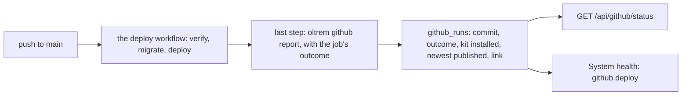

# Phase 5: the GitHub module

> **In plain words.** The portal will show which version of the kit it runs, whether a newer
> one is out, and whether the last update went live. It learns this without a GitHub key: the
> update robot that deploys the portal writes a short note into the portal's database at the end
> of every run. System health turns red when the last update failed and amber when a newer kit
> is waiting to be merged.

## What changed, and why

| What | Why |
|---|---|
| **`@oltrem/github`**: the `github_runs` table (migration `0013`), two routes, the `github.deploy` check, one capability on bit plane 5 | Plan 4.4: the repository view, the build status, the kit version and "a newer version exists" |
| **`oltrem github report`** (`@oltrem/cli`) | The deploy workflow's last step writes the run into the database |
| **The manifest gate** checks the backup and GitHub modules' test Workers too | The backup module's was missed when it was added |
| **ai.md** points to the tool's README for its commands instead of listing them | The list grew with each command and was near ai.md's size budget |

## Decisions taken while building

- **No GitHub token.** The plan counts two stored Cloudflare tokens per client and no GitHub
  token in any client repository or workflow. Reading a private repository from the Worker
  would need one. Instead the workflow, which already holds the deploy token and its own
  short-lived GitHub token, reports each run itself. The cost: what the page shows is as fresh
  as the last run, and nothing is polled.
- **The kit version is what the run installed.** The core packages are released together, so the
  version of `@oltrem/core-http` in the run is the kit's. What production runs is the newest run
  that deployed; a failed run after it leaves that unchanged.
- **The newest version comes from the registry, and unknown stays unknown.** The run asks
  `pnpm view`; when the registry does not answer, the row says unknown and the page keeps the
  last known answer. Nothing is guessed.
- **A report never fails a deploy.** The step runs whatever happened before it and carries
  `continue-on-error`.
- **The docs mirror's status waits** for a client that keeps a mirror; the plan makes the mirror
  optional.

## Impact on each service

None. Nothing is deployed and the first client's platform is not touched.

## Before and after

Before, the portal could not tell which kit it ran or whether its last update went live. Now:

## How it was verified

- `pnpm verify` green locally, its twelve gates, the manifest gate now on the backup and GitHub
  modules' test Workers too.
- The GitHub module's five tests pass inside the Workers runtime, three runs in a row: nothing
  known before a run, a deploy on the newest kit through the route and refused without the
  capability, a failed run, a newer kit published, a registry that did not answer, the runs in
  order, and how versions compare.
- The report's five tests pass on Node, three runs in a row, its SQL run against the module's
  real migration in SQLite: a run recorded with every field, unknown versions, a re-run
  replacing its row, a quote in a value, and what stops a report.
- Not verified: no workflow has run the report yet; the step goes into the client template's
  workflow when the template mounts the module, and the registry answers once the packages are
  published in phase 6.
