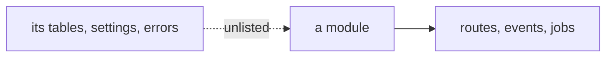
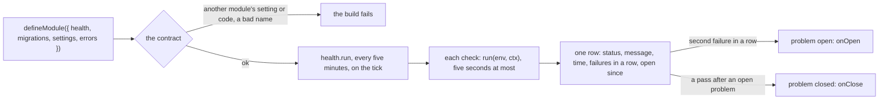

# Phase 3: health and the manifest's last data fields

> **In plain words.** A portal should notice when something is wrong before a person does: a
> table that stopped answering, a mailbox that will not send, a backup that did not land. Until
> now nothing in the kit watched. Now each module writes down, on its own description, the checks
> that say whether its part is healthy, and the Worker's alarm runs all of them every five minutes
> and keeps the last answer for each in one table. A single bad answer is noted and nothing more;
> two in a row open a problem, and the next good answer closes it. That is what a System health
> page will show and what an alert will later be sent from. The same step completes the module's
> description with the three lists it still owed: the database changes it ships, the settings it
> owns and the error codes it uses, each checked so that no module can claim another's.

## What changed, and why

| What | Why |
|---|---|
| **The manifest declares health checks**: `health` on `defineModule` (`@oltrem/core-module`), each an id `<module>.<name>`, a lane, a summary and a `run` that answers `ok`, `warn` or `fail` with a few words | Plan 4.3: a module is one manifest; plan 10: health is read from the modules, never wired by hand |
| **`@oltrem/core-health`**, the runner: `createHealth({ bindings, modules })`, migration `0009`, the table `oltrem_health`, and the `health` module that carries the job `health.run` every five minutes | One table, one writer, no cron of its own: the checks are a job like any other, run by the tick of `@oltrem/core-jobs` |
| **Two-fails-open**: the failures in a row are counted; the second opens the problem and calls `onOpen`; a pass closes it and calls `onClose` | One slow minute must never page anyone; the hooks are where the alerts of phase 4 attach without a change here |
| **A check that throws, does not answer within five seconds, or answers another shape is a failure with the reason** | A check that hangs or crashes is itself a finding, and the tick must finish |
| **The manifest declares `migrations`, `settings` and `errors`**, each checked against the module's id | Plan 4.3 and 18: one file says everything a module owns, so the generator and the references can read it, and a module cannot claim another's setting or code |
| **The client template** mounts the health module beside its modules and runs its job on the tick; migration `0009` synced into its folder and its generated reference | A client gets system health with no code of its own |

## Decisions taken while building

- **The runner is a module.** The job that runs the checks is carried by a built-in `health`
  module the template mounts, so the tick sees it like any other job and the jobs page will list
  it. The health module declares no check of its own and no route yet.
- **Checks run in sequence, one write each.** The table is small and a run is a handful of
  checks; running them in parallel would hide which one is slow. The time each took is kept.
- **A warning does not count as a failure.** `warn` resets the count of failures in a row, so a
  degraded but answering part never opens a problem on its own; it shows amber on the page.
- **An undeclared check's row is kept**, as a removed job's is, so a module switched off and on
  keeps its history.
- **`migrations` is a declared list, not a runtime check of the ledger.** `oltrem doctor` and the
  deploy command already refuse a Worker whose ledger is behind; a check at startup on every cold
  isolate would cost a read for a case two gates cover. It can be added without a manifest change.
- **`settings` and `errors` are matched by shape**, a key and a module, so the contract package
  depends on neither `@oltrem/core-config` nor `@oltrem/core-errors`.
- **Deferred:** the health page, acknowledging and snoozing (phase 5); the alerts (phase 4,
  through `onOpen` and `onClose`); pages, i18n and docs on the manifest (with Astro, after the
  sandbox measurement).

## Impact on each service

None. Nothing is deployed and the first client's platform is not touched. The client template
runs the health job every five minutes with no module declaring a check, so a deployed sandbox
would read an empty table and write one jobs row per tick.

## Before and after

Before this commit nothing watched a module's parts, and a module's migrations, settings and
errors were known only to the code that used them:

Now the checks are declared, run on the tick and recorded, and the manifest lists what the module
owns:

## How it was verified

- `pnpm verify` green locally, its twelve gates, the manifest gate on the health package's test
  Worker too; the health package's four tests pass inside the Workers runtime against migrations
  0008 and 0009; the contract's seven, the jobs package's four and the client template's five
  pass, the template with the health module mounted, the new table and a tick that runs the health
  job.
- The health tests, on a fixed clock: two checks run and their rows written; a problem opened on
  the second failure in a row and not the first, `onOpen` called once, closed on the next pass with
  `onClose`, the count reset by a warning; a check that throws, one that does not answer in time
  and one that answers nonsense recorded as failures with the reason; the rows listed by lane with
  an undeclared one kept; the tick running the checks through the health job beside the
  scheduler; the contract refusing a bad check id, lane or summary, a bad migration name, a
  setting or an error defined for another module.
- The template's migrations folder re-synced with `oltrem migrations sync` and its generated
  reference with `oltrem docs`, both checked by the tool's own tests.
- Not verified: no Worker runs a check, so what a run costs and a check's real timeout are
  unmeasured until the sandbox; no module declares a check yet; no alert leaves `onOpen`.
