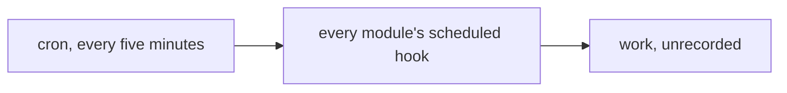
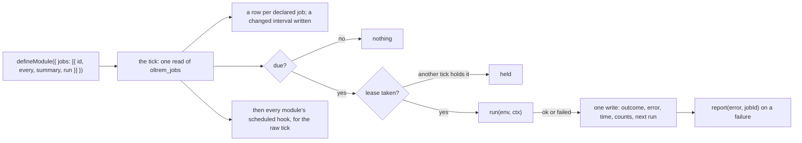

# Phase 3: jobs and the tick

> **In plain words.** Some work happens on a clock rather than on a click: sending a daily
> digest, clearing out old records, checking that a backup landed. Until now a module could only
> ask to be woken on every tick of the Worker's one alarm, and nothing kept track of what it did.
> Now a module lists its timed work on its own description, each item with how often it should
> run. The Worker's one alarm, every five minutes, looks at one table, runs whatever is due, and
> writes down what happened: when it ran, how long it took, whether it worked, and the error if it
> did not. Two copies of the Worker running at once cannot run the same job twice, and a job that
> fails is tried again at its next time, not in a loop. It is the second piece of the module
> system, and the first thing a System health page will have to show.

## What changed, and why

| What | Why |
|---|---|
| **The manifest declares jobs**: `jobs` on `defineModule` (`@oltrem/core-module`), each an id `<module>.<name>`, an interval of a count and a unit (`15m`, `6h`, `1d`), a summary and a `run` function, checked when the module loads | Plan 4.3: a module is one manifest; the plan's `jobs` field, with the fields a consumer exists for today (tiers and budgets come with the jobs page) |
| **`@oltrem/core-jobs`**, the scheduler: `createScheduler({ bindings, modules })` and its `tick`; migration `0008`, the table `oltrem_jobs` | Plan 4.3: "the single cron tick reads the schedule and dispatches"; plan 10: one table, prefixed, owned by the package |
| **The lease**: one conditional write takes a job for ten minutes; another tick finds the lease and leaves the job; a lease that lapses without a write is taken over | Workers run in many isolates and a cron can overlap a slow run; a job must never run twice at once and never stay stuck |
| **The record**: one write per run with the outcome, the error's first 400 characters, the time it took, the counts and the next run | What the jobs page and System health show; a failure is also reported through `report(error, jobId)` |
| **`createWorker({ tick })`** (`@oltrem/core-http`): the tick runs first on every cron, then the modules' `scheduled` hooks | One cron, one entry point; the raw hook stays for the rare module that needs every tick |
| **The client template** builds the scheduler and passes its tick; migration `0008` synced into its folder and its generated reference | A client gets the tick with no code of its own, as plan 4.3 wants |

## Decisions taken while building

- **Run inside the tick, for now.** The plan sends heavy jobs to the queue or a Workflow. No
  module has a heavy job yet, so the first slice runs every job in the cron handler, under the
  lease; the tier and the dispatch come with the first heavy job, and the table needs no change
  for them.
- **The next run is the tick's time plus the interval**, not the previous due time plus the
  interval. A daily job therefore drifts by up to one tick a day, and a job that was stuck runs
  once, not once per missed slot: simpler, and the right behaviour for every job the plan names.
- **A failure waits for its next time.** A job that throws is recorded and reported and runs
  again at `now + every`, so a broken job costs one run per interval and never a tight loop; the
  outbox has its own backoff ladder for the sends themselves.
- **A new job's first run is the first tick after its deploy**, so a module's job needs no seed
  and a fresh client's schedule fills itself.
- **A removed job's row is kept** and shown as undeclared, so its history survives a module being
  switched off and on; nothing deletes schedule rows.
- **Pausing waits for the jobs page.** A column nobody can set is a feature nobody asked for yet.

## Impact on each service

None. Nothing is deployed and the first client's platform is not touched. The client template
runs the tick on its five-minute cron with no module declaring a job yet, so a deployed sandbox
would read the empty table every five minutes and write nothing.

## Before and after

Before this commit a module could only be called on every tick, and the Worker remembered nothing
of what it did:

Now the work is declared, leased, run when due and recorded:

## How it was verified

- `pnpm verify` green locally, its twelve gates, the manifest gate on the jobs package's test
  Worker too; the jobs package's four tests pass inside the Workers runtime against migration
  0008; the contract's seven and the pipeline's twenty-two pass with the jobs field and the tick;
  the client template's five pass with the new table and an empty tick.
- The jobs tests, on a fixed clock moved by hand: a row made for each declared job and both run on
  the first tick, one succeeding and one failing, the outcome, error, counts and next run written
  and the failure reported; nothing due five minutes later and the hourly job due an hour later,
  not the daily one; a lease another tick holds respected and taken over once it lapsed; a changed
  interval written with the next run brought forward; a removed job's row kept as undeclared; a
  bad id, interval, duplicate or blank summary refused by the contract.
- The template's migrations folder re-synced with `oltrem migrations sync` and its generated
  reference with `oltrem docs`, both checked by the tool's own tests.
- Not verified: no Worker ticks, so the lease between two real isolates and what a tick costs are
  unmeasured until the sandbox; no module declares a job yet; pausing and the heavy path are not
  built.
