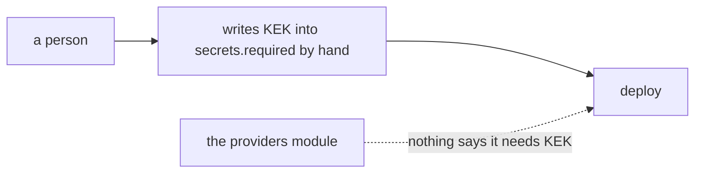
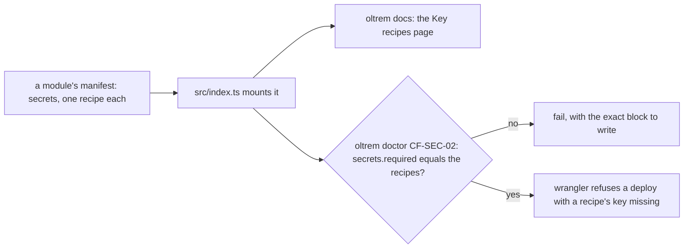

# Phase 4: key recipes

> **In plain words.** A secret the Worker needs now comes with its instructions, written once in
> the module that needs it: what the key is for, the command that makes it, how to see that it
> works, how to change it, and what stops while it is missing. The client's generated reference
> shows these instructions on a page of their own, and the setup check refuses a Worker whose
> list of required secrets does not match them, so a deploy can never go out missing a key the
> code needs. The first recipe is the key that locks every provider password stored in the
> database.

## What changed, and why

| What | Why |
|---|---|
| **`secrets` on the module contract**: one recipe per Worker secret, its name, purpose, how to create it (with `createAt` and `scopes` when an outside service issues it), test, rotate, and live without it; validated when the module is defined | Plan 4.3 and 15.3: key recipes ship with the module that needs them, as data |
| **`KEK_RECIPE` on the providers module**: the key made by one Node command, kept by the vendor, rotated through `POST /api/providers/keys/rewrap` | Plan 8.4: provider credentials are sealed under one Worker secret |
| **The Key recipes page** in `docs/_generated/secrets.md`, from every module `src/index.ts` mounts | Plan 15.5: the reference is generated, never written by hand |
| **The doctor check `CF-SEC-02`**: `secrets.required` names exactly the recipes of the mounted modules | Plan 15.3: wrangler then refuses a deploy with a missing key and names it |

## Decisions taken while building

- **A provider's own key is not a Worker secret.** It is pasted on the portal and stored sealed;
  its recipe is already on the provider's definition. Only what the Worker itself must hold is a
  module recipe, so the Worker's secret count stays at the plan's few.
- **The mounted modules are read from `src/index.ts`.** Its `modules` export is every module the
  Worker mounts, the kit's included, so the check sees the providers module's recipe the day the
  template mounts it. The file must load in Node for this, as module code already must. A file
  with no `modules` export makes the check skip and the page say so.
- **Checked, with the block printed, not rewritten.** `wrangler.jsonc` carries comments the
  kit's JSONC reader does not keep, so the doctor prints the exact `secrets.required` block and
  the manifest's list to write instead of rewriting the file.
- **The key is made with Node, not a new command.** One line of Node's own crypto makes the 32
  random bytes in base64url that the envelope expects; the recipe says to keep the key in the
  vendor's password manager, because Cloudflare never shows a secret back and a rotation needs
  the old one beside the new.
- **No rotation interval as a number.** The recipe says to rotate on the vendor's schedule and at
  once when someone who held the key leaves; an interval is the vendor's call, not the kit's.
- **Not built here.** `CF-SEC-01`, every required secret present on the live Worker, needs a
  signed-in wrangler and a deployed Worker, so it comes with the sandbox; the provider key probes
  (`PROV-01`) run inside the Worker and come with the Setup page and the screens.

## Impact on each service

None. Nothing is deployed and the first client's platform is not touched. The client template
mounts no kit module with a recipe yet, so its check passes with no secret required.

## Before and after

Before this commit, a secret was a name in two lists that nothing tied to the code needing it:

Now the module says what it needs, and the reference and the check follow from it:

## How it was verified

- `pnpm verify` green locally, its twelve gates. The contract's test refuses a bad name, a
  duplicate, a missing field, a plain-http `createAt` and an empty scope. The providers module's
  forty-seven tests, with the manifest carrying `KEK_RECIPE`. The tool's tests, on a copy of the
  client template: the check passing with nothing required, a client module's recipe listed on
  the page, the check failing with the block to write, failing on a required name with no
  recipe, then passing; a Worker file Node cannot load named as the problem; the sample client
  without a `modules` export skipped.
- A key made by the recipe's exact Node command was accepted by the envelope, which sealed and
  opened a value under it.
- Not verified: no Worker was deployed, so wrangler's own refusal of a missing secret is taken
  from Cloudflare's documentation of `secrets.required`, not seen.
