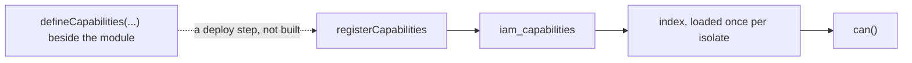
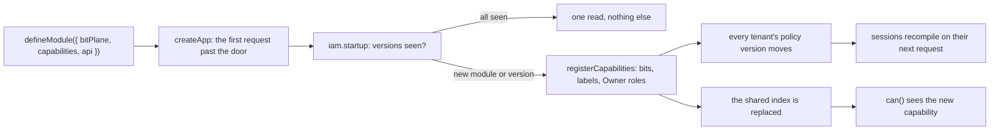

# Phase 3: capabilities on the manifest

> **In plain words.** Every module of the kit has a list of the things it lets people do, each
> with a short name a screen can show. Until now that list lived beside the module and somebody
> had to write it into the permission tables by hand before the module worked. Now the list is
> part of the module's own description, and the Worker reads it the first time it is asked
> anything after a deploy: a new module, or a new version of one, puts its new permissions into
> the tables by itself, gives them to the Owners, and the next request already sees them. Nothing
> is done twice: a version the tables already know costs one small read. It is the first piece of
> the module system, the part of the kit that lets a feature be added by writing one file.

## What changed, and why

| What | Why |
|---|---|
| **The manifest declares capabilities**: `bitPlane` and `capabilities` on `defineModule` (`@oltrem/core-module`), checked when the module loads: the plane a whole number, each id the module's own, declared once, with a class, an English label and a known floor | Plan 4.3: a module is one manifest and nothing else is wired by hand; the shape is checked at build time, never found out at deploy |
| **A route checks only what the module declares**, `<module>.self` apart | Plan 4.3 names it: a test fails the build when a route checks an unknown capability; before, such a route was simply refused to everyone at run time |
| **The pipeline's startup hook**: `createApp({ startup })` runs it once per isolate, on the first request past the door, with the mounted modules; requests that arrive meanwhile wait on the same run; a failure answers that request and runs again on the next | One place for work that happens once per isolate, kept off `/healthz` and off requests without an identity |
| **`createIam(...).startup`**: reads the registry's module versions, registers the capabilities of every mounted module whose version it has not seen, moves each tenant's policy version, replaces the index | Plan 4.3, "upserted into IAM at deploy": the kit deploys by `wrangler deploy` with no step of its own, so the first request after it is the moment; keyed on the version so an unchanged module costs one read |
| **One index source** (`capabilityIndexSource`) shared by the sessions, the governance and the handover, loaded once per isolate and replaced after a registration; a failed read is tried again | Before, each of the three kept its own copy for the life of the isolate, so a new capability stayed unknown to the check until the isolate was recycled |
| **The IAM and users modules declare their own sets** on planes `0` and `1` | The registry fills itself on a new client's first request; the hand-run `registerCapabilities` stays for tests and repairs |
| **A version may carry a pre-release tag** in `defineCapabilities`, as the module contract already allowed | The two rules now feed one another, so they agree |

## Decisions taken while building

- **Register on the first request, not in a deploy step.** A client deploys with the one command
  of plan 10 and nothing runs between the migrations and the first request; a startup hook inside
  the Worker needs no new step, no token and no new place for a failure to hide. Two isolates
  starting together both register: the bits are given from the same rows in the same order, so
  the writes agree, and the upserts are idempotent.
- **Keyed on the module version.** A changed declaration under the same version is not seen, on
  purpose: the version is the contract's word for "something changed", and comparing it is one
  read. The alternative, a stored hash of the declaration, needs a column and a hash on every
  start. A gate that refuses a commit changing a module's capabilities without its version belongs
  with the contract tests of this phase.
- **The policy version moves on a registration.** A new capability joins every Owner role in the
  tables, but an Owner's session carries a compiled map; moving the tenant's version is the
  model's own way of saying "recompile on your next request", so an Owner holds the new module's
  capability without signing in again.
- **The capability types live in the module contract**, and the IAM module re-exports them: the
  contract cannot import a module, and a module's manifest must name them.
- **A module may still declare none.** A client on the own-account rule has no registry; its
  owner holds every capability by name. The cross-check of routes against the declaration runs
  once a module declares any.

## Impact on each service

None. Nothing is deployed and the first client's platform is not touched. The client template
keeps its own-account authorizer and mounts no module yet; wiring `createIam` into it, with the
Vendor's address set by `oltrem setup`, waits on the sandbox.

## Before and after

Before this commit a module's capabilities were a separate declaration that a deploy step still
to be written would have had to register; the check's index was loaded once per isolate and never
replaced:

Now the declaration is on the manifest, the first request past the door registers what the
registry has not seen, and the index the check reads is replaced in place:

## How it was verified

- `pnpm verify` green locally, its twelve gates; the contract's seven tests, the pipeline's
  twenty-two and the IAM module's fifty-seven pass inside the Workers runtime, the users module's
  four with its manifest now declaring its plane.
- The contract test: a manifest with its plane and capabilities, frozen; a plane without
  capabilities and capabilities without a plane refused, a fractional plane, another module's id,
  a duplicate, an unknown class or floor, a blank label; a route checking an undeclared capability
  refused while `<module>.self` passes.
- The pipeline test: the hook does not run for `/healthz` or a request without an identity, runs
  once with the module ids on the first request past the door, answers that request with the
  internal error when it fails and runs again on the next, then never again.
- The IAM test, through three apps on one IAM instance: the registry empty before the first
  request past the door and both modules in it after, with their planes and versions; the first
  Owner holds the new module's capability at once; a declaration grown under the same version
  not seen (the capability absent, a stranger still refused); a bumped version registered, the
  tenant's policy version moved once, the Owner allowed on the new route without a new sign-in;
  an isolate that starts on the registered version changes nothing.
- Not verified: no Worker starts with the hook, so what the registry read costs an isolate's first
  request is unmeasured until the sandbox; a capability changed under an unchanged version is not
  seen, by design, and no gate refuses that commit yet.
