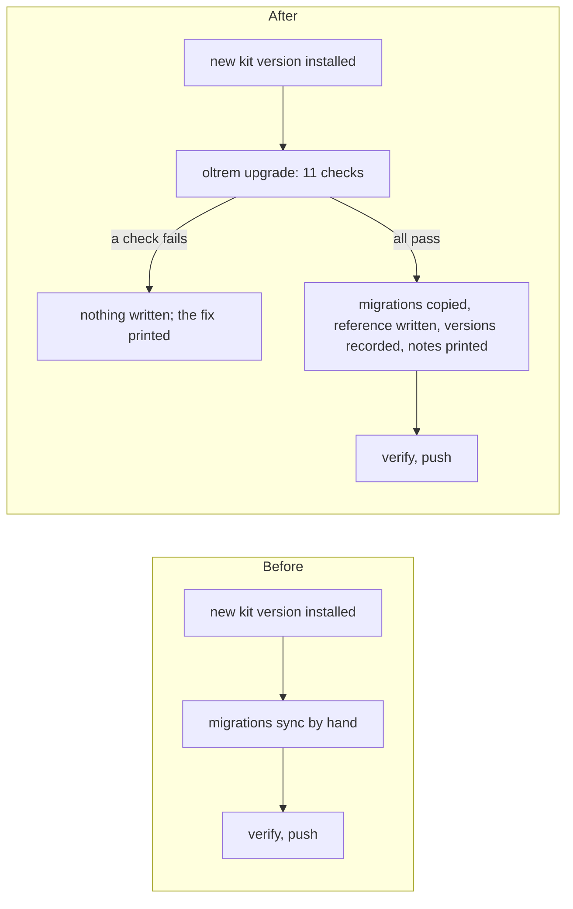

# Phase 6: oltrem upgrade

> **In plain words.** When a client's portal moves to a new kit version, one command now does the
> careful part. It checks everything that could break first, and it changes nothing while a
> check fails. When all pass, it copies the kit's new database changes into the client's
> repository, refreshes the generated reference, and prints what changed in each package since
> the client's last upgrade. Then the usual verify and push deploy it.

## What changed

- **`oltrem upgrade [dir]`** (`packages/cli/src/upgrade.ts`). It runs eleven checks:
  - seven of the doctor's: Node, pnpm, the resource manifest, the workflow, the required
    secrets, the token registry and the instruction files;
  - `UP-KIT-01`, the kit's floor: Node, the installed wrangler, and the `compatibility_date`;
  - `UP-MIG-01`, the kit migrations can be copied;
  - `UP-SEC-01`, every required secret is set on the deployed Worker;
  - `UP-SIZE-01`, the bundle's size against 64 MiB and its startup against 1 s.

  When none fails, it copies the migrations, writes the reference, records the kit versions and
  prints the release notes.
- **The kit's floor** is in `@oltrem/core-http`'s `package.json`: `engines.node`, and the
  `oltrem` field with the lowest wrangler and the earliest compatibility date. A test holds them
  equal to the workspace's Node, the catalog's wrangler and the client template's date.
- **`migrations/kit.json`** may now hold `packages`, the kit versions the last upgrade took.
  `oltrem migrations sync` keeps the field, and its check compares only what it owns.
- **The release notes** come from each installed package's `CHANGELOG.md`, which Changesets
  writes: every section after the recorded version, up to the installed one.

## Decisions

- **The versions live in `kit.json`.** It is already the kit's record in the client's
  repository. Keeping them there needs no new file, and an upgrade's change is visible in one
  place. A patch that Dependabot merges on its own, without an upgrade, is covered by the next
  upgrade's notes, which start from the version recorded last.
- **Measured on the vendor's computer.** `wrangler check startup` runs the Worker locally. Its
  number is a signal, not the figure Cloudflare enforces. The check reports the profile's whole
  window, which is the larger of the two numbers wrangler prints.
- **Secrets on the account are a warning when unknown.** Listing them needs wrangler signed in to
  the client's account and a Worker deployed once. Without that, the upgrade does not block,
  because the deploy itself refuses a missing secret (`secrets.required`).
- **The size limit is research file 11's.** The research found 64 MiB on the limits page, and an
  older 3 MB / 10 MB elsewhere, to re-check. The template's bundle is about 0.6 MiB, so either
  figure leaves room today.

## Not done here

- No upgrade has run in a real client repository between two published versions. That needs
  publishing, which waits on the `oltrem` organisation, and the sandbox.
- Dependabot opening the change in a client repository is set up with the sandbox.

## How it was verified

- The twelve gates pass locally.
- The tool's tests for the command, on a copy of the client template with the kit linked in and a
  stand-in for wrangler:
  - all eleven checks pass;
  - the bundle reads as 586 KiB with its source map left out, and startup as 85 ms;
  - the versions are recorded and the first run shows each package's own notes;
  - a second run has no notes, and `kit.json` keeps the versions through `migrations sync`;
  - a missing secret, a 1.2 s startup and an old `compatibility_date` each fail with their fix,
    and `kit.json` is left byte for byte;
  - the command's exit code is 1 when a check fails.
- The notes parser on a three-version change log: the sections after 0.2.0 up to 0.3.0, none when
  nothing moved, and the installed version's own on a first run.
- The floor test reads `packages/core-http/package.json`, the catalog, the template's
  `wrangler.jsonc` and the root `package.json`.
- `wrangler deploy --dry-run --outfile` and `wrangler check startup --worker` were run on the
  client template by hand: 560.91 KiB, 133.90 KiB gzipped, and an 84.7 ms startup window on this
  computer. The profile's `startTime` and `endTime` give that window.
