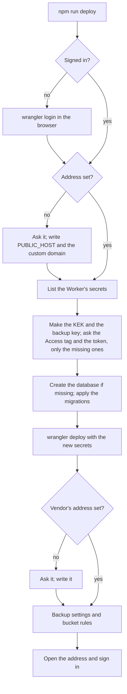

# One command deploy

> **In plain words.** A client's portal now goes onto Cloudflare with one command,
> `npm run deploy`. It opens the browser to sign in to Cloudflare, asks for the portal's web
> address, makes the two keys the portal needs and saves them in one file for the Vendor to put
> in a password manager, walks the person through the two things only a person can make in the
> Cloudflare dashboard (the sign-in door and one access token) and asks them to paste the result,
> then creates the database, deploys, and finishes the setup. Running it again later only does
> what is missing. It has not yet run against a real Cloudflare account: that is the sandbox
> test.

## What changed, and why

| What | Why |
|---|---|
| **`oltrem deploy`** in `@oltrem/cli`: sign-in, the address, the missing secrets, the database and migrations, the deploy, the Vendor's address, the backup's setup, each step looking first | The owner's card: one command, browser sign-in, resources created, Access as one guided step |
| **`npm run deploy`** at the kit's root and `deploy` in the client template run it | The same front door as `npm run dev` |
| **`oltrem-keys.txt`** holds the KEK and the backup key's private half; git ignores it | Cloudflare never shows a secret back, a KEK rotation needs the old key, and no backup opens without the private key; the file is an age identity, so the restore drill reads it |
| **`readVendor`** in the CLI's `vendor.ts`, shared by `vendor set` and `deploy` | The deploy asks for the Vendor's address only while the database has none |
| **`terminal`** on the wrangler runner | Wrangler's sign-in and its choice of account read the keyboard |

## How it works

Before, the same result took `pnpm setup`, four `wrangler secret put` commands each with its own
recipe, `pnpm deploy`, then `oltrem vendor set` and `oltrem backup setup` by hand.

## Decisions taken while building

- **Only the missing secrets go up.** A Worker that answers keeps its KEK; when its secrets
  cannot be listed the command stops rather than risk a new KEK, which would leave every stored
  provider key unreadable.
- **The keys are kept until the Vendor moves them.** A run that stopped before the deploy uses
  the keys it kept, so a second run never makes a second pair.
- **The Access application stays a guided step.** The browser sign-in gives wrangler no Access
  permission, and a token cannot create itself; the command prints the steps and checks the tag
  it is given (64 hexadecimal characters).
- **The secrets travel with the deploy** in a file wrangler reads (`--secrets-file`), written in
  the system's temporary folder and removed right after, never printed.

## How it was verified

- `@oltrem/cli`'s deploy test on Node with a stand-in for wrangler and for the keyboard: the first
  run signed out and empty (sign-in with the keyboard handed over, the address written into the
  template's own `wrangler.jsonc`, the four secrets uploaded and their file removed, the token
  asked without echo, the age public key read by `@oltrem/core-crypto`'s own parser, the database
  made and migrated, the Vendor and the backup settings written); a second run asking nothing and
  sending nothing; kept keys reused; a Worker whose secrets cannot be listed refused; a wrong
  answer stopping before anything is sent; bech32 against the BIP 173 vector.
- The vendor command's tests after `readVendor`.
- `pnpm verify` with its twelve gates.

Not verified: any run against a real Cloudflare account (the sign-in, the custom domain, the
database by name, `--secrets-file`, the account choice), the hidden input on Windows, and the
Access steps as written. All wait on the sandbox account.
