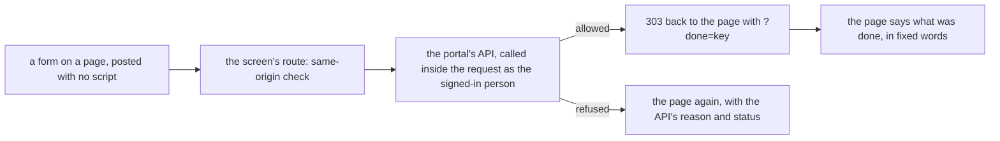

# The screens that change things

> **In plain words.** The portal's screens can now change things, not only show them. An Owner
> can invite someone with a role at a place, withdraw an invitation, give a person a role or end
> one, switch an account off with a reason or back on, make and edit a role by ticking what it
> may do, and add a place such as a site or a team. Every change goes through the same checks as
> the API, so a screen can never do more than the person may. In a second push the same day, an
> email provider is connected from a screen too: where to make its key, the key pasted and
> sealed, checked, a test message sent, and the provider made the one that sends. In a third,
> a Settings page lists every setting with its value and where it comes from, and lets the
> person who may change one save it, such as the address the portal's email comes from. In a
> fourth, a person's exceptions: one thing allowed or denied to one person at one place, with
> three chips per capability (as their roles say, allow, deny).

The owner asked on 2026-10-21 at 15:32 to start the next phases; the thread put the core parts
of version 1 that were still missing first, starting with the screens that change things.

## What changed

| Part | Change |
|---|---|
| `@oltrem/core-ui` | `ChoiceChips`: a choice of one as native radios inside chips in the sideways row, so a role or a place is never picked from a dropdown alone (R-12) |
| `@oltrem/screens` | `src/forms.tsx`: the invitation form and the invitations waiting, the person page (roles held, give a role, the account switch), the role form with its capabilities grouped by module, the place form; `screens.tsx` registers the pages and the form routes; the people and role tables link to their records |
| `@oltrem/screens`, second push | the provider forms: the domain look-up, the page that connects one provider with its key recipe, the page of one connected provider with its actions in a sideways row and its key pasted again; the instance states in plain words (Sends, Standby, Ready) |
| `@oltrem/core-config`, third push | the `settings` module on bit plane 7: `GET /api/settings/values` reads every setting from D1 with its source and whether the caller may change it; `PUT /api/settings/values/:key` checks the schema and `editableBy`, saves through `Config.save` and audits; [its README](../../packages/core-config/README.md) |
| `@oltrem/screens`, third push | the Settings page and chip: every setting grouped by module, a text, number or switch control when the person may change it, the next-deploy badge |
| `@oltrem/screens`, fourth push | the exceptions page of a person (a row of places, three chips per capability that may be given one person at a time) and their exceptions in force on the person page, each with End |
| The client template | mounts the settings module, with the session's standing (Vendor, Owner, or anyone holding `settings.manage`); its screens test runs the whole set of changes as the Owner; `npm run dev` makes a KEK of the computer's own into `.dev.vars` once, so a key pasted on the computer can be sealed |

How a form travels:

## Decisions

- **The API decides, the screen asks.** No rule is repeated in a screen: the grant rules, the
  fresh sign-in, the second person for an Owner, the reason a switch needs. A refusal is shown
  with the API's own words.
- **Fixed words after a change.** The redirect carries a key such as `granted`, never an address
  or a name, so nothing personal sits in the address bar or the browser's history. The only thing
  shown from a write is the invitation link, rendered once and never put in an address.
- **A new role sits below every role there is.** Its order is the lowest one plus ten, so the
  person making it outranks it and can give it; changing the order comes with the role editor's
  later work.
- **A KEK per computer, made once.** A provider's key is sealed under the KEK, which a deployed
  portal holds as a Worker secret. On a computer, `npm run dev` writes a random one into
  `.dev.vars` the first time, which git ignores, and keeps it after that, so the keys sealed with
  it still open on the next run. It never leaves the computer.
- **The test message is honest.** The template's client file sets no sending address, so a test
  message is refused before it reaches the provider and the page says why
  (`from: not an email address`). The Settings page is where the address is set, and the test
  then goes through.
- **Who may change a setting is the setting's.** Each definition names `vendor`, `owner` or
  `admin`; the route reads it against the caller's standing, which IAM knows and the client hands
  in, so `@oltrem/core-config` stays free of the IAM module. A client-file setting is shown, never
  editable: it changes with a deploy.
- **Exceptions write only what changed.** Saving the three chips of a place compares them with the
  exceptions in force there: one back to "as their roles say" is ended, a new one is made, one
  turned round is ended and made again. Each is the API's own override, with its default end.
- **Invitations live with the people.** The waiting ones and the form are on the People page; the
  Access page keeps the company, roles, groups and places.

## Not done here

- Groups, reviews, requests, approvals, the Vendor's access, profiles; an exception's own end
  date and reason from the screen (the API's default end applies).
- A provider's delivery-report address and the client's own provider definitions: still the API.
- A setting whose value is a list or an object: shown, changed through the API; the plan's
  `/api/config/schema` for tools and agents.
- A real provider's answer: the tests stand in for it; the first real key is the owner's test.
- Seen in a browser or on a phone: the owner's test.

## How it was verified

- `npm run verify`: the twelve gates pass.
- The template's screens test, inside the Workers runtime: the Owner makes a role with two
  capabilities and sees them ticked, adds a place, sees an invitation without a role refused with
  422, invites someone who accepts, ends and gives their role again, switches the account off
  (the person then has no account) and on, withdraws a second invitation, and a form posted from
  another site is refused with 403.
- The same test file, second push: the Owner connects Resend with the provider's answers stood
  in for; a missing key is refused with 422, the key is sealed and never shown, checked
  (Worked), a test message refused for want of a sending address, the provider made the one that
  sends, its removal refused with 409 while it sends, taken out of use, its key pasted again, and
  removed. `scripts/template-dev.test.mjs` holds the local KEK to being made once and kept.
- Fourth push: in the template's screens test, the Owner allows `health.read` and denies
  `users.read` to the new person at the company; that person is then refused the People page and
  shown System health; the deny is put back to their roles and the allow ended from the person
  page.
- Third push: the settings module's own test (`packages/core-config/test/module.test.ts`) and,
  in the template's screens test, a malformed sending address refused with 422, a good one saved
  and shown as set by the Owner, and the test message then sent (Worked).
- `@oltrem/core-ui`'s test of `ChoiceChips`: the fieldset and legend, one radio per option, the
  given one chosen, `required` on each.
