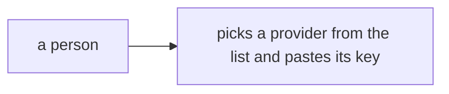
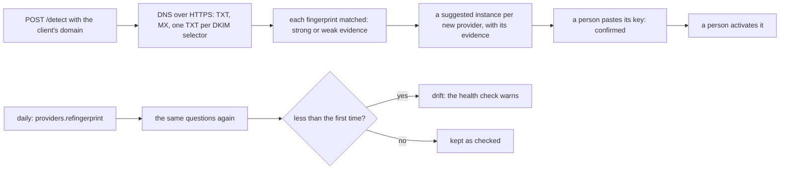

# Phase 4: provider detection

> **In plain words.** A client usually already sends email through someone: their domain's
> public DNS records say who. The portal now reads those records and suggests the providers it
> finds, with the records it found them by, so setting up starts from what the client already
> has. A suggestion never sends anything: a person pastes its key and turns it on. Once a day the
> portal reads the records again, and if a provider's records are gone it says so on the health
> page, before mail starts failing.

## What changed, and why

| What | Why |
|---|---|
| **A DNS-over-HTTPS client** (`createResolver`): Cloudflare's resolver in its JSON form, TXT chunks joined, a CNAME on the way kept | Research 13, 5: a Worker has no DNS of its own; one HTTPS question per name and type |
| **`detect`**: SPF includes, DKIM selectors and where they point, MX hosts and verification records matched against each definition's fingerprint, every match kept as evidence, strong or weak | Plan 8.3: a suggestion carries the evidence a person can check |
| **`POST /detect`**, the thirteenth route: one `suggested` instance per new provider, labelled "(found in DNS)", audited | The setup flow starts from the client's own domain |
| **The job `providers.refingerprint`**, daily, and **the health check `providers.dns`** | Plan 8.3: a provider whose records changed is drift, seen on the health page before sends fail |

## Decisions taken while building

- **A suggestion never sends by itself.** It has no key; activation already refuses a
  suggestion, and pasting a key makes it `confirmed`, still waiting for a person to activate it.
- **Strong and weak evidence.** A record that names the provider (an SPF include of its domain or
  under it, a DKIM CNAME to its domain, its verification record) is strong. A DKIM key at a
  common selector name such as `mail` or `s1` only shows that someone signs there, so it is weak,
  and a provider seen only that way is a weak suggestion.
- **A match is a domain or a name under it**, never a substring: `notmailgun.org` is not Mailgun.
- **One TXT question per DKIM selector**, deduplicated across definitions, so a CNAME and the key
  behind it come back together: at most ten questions per domain with the kit's definitions.
- **The verification code is not stored**: the evidence says a provider's verification record
  exists, not its value.
- **Drift is less than the first time**: `now` keeps what the last check saw (`strong`, `weak` or
  `none`) and `drift` is true when it is below the first detection's confidence; a disabled
  instance does not count toward the warning.
- **Fingerprints stay as the research left them.** Resend's is still empty, and Postmark's and
  SES's DKIM selectors are per account, so only their SPF includes are checked; the sandbox
  domain confirms or corrects them.

## Impact on each service

None. Nothing is deployed and the first client's platform is not touched; no Worker mounts the
module yet.

## Before and after

Before this commit a fingerprint was data nothing read, and `suggested` a status nothing wrote:

Now the domain is read first, and checked again every day:

## How it was verified

- `pnpm verify` green locally, its twelve gates; the providers module's forty-seven tests pass
  inside the Workers runtime, three runs in a row: the matcher against small zones, the resolver
  against a scripted answer, and through the pipeline the route, its audit rows, a suggestion
  refused activation, and the daily job marking drift with the health check warning.
- Not verified: no real DNS was read; Cloudflare's resolver and the fingerprints are confirmed on
  the sandbox domain, and the job has not run on a schedule.
