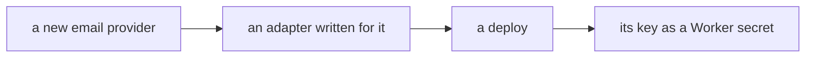
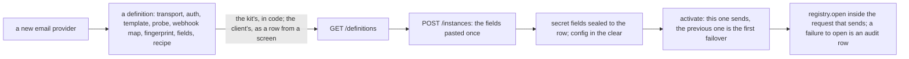

# Phase 4: providers as data

> **In plain words.** The portal sends email, and later uses other outside services, through
> providers: Resend, Brevo, Postmark and the like. Most platforms write a piece of code for each
> one. This kit writes none: a provider is a description, a page of data saying where to send the
> request, how to sign in, how to read the answer, how its delivery reports are signed, what its
> DNS records look like, and the recipe for its key. Seven email providers ship with the kit as
> such descriptions; a client can add its own or change one from a screen, with no deploy. Setting
> a provider up means pasting its key once: the key is sealed to its own row and never shown
> again, the screens see only that it is set, and one instance at a time is the one that sends,
> the others standing in behind it in order.

## What changed, and why

| What | Why |
|---|---|
| **The definition contract** (`defineProvider`, `definitionProblems`): id, kind, transport (HTTP with a send template and a probe, SMTP, S3), auth scheme, capabilities, the fields a person pastes, the key recipe, the webhook field map, the DNS fingerprint | Plan 8.1: what differs between providers is data checked by one schema, so a new provider is a row and never an adapter |
| **Seven email definitions in code**: Resend, Brevo, Postmark, SendGrid, Mailgun, Amazon SES, any SMTP server | Plan 8.2: the two email adapters are code, every provider is a row; these are the rows the sandbox will prove |
| **Instances** per tenant: definition, label, config in the clear, the secret fields sealed to the row, status, failover order, what the probe last saw, what the detection found | Plan 8.1 and 8.3: one active instance, the previous one as failover, a suggestion that never activates alone |
| **Eleven routes** under `/api/providers` on two capabilities, bit plane 2, with the IAM sessions and audit wrapper | The screens of phase 4 call these; a credential goes in and never comes out |
| **Three tables**, migration `0010`: the client's definitions, one data key per tenant, the instances | R-09: each is a different kind of row; the kit's definitions take no table at all |
| **A credential that fails to open is an audit row** (`providers.open`, failed, with the code) | Plan 8.4: audit every failed use; a moved or altered credential is a fact, not a log line |
| **`POST /keys/rewrap`** after the KEK changed | The rotation of the previous record needs a hand on every tenant's data key; this is it |

## Decisions taken while building

- **The kit's definitions live in code, the client's in rows.** Seeding forty rows at startup
  would need a version dance like the capability registry's; a definition in code ships with the
  deploy, and a client's row of the same id replaces it, so a screen can still change one with
  no deploy. Removing the row brings the kit's back.
- **Written from the public references, confirmed on the sandbox.** Every template, probe path,
  webhook map and recipe link comes from the provider's own API documentation, named in `docs`.
  A DNS fingerprint is written only where the research confirmed the pattern (Brevo, SendGrid,
  Mailgun, Postmark, SES); Resend's is left empty rather than guessed. The acceptance of this phase
  sends through two of these rows and will correct what the references got wrong.
- **One template language, decided now, implemented in the next slice.** `{{secret.x}}`,
  `{{config.x}}` and `{{message.x}}` placeholders; a string that is one placeholder takes the
  value as it is (a list, an object); a `$each`/`$as` pair maps a list; a JSON or a form body.
  The definitions are written in it so that the engine has its rows to test against.
- **A webhook a provider does not sign** (Brevo) gets `signature: none`; the URL token the
  webhook routes will carry is then the only guard, and the record of that slice will say so.
- **Secret and plain fields in one list.** The definition marks which fields are secret; the
  registry seals those together and keeps the rest as config, so a person pastes one form and the
  Mailgun domain or the SES region is readable on the screen while the keys are not.
- **The Vendor sets up no instance.** Instances belong to a tenant; the Vendor's session has none,
  and the route refuses rather than guess one.

## Impact on each service

None. Nothing is deployed and the first client's platform is not touched. The module is mounted
in no Worker yet; the client template mounts it when the email module exists to use it.

## Before and after

Before this commit a provider would have been code:

Now it is a row, and its key a sealed value:

## How it was verified

- `pnpm verify` green locally, its twelve gates, the manifest gate on the module's test Worker
  too; the module's eight tests pass inside the Workers runtime through the pipeline beside the
  IAM module: the seven definitions pass the contract and a bad one is refused with its path; an
  instance set up with its credential sealed to its row and the key in no response or table; a
  missing, unknown or empty field refused; activation, the failover order and `pick`; the active
  instance not removable and a suggestion not activatable; a client's definition added, replacing
  the kit's and removed; the audit rows with field names and no value; a credential moved to
  another row refused and recorded; the data keys wrapped again after the KEK changed and opened
  under the new key alone.
- Not verified: nothing speaks to a provider yet, so the templates, probes, webhook maps,
  fingerprints and recipe links stand on the public references until the sandbox sends through
  two of them; the module runs in no Worker.
