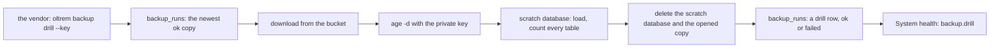

# Phase 5: the restore drill

> **In plain words.** A backup is only worth something if it opens. Once a month the vendor runs
> one command on their own computer: it takes the newest copy, opens it with the private key,
> loads it into a throwaway database, checks that every table and every row arrived, then deletes
> the throwaway database and the opened copy. The result is written down, and System health
> turns red when a drill fails and amber when none has passed for 35 days. The client's own
> database is only read.

## What changed, and why

| What | Why |
|---|---|
| **`oltrem backup drill [dir] --key <file>`** (`@oltrem/cli`) | Plan 9.3: a monthly drill that downloads, decrypts, loads into a scratch database, runs the smoke queries, deletes the scratch database, and is recorded |
| **The `backup.drill` health check** (`@oltrem/backup`) | The drill is done by a person, so the check is the reminder and the alarm |

## Decisions taken while building

- **On the vendor's computer, not in the Worker.** Opening a copy needs the private key, and the
  key never reaches Cloudflare; so the drill is a command, run with the vendor's own wrangler
  sign-in and the free age tool, and no new token.
- **The smoke check is the copy itself.** The command reads the copy's tables and counts the
  rows it inserts into each, then asks the scratch database for the same counts: every row must
  have arrived. It also requires the migrations table and `backup_runs`, so a copy of another
  database never passes. The reader was checked against a real `wrangler d1 export`, with a
  semicolon and quotes inside a value, a line break and a quoted table name.
- **Nothing is left behind.** The scratch database is deleted whatever happens, and one that
  cannot be deleted is named with the command to delete it. The opened copy is the client's
  whole database in plain text, so it lives in a private temporary folder removed at the end.
- **Every drill is recorded**, a failure too, with its reason, as a `drill` row in the same table
  as the exports. A drill that cannot read that table records nothing and says so.
- **Sizes are checked twice.** The download and the opened copy must each be the size the export
  recorded, so a cut-off download is caught before anything is loaded.

## Impact on each service

None. Nothing is deployed and the first client's platform is not touched.

## Before and after

Before, a copy was made every night and nothing proved it could be restored. Now:

## How it was verified

- `pnpm verify` green locally, its twelve gates.
- The drill's eight tests pass on Node, three runs in a row, with wrangler's D1 commands run
  against SQLite databases in memory: a drill that passes, the wrong key, a load that loses a
  row, six other failures each recorded with its reason, a scratch database that cannot be
  deleted, what stops a drill before it starts, and the command's exit codes.
- End to end in the cloud container with the real age tool and wrangler on local databases:
  a local database exported by `wrangler d1 export`, encrypted with `age`, put in a local bucket,
  then drilled by the built command (wrangler's `--remote` swapped for `--local`). It passed and
  recorded its row; with another key it failed with age's own words and recorded that.
- The backup module's eleven tests, the drill check's three states among them.
- Not verified: no drill ran against a real account. Creating and deleting a database by name
  and loading a file with `--remote` are wrangler's documented commands, run on the sandbox.
