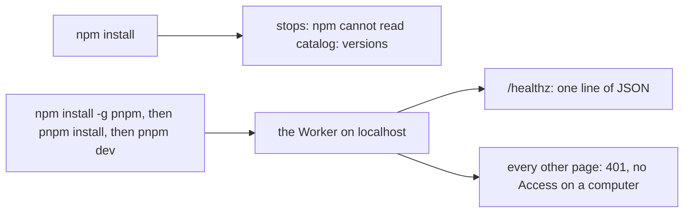
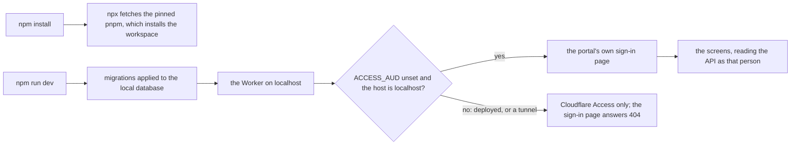

# The screens and two commands

> **In plain words.** Anyone with Node can now try the portal on their own computer with two
> commands, `npm install` and `npm run dev`, then open <http://localhost:8787>. The portal has
> its first screens: a home page with a card per part, and a page each for people, access,
> providers, email, backups, deploys and System health. On the computer there is no Cloudflare
> Access, so the portal shows a sign-in page of its own, which works only on `localhost` and
> disappears once the portal is deployed.

The owner asked for this on 2026-10-21 at 14:29, after a first try where `pnpm dev` showed only
a line of JSON: "simple execution and installation process for anyone who uses this. just like
npm install, npm run dev". It overrides, for the screens and the local setup, the decision of
14:17 to pause building until the sandbox exists.

## What changed

| Part | Change |
|---|---|
| The root `package.json` | no dependencies of its own any more: the tools moved to a private `tools/` package, so `npm install` no longer stops at a `catalog:` version. Its `postinstall` (`scripts/install.mjs`) runs the pinned pnpm when npm started the install, and `dev`, `typecheck` and `build` start pnpm through `scripts/pnpm.mjs`, which uses npm's own `npx` when npm started the run |
| `@oltrem/core-http` | the local door (`localDoor`), the sign-in and sign-out routes, the redirect of a page request with no identity, and `publicRoutes` for what answers before the door |
| `@oltrem/core-module` | an identity may carry `door: 'local'` |
| `@oltrem/iam` | the audience check, in the session hook and in accepting an invitation, is one helper that lets the local door through |
| `@oltrem/core-health` | the routes `GET /api/health/checks` and `/budgets`, checked against the new `health.read` |
| `@oltrem/screens` | new: the frame, the pages, the first-run forms and the committed stylesheet ([its README](../../packages/screens/README.md)) |
| `@oltrem/cli` | `oltrem docs` stands in for `@oltrem/screens` while it loads a Worker file in Node |
| The client template | mounts the screens and the local door; its `dev` script applies the migrations locally and gives the Vendor `vendor@example.com` before it starts |

Before, on a computer:

After:

## Decisions

- **npm in front, pnpm inside.** The owner chose to keep pnpm (the card answered at 06:45). npm is on
  every computer with Node, so npm is the only thing a person types; it fetches the exact pnpm
  version `package.json` pins, so nothing is installed globally. Agents keep using `pnpm`.
- **Two locks on the local door.** It opens only when `ACCESS_AUD` is unset (a required secret
  once deployed) and the request's host is loopback. Either lock alone would be one mistake away
  from an open portal; a tunnel to a computer answers 401, which was checked by hand.
- **Rendered in the Worker, not Astro, for now.** The plan names Astro. Preact rendered by the
  Worker needs no second build, so `npm run dev` shows the screens at once and the deploy stays
  one Worker. The components are plain Preact on `@oltrem/core-ui`, so they move under Astro if
  the sandbox measurement favours it. This is a departure from the plan for the owner to confirm.
- **The pages read through the API.** Each page calls the portal's own routes inside the same
  request, with the caller's identity, so the permission check is never repeated in a screen.
- **The stylesheet is committed.** Compiled by Tailwind into a TypeScript module and served by
  the Worker, so a fresh copy needs no build step; a test keeps it equal to its build.

## Not done here

- Forms beyond the first run: adding people, providers, grants and settings is still the API.
- The plan's page fields on the manifest and Spanish; the gallery page and the screen gates.
- A one-click Cloudflare setup: Cloudflare's Deploy button reads a public repository, and this one
  is private under the Oltrem Licence, so it waits on the owner's decision.
- The CPU cost of a screen on Cloudflare: measured with the sandbox.
- A run on Windows or macOS: the npm path is tested with Windows paths in `scripts/pnpm.test.mjs`
  only.

## How it was verified

- `npm run verify`: 12 gates passed. The template's `test/screens.test.ts` runs the whole first
  run inside the Workers runtime (the Vendor signs in, creates the company, the Owner accepts,
  every page answers with its words), a stranger, and the door's absence behind Access; the
  local door's seven tests in `@oltrem/core-http`; the npm path in `scripts/pnpm.test.mjs`.
- A fresh copy of the repository with no `node_modules`: `npm install` exited 0, installing with
  pnpm 10.28.0; `npm run dev` served the sign-in redirect, the stylesheet and, signed in as the
  Vendor, the company form.
- By hand on `npm run dev`: the full first run in the order the template's README gives, every
  page with its cards and tables, and a quick tunnel to the same server answering 401.
- Not seen on a phone or in a browser by the kit's side: the owner's first look is the test.
