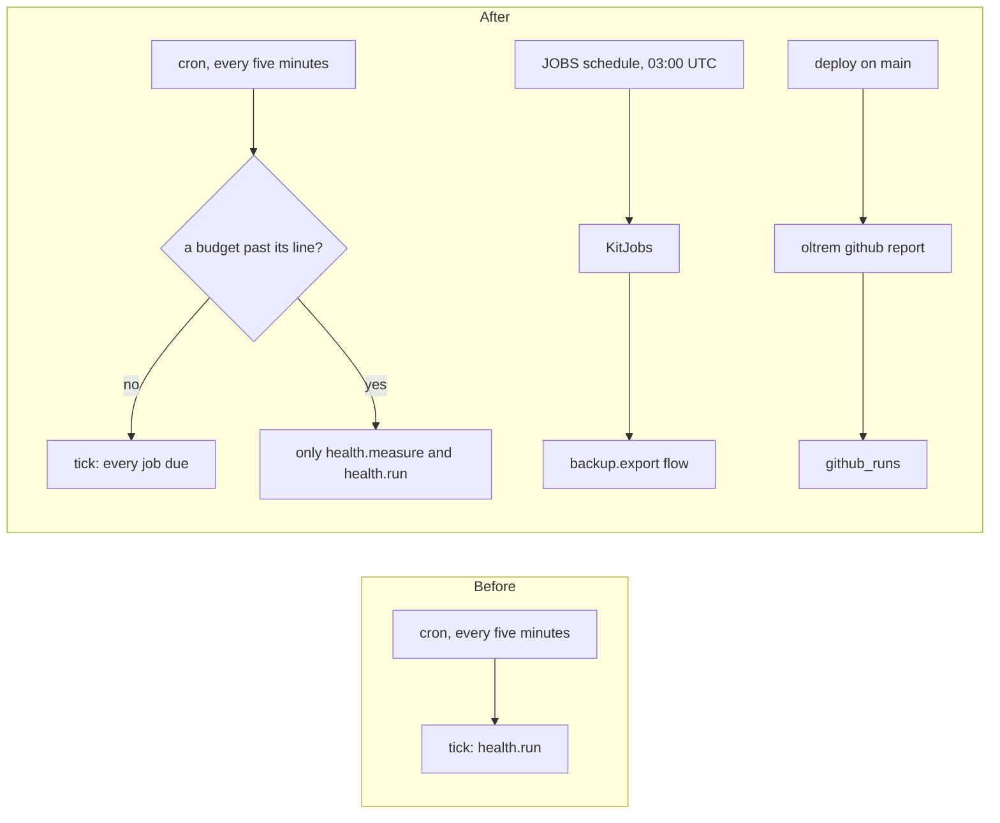

# Phase 5 in the client template: backup, GitHub and the budgets

> **In plain words.** The nightly backup, the deploy report and the free-plan budgets were built
> and tested on their own. Now the client template's Worker runs all three. Every night a
> Workflow starts the backup. Every deploy on main reports itself to the portal. Every fifteen
> minutes System health measures the free plan and holds the other jobs back near a limit. A
> fresh portal says plainly what it still needs: the two backup settings and the two keys.

## What changed

- **`templates/client/src/index.ts`** mounts `@oltrem/backup` and `@oltrem/github` after IAM
  and users. It passes `budgets` to System health, and passes `health.pause` to the scheduler.
- **The settings reader.** It is one `createConfig` per isolate, made on first use, since the
  bindings arrive with the first event. It reads the kit's defaults, the client file's
  `settings` and the live values behind the one KV snapshot. The backup's target and the budgets'
  account both come from `backup.account_id` and `backup.database_id`.
- **The one Workflow.** `KitJobs` extends `WorkflowEntrypoint` and hands every instance to
  `createFlows(...).run`.
  - `wrangler.jsonc` binds it as `JOBS`, with `schedules` set to the mounted flows' own: the
    backup's `0 3 * * *`. No cron trigger is spent on it.
  - The `nodejs_compat` flag is on, because the age format needs it.
- **Two more required Worker secrets**, the backup module's key recipes: `KIT_OPS_TOKEN` and
  `BACKUP_PUBLIC_KEY`. They are in `secrets.required`, the manifest, `src/env.d.ts`, the
  template's token registry and its generated reference.
- **The deploy workflow's last step** is `oltrem github report --outcome ${{ job.status }}`. It
  runs on main whatever happened before, and it may fail without failing the run.
- **Migrations `0012` and `0013`** are copied into the template.
- **`@oltrem/cli`: a stand-in for `cloudflare:workers`.** `oltrem docs` and the doctor import the
  Worker file in Node, and the Workflow class extends a runtime class at module scope. The child
  process that reads the manifests now resolves `cloudflare:workers` to four empty classes. They
  are never run there.

## Decisions

- **The Workflow's schedules are tested, not generated.** A flow whose schedule the binding does
  not name would never run, and nothing would say so. The template's test reads the binding's
  schedules with wrangler's own reader and holds them equal to `flows.schedules`. A client that
  mounts a flow on a new schedule gets a red verify until the binding names it.
- **A stand-in, not a second entry file.** Keeping the Workflow class out of `src/index.ts`
  would have split the Worker in two files. A stand-in in the one process that reads the
  manifests keeps one Worker file, and any client class built on the runtime loads the same way.
- **The budgets read the backup's account setting.** There is one account per client, so one
  setting serves both, with no new variable (R-09).

## Not done here

- The two settings' writer and the bucket lock with its lifecycle rule. They come with
  `oltrem setup`. Until then a backup by hand answers `KIT-E-1601`, naming what is missing.
- Providers and email in the template, with the key-encryption key. That is the next change.
- Not checked against a real account:
  - whether the deploy token needs a permission beyond Workers Scripts Edit to create the
    Workflow;
  - how a portal's first deploy gets its required secrets.

  The sandbox's first deploy is that run.

## How it was verified

- The twelve gates pass locally.
- The template's seven tests, inside the Workers runtime:
  - the health route lists `iam`, `users`, `backup`, `github` and `health`;
  - the Vendor's backup by hand gets 503 `KIT-E-1601`, naming both settings and both secrets;
  - the GitHub status says no run is known;
  - the binding's schedules equal the flows' own;
  - an instance started on the real `JOBS` binding runs `KitJobs` and completes with nothing run;
  - the backup and GitHub tables exist;
  - one cron tick runs `health.measure` and `health.run`. They record the four checks (backup
    freshness, the drill, the deploy, the budgets), each warning with what is missing. The
    database's size is measured from D1 itself.
- `@oltrem/cli`: 86 tests. The Key recipes test copies the template, so it now loads a Worker
  file that imports `cloudflare:workers`, and it lists the three secrets.
- `oltrem doctor` in the template: every check passes, CF-SEC-02 with `ACCESS_AUD`,
  `BACKUP_PUBLIC_KEY` and `KIT_OPS_TOKEN`.
- Cloudflare's documentation was read on 2026-10-21 for the `schedules` field of a Workflow
  binding. The pinned wrangler's schema has it.
- Not verified here: a scheduled instance, a real export and a real deploy report.
