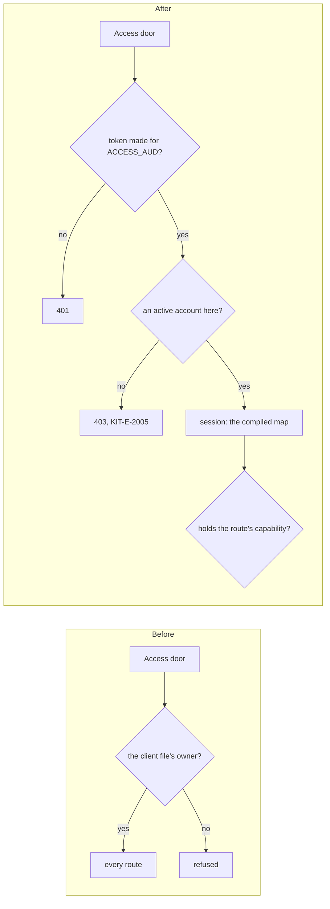

# Phase 2 in the client template: who may sign in

> **In plain words.** Until today, the client template let in exactly one person: the owner
> named in the client file. The permission system built in phase 2 ran only in its own tests. Now
> the template's Worker runs it. The Vendor gets in first, the people the company invites follow,
> and anyone else is refused, even when Cloudflare's sign-in door let them through. A sign-in
> made for another client's door is refused too.

## What changed

- **`templates/client/src/index.ts`** mounts the IAM and users modules before the client's own:
  the session hook and the authorizer of `@oltrem/iam` replace the owner-only check, and its
  startup hook registers every mounted module's capabilities when the Worker starts.
- **`ACCESS_AUD`**, the tag of the client's Access application, is the Worker's first required
  secret (plan 9.2 lists it). The IAM module declares its key recipe (`ACCESS_AUD_RECIPE`), so
  `oltrem doctor` (CF-SEC-02), the generated Key recipes page and the token registry agree on it.
- **`@oltrem/iam`**: the audience may be given as a function of the env, read on each request.
  A Worker file must load in Node for `oltrem docs` and the doctor, so it cannot read a secret at
  module scope. An empty tag matches no token, so a Worker without the secret refuses everyone.
- **Migrations `0004` to `0007`** are copied into the template; `oltrem.manifest.json`,
  `wrangler.jsonc` (`secrets.required`), `src/env.d.ts`, the template's token registry and its
  generated reference name the secret.

## Decisions

- **The owner is invited, not built in.** The client file's owner is the address the Vendor
  invites as the first Owner (plan 7.4). Until that invitation is accepted, only the Vendor gets
  in.
- **No local way around the door.** Own-account mode (plan 15.4) is a fallback for a portal whose
  Access door is not set up, with a sign-in link by email. It needs the email screens and stays
  owed; `ownerOnly` in `@oltrem/core-http` is kept for it.

## Not done here

- `oltrem setup` does not yet write the Vendor's address into the Vendor's row. Until it does,
  the first deploy has no one who can sign in.
- The template does not mount providers, email, backup or GitHub yet, nor pass the budgets. They
  come in the next changes, with the `JOBS` Workflow, the key-encryption key and the ops token.

## How it was verified

- The twelve gates pass locally.
- The template's five tests inside the Workers runtime: the health route lists `iam`, `users`
  and `health`; no identity gets 401; a token for another application gets 401 with "the token is
  for another application", even the Vendor's; a stranger and the client file's owner, with no
  account, get 403 `KIT-E-2005`; the Vendor gets its session at `/api/iam/me` and the directory
  at `/api/users/people`.
- `@oltrem/iam`: 58 tests, one new: the audience read from the env, refused for another
  application, and everyone refused with an empty one.
- `oltrem doctor` in the template: all nine checks pass, CF-SEC-02 with `ACCESS_AUD`.
- Not verified here: a sign-in through a real Access door. The sandbox is that run.
