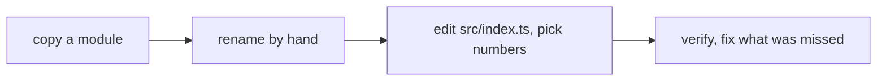
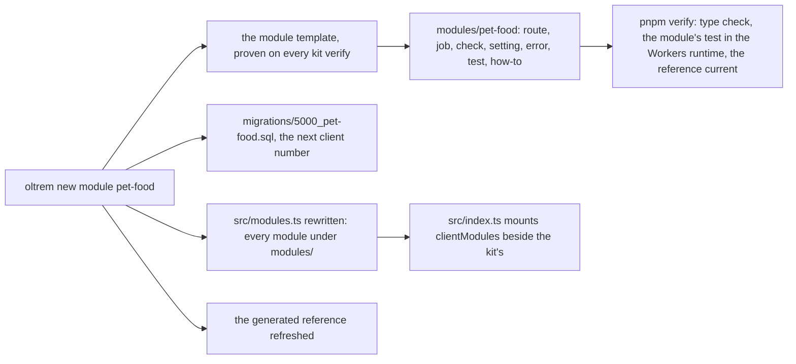

# Phase 3: the module generator

> **In plain words.** A client's own features, a booking list, a loyalty programme, a device
> fleet, are modules in the client's repository. Until now the only way to start one was to copy
> another by hand and rename everything, which is where mistakes come from. Now one command,
> `oltrem new module pet-food`, writes a complete, working module with the name in every place it
> goes: a web route, a daily job, a health check, a database migration, a setting, an error code,
> a test and a how-to. The client's own numbers are taken care of: the migration gets the next
> free one and the error codes the next free hundred. The module is listed where the Worker finds
> it, the reference pages are refreshed, and the repository's checks pass without a single edit.
> The kit proves this on itself: the sample the generator copies is real code the kit type-checks
> and tests on every verify, and a test shows the generator reproduces it exactly.

## What changed, and why

| What | Why |
|---|---|
| **`templates/module`**, the module template: the `sample-notes` module as real code, with its migration, its test inside the Workers runtime and its how-to, type-checked and tested on every verify | Plan 18: `oltrem new module` must produce a module that deploys with no edits; the one way to prove the output is to make the output the code the kit already proves |
| **`oltrem new module <name> [dir]`** (`@oltrem/cli`): copies the template with the name written in as an id, a table prefix and a title; the migration at the next client number (5000 and up), the error codes in the next free hundred; `src/modules.ts` rewritten; the reference refreshed | Plan 4.3: client features are modules made this way and nothing else about them is special |
| **`src/modules.ts`** in the client template, written by the generator and never by hand; the Worker mounts `clientModules` beside the kit's modules; `modules/**` type-checked and tested by the client's own verify | A new module is found by the Worker without an edit of `src/index.ts`, and the file that lists them has one writer |
| **The sample's contract test**, copied with the module: the manifest declares one of each part, the route adds a note once and refuses a taken title, a blank one and a stranger, the job removes the old notes, the check answers | Plan 15.6: a contract test per module; a module that loses a part, or a part that stops doing what it says, fails the client's build |
| **Setting keys accept a dashed module segment** (`pet-food.keep_days`) | A module id may carry dashes (`hotel-content`, plan 4.4) and its settings must start with it |
| **Two rows on the generated repository map**: `modules/` and `src/modules.ts` | The map shows the files that exist |

## Decisions taken while building

- **The template is a workspace package, not a string in the generator.** It is type-checked
  against the Workers types, its test runs inside the Workers runtime, the manifest gate covers
  its test Worker, and the generator's own test holds the two together: generating `sample-notes`
  reproduces the template byte for byte. A change to the template is a change to what every
  future module starts from, and it is proven before it is committed.
- **Three forms of the name, nothing else substituted.** The id (`sample-notes`), the table
  prefix (`sample_notes`) and the title (`Sample notes`) are the only tokens, plus the migration
  number and the error hundred. The template's identifiers (`manifest`, `ERRORS`, `KEEP_DAYS`)
  carry no module name, so the generator never has to invent an identifier.
- **A client's own modules are always on.** `oltrem.config.ts`'s `modules` list is for the kit's
  modules a client switches on; a module under `modules/` exists because the client wanted it, and
  removing it is removing the folder. `src/modules.ts` is rewritten from the folder each time.
- **Error codes by the hundred.** Each client module owns a hundred codes from 5000 up, the next
  module the following hundred, read from the modules already in the repository; the kit's codes
  sit below. The error registry still refuses a reused code at load, so a hand-written collision
  fails the build.
- **No page yet, no capabilities yet, the setting read as its default.** The renderer waits on the
  sandbox measurement (the owner's call); in own-account mode the owner holds every capability by
  name, and the live settings reach a module once the Worker hands them over (plan 5). The how-to
  says so, and the module gains each when the kit does.
- **The kit's module ids are reserved** (plan 4.4), so a client module can never shadow one.

## Impact on each service

None. Nothing is deployed and the first client's platform is not touched. The client template
mounts an empty list of its own modules; a client that runs the command gets a module its next
push deploys.

## Before and after

Before this commit a client's feature started as a copy of another module, renamed by hand, with
the Worker's module list and the migration numbers edited by hand too:

Now one command writes the module from proven code and the repository's checks pass unchanged:

## How it was verified

- `pnpm verify` green locally, its twelve gates, the manifest gate on the module template's test
  Worker too; the module template's three tests pass inside the Workers runtime against its own
  migration, through the pipeline in own-account mode; the generator's five tests and the template
  check pass on Node; the client template's five pass with `clientModules` mounted; the settings
  registry's test accepts a dashed module segment.
- The generator's tests: `pet-food` written with its name in every form and no trace of the
  sample's, its migration at 5000, its code at `KIT-E-5001`, listed in `src/modules.ts`, the
  reference refreshed; a second module at 5001 and `KIT-E-5101`, both listed in name order; a bad
  or reserved name, an existing module and a directory that is not a client repository refused;
  two runs byte-identical and `sample-notes` reproducing `templates/module` byte for byte; the
  command line's output, exit codes and `--json`.
- The client template's `src/modules.ts` is held to what the generator writes for no module, and
  its generated reference was re-rendered with `oltrem docs`.
- Not verified: no client repository has run the command against a real deploy, so "deploys with
  no edits" is proven by the template's own verify and the generator's byte-for-byte test, not by
  a deploy; a module's page, capabilities and live setting are not built.
