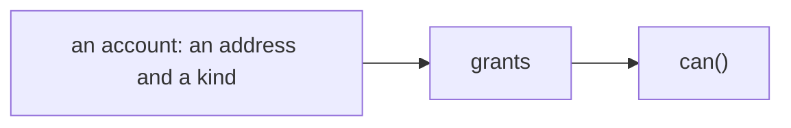
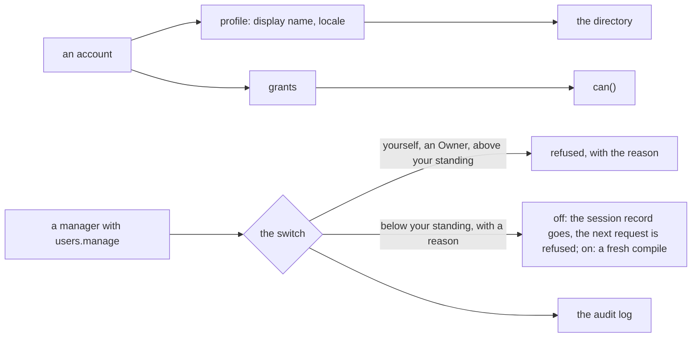

# Phase 2: the users module

> **In plain words.** The permission model knows people only as accounts with grants. This step
> adds the part of an account that is the person's own: a display name and a language, shown in a
> directory anyone with the right permission can search. It also adds the switch: a manager can
> switch a colleague's account off when they leave and back on when they return, with a reason
> that goes in the record. The rules protect against misuse: nobody switches off themselves, nobody
> switches off an Owner (an Owner leaves only when a second Owner agrees), and nobody switches off
> a person they could not have given their grants to. It is the kit's second module, and it shows
> how a module stands on the permission model instead of rebuilding it.

## What changed, and why

| What | Why |
|---|---|
| **`@oltrem/users`**, the second module: `createUsers({ bindings, sessions })` returns the `people` functions and the manifest of seven routes under `/api/users` | Plan 4.4 names `users` as a core module beside `iam`: the people's side of the same accounts |
| **The profile**: migration `0007`, the table `users_profiles` (display name, locale) | What a directory shows instead of a bare address, and how the person reads the portal; the account row itself stays the IAM module's |
| **The directory**: every account of the company but the Vendor, with its profile, searchable by address or name, filtered by kind and state, paged | What the people screen lists; the grants a person holds stay on the IAM side (`GET /api/iam/people/:id`) |
| **The switch**: `deactivate` and `reactivate`, under the standing rules, audited with a reason | A person who leaves must lose access on their next request; the rules keep the switch from becoming a way around the grant rules |
| **Two capabilities on bit plane `1`**: `users.read`, `users.manage` (fresh sign-in); `users.self` for one's own profile | The directory and the switch are different trusts; `users.manage` joins every Owner role at deploy, as every non-Vendor capability does |
| **`<module>.self` generalised** in the IAM authorizer (`SELF_SUFFIX`) | Every module has routes about one's own things; one rule, read the same way for each |
| **The IAM module exports its audit wrapper** (`recorded`, `sessionActor`) | A module's writes are recorded the same way as the governance's, refusals included |
| **The lint's boundary rule lets a module import the IAM module**, and no other module | Plan 4.4 makes `iam` core and always on: the permission model is what every module stands on; two modules importing each other stays refused |
| **Two error codes**, `KIT-E-2101` nothing to change and `KIT-E-2102` an Owner is not switched off; the rest reuse the IAM codes | Every refusal names its reason and its remedy (plan 4.4) |

## Decisions taken while building

- **Invitations and group membership stay in `iam`.** The plan lists them under `users`, but they
  are grants, decided by standing, approvals and the grant rules; the users module calls the same
  routes rather than owning a second copy of those rules.
- **The standing rule of the switch.** To switch a person off or on, the actor's standing at each
  scope must be above every allow grant that reaches the person there, direct or through a group;
  the Vendor stands above everyone. So a manager at one location switches off its clerks and not a
  clerk who also holds a grant at the root, and nobody switches off an Owner: that grant ends only
  with a second person, as the governance says, and the account follows.
- **The switch keeps everything.** Grants, groups, requests and history stay; only `is_active`
  changes and the session record goes, so the next request is refused and a return needs no
  re-granting.
- **Profiles are a table of this module, not columns on the IAM principal.** Each module owns its
  migrations (plan 4.3 and 10); the account row is the IAM module's, the profile is the users
  module's, joined by the principal's id.
- **Deferred:** service accounts (the door's service tokens carry no email, so the identity reader
  and the session key need a second shape, best tried on the sandbox); the sync of the door's
  groups (needs the Cloudflare API through the providers module of phase 4); the phone screens.

## Impact on each service

None. Nothing is deployed and the first client's platform is not touched. The module runs in its
tests only; the client template keeps its own-account authorizer until the module system of
phase 3 wires modules in.

## Before and after

Before this commit a person was an account and its grants; a leaver's access ended only when
every grant was ended, and nothing said who they were:

Now the account has a profile the directory shows, and one switch, under the standing rules, ends
or restores its access as a whole:

## How it was verified

- `pnpm verify` green locally, its twelve gates, the manifest gate on the users module's test
  Worker too; the users module's four tests pass inside the Workers runtime against migrations
  0003 to 0007, through the pipeline beside the IAM module, whose fifty-five still pass.
- The lint's boundary rule was shown to allow the users module's import of `@oltrem/iam` and, with
  a throwaway module, to refuse an import of any other module.
- The four tests: the manifest's seven routes and two capabilities on plane 1; the directory
  listing every account but the Vendor with its filters, a page of zero refused, one person read
  and an unknown one or the Vendor not found, a person without `users.read` refused; a profile
  edited by oneself (trimmed) and read back, a bad locale and an empty change refused, another's
  profile refused to a clerk and edited by the Owner, found by name, with the audit row; the switch
  refused to a clerk, done by a manager over a clerk at her location and refused over a group
  grant at the root, refused for oneself and for an Owner, needing a reason, done once and
  nothing to change the second time, an unknown person not found, the sessions following each
  switch, the Vendor standing above a manager, and the audit rows with their actors, reasons and
  refusals.
- Not verified: no Worker serves the module; service accounts and the group sync are not built;
  the invitations (IAM) and the directory (users) are not yet one screen.
