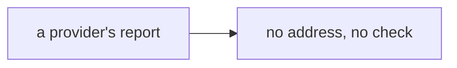
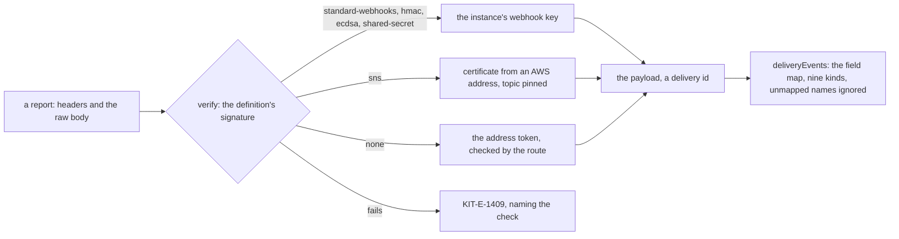

# Phase 4: the webhook verifiers

> **In plain words.** After an email leaves, its provider reports back: delivered, bounced, marked
> as spam. Anyone could send the portal a fake report, so each one is checked against the
> provider's own signature before the portal believes it. Five kinds of signature cover the six
> providers that sign; Brevo signs nothing, so a secret token in its address will be its only
> guard. A report that passes is turned into one of nine plain events the portal understands,
> whatever the provider called it. The address the reports arrive at is a question for the
> owner, asked on a card; the checks are built either way.

## What changed, and why

| What | Why |
|---|---|
| **`createWebhookVerifier`**: Standard Webhooks (Resend), HMAC of timestamp and token (Mailgun), ECDSA over timestamp and body (SendGrid), SNS RSA with the certificate fetched from AWS and the topic pinned (Amazon SES), the basic auth password (Postmark), and `none` (Brevo) | Plan 8.1: five verifiers cover every kit provider, chosen by the definition, never by the provider's name |
| **`deliveryEvents`**: the definition's field map read with the JSONPath subset into the nine kinds, a batch read as a list, an SNS envelope opened, an unmapped name counted as ignored | Research 13, 1.4: one event shape for the email module, whatever the provider sends |
| **A key field per scheme** (`WEBHOOK_FIELDS`), checked by the contract, and **optional fields** | A definition cannot name a signature it has no key for; the webhook keys are optional so a provider sends before its reports are set up |
| **Webhook fields on four definitions**: Resend's signing secret, Postmark's webhook password, SendGrid's verification key, the SES topic ARN; Mailgun's signing key made optional | The verifiers need them; written from each provider's webhook documentation |
| **`KIT-E-1409`**, a report refused, naming the check | A refusal says which check failed and never echoes a key |

## Decisions taken while building

- **The SNS topic is pinned.** Any AWS account can create a topic and subscribe the portal's
  address, and its messages carry valid AWS signatures; only the instance's own topic is
  accepted, and without one set nothing is.
- **The SNS certificate comes only from an `sns.<region>.amazonaws.com` address over HTTPS**,
  checked before any fetch, and is cached for the isolate per address and hash. The certificate's
  public key is read with a forty-line DER reader, since WebCrypto imports keys, not certificates.
- **Five minutes for every signed timestamp**, as the providers document; a delivery id is
  returned so the email module drops a repeat inside that window.
- **Every comparison is WebCrypto's** (`verify` for HMAC, ECDSA and RSA, `timingSafeEqual` for the
  password), never `===`.
- **An event name is looked up among the map's own keys**, so a report naming `constructor` is
  ignored rather than read from the object's prototype.
- **Fixtures signed outside the kit.** The tests use the Standard Webhooks published vector, an
  HMAC made in Python, and signatures made with openssl against a throwaway key and certificate
  whose private keys were not kept, so the code is not its own oracle.
- **The address waits on the owner.** Providers cannot sign in, so reports need one path that
  skips the Cloudflare sign-in door; that is asked on a card, and the route comes with the email
  module.

## Impact on each service

None. Nothing is deployed and the first client's platform is not touched; no Worker mounts the
module yet.

## Before and after

Before this commit a definition named its signature scheme, and nothing checked it:

Now a report is checked by its definition's scheme, then read into the kit's events:

## How it was verified

- `pnpm verify` green locally, its twelve gates; the providers module's forty-two tests pass
  inside the Workers runtime, three runs in a row. Each scheme passes its fixture and refuses a
  changed body, an old timestamp, another key, and a missing key field; SNS also refuses another
  topic and a certificate address that is not AWS's, without fetching it; each provider's report
  becomes the expected events.
- Not verified: no real provider has posted a report. The header names, field paths and the
  five-minute window stand on the public references; the SNS certificate is a stand-in, so AWS's
  own certificate is not exercised; the acceptance on the sandbox posts real reports.
