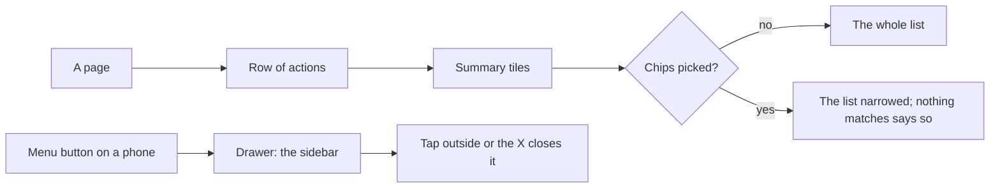
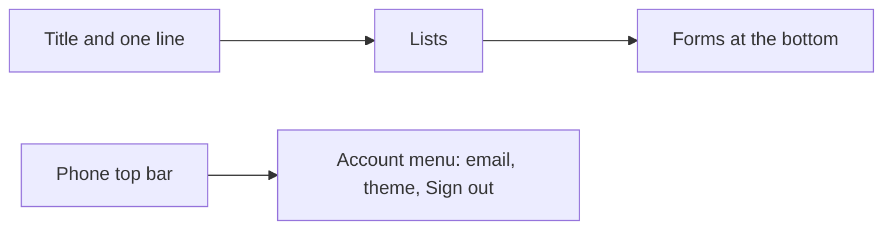

# Every page reworked, and the sidebar on a phone

> **In plain words.** On a phone, the portal now has the same sidebar as on a computer: a Menu
> button at the top slides it in from the left, and a tap outside closes it. The sideways row of
> sections stays under the top bar. Every page was reworked: it opens with a row of the things
> you can do there, then a row of small tiles that count what matters (people switched on,
> messages that failed, checks that need a look), then its lists and forms, each form in its own
> panel. People and Email can be narrowed with a row of chips (switched on or off; sent, waiting
> or failed). An empty list says so in a dashed box instead of a blank space. Nothing new is read
> from the database: the tiles count what the page already loads.

## What changed, and why

| What | Why |
|---|---|
| A Menu button on a phone opens the sidebar as a drawer from the left: the sections in their groups, who is signed in, the theme switch, Sign out | The owner asked for the sidebar on a phone too; the account menu it replaces held only the account |
| The sideways row of sections stays under the top bar | Every option stays visible in a row on a phone (R-12) |
| A row of actions at the top of People, a person, Access, Providers and the audit log, each a link to the form on the page | The forms were at the bottom of long pages |
| Summary tiles on People, Access, Providers, Email, Backups, Deploys, System health and Alerts | The pages were lists with no overview |
| People narrowed to switched on or off (`?show=`), Email to sent, waiting or failed (`?state=`), from a row of chips | Finding the accounts switched off or the messages that failed meant reading the whole list |
| Forms in panels, sections with a line of what they hold, notices with an icon and a coloured edge | Forms and lists ran together |
| Deploys says when a newer kit exists and how to install it; Alerts says who is emailed and links to Settings; Backups says how a copy is kept | The pages showed numbers without what to do with them |
| A person's page opens with their name, email, kind and since when, and whether the account is on | The page started with a table |
| Tables have a card edge on a computer and a shadow per card on a phone; buttons and chips have a surface and a border | Light pages had too little contrast between the page and its contents |
| Removed: the phone's account menu (`details`), the links paragraph on a person's page, an export no other file used | Clean-up after the rework |

## How it works

Before, a page had its title, one line, then its lists and forms one after the other; on a phone
the top bar held the mark and an account menu with the email, the theme and Sign out.

## How it was verified

The client template's screen test (the drawer and the button that opens it on every signed-in
page; the four groups and the role; the People tiles and the switched-off filter marked as chosen
with its empty sentence; the Email filter of failed messages with its own; the Alerts words); the
core-ui tests (31) and the screens' stylesheet test; headless screenshots of People and Access at
1280 px, People, Email and the open drawer at 390 px, light and dark; the twelve gates pass. Not
verified: the look on the owner's phone and computer, and a real deploy.

## Later the same day: the sidebar only, and a smaller account area

The owner chose "Sidebar only" (03:34): with the sidebar on a phone, the row of sections under
the top bar is not needed. The row is gone; the phone's top bar holds the Menu button and the
portal's mark, and the avatar button that opened the same drawer is gone with it. R-12 now says
that a page's options sit in a sideways row and the portal's sections in its sidebar (`rules.md`,
`ai.md`). The account area at the foot of the sidebar was a large block (a big avatar, a bordered
box of three labelled theme buttons, a full-width Sign out row); it is now two lines: the avatar,
the email and role with Sign out as an icon beside them, then "Theme" with three icons. Verified
by the template's screen test (two section lists only, the sidebar's and the drawer's; the chosen
theme still marked as pressed) and screenshots of People at 1280 px and the drawer at 390 px.
