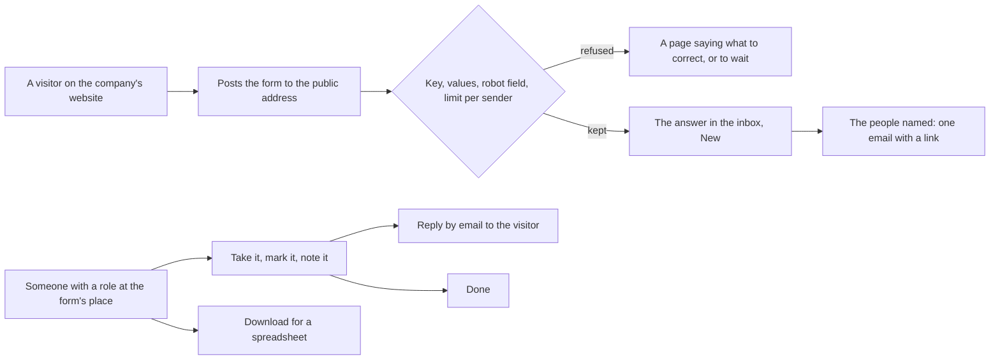
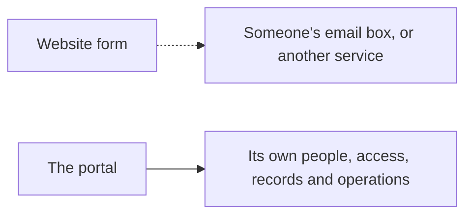

# Forms and inbox

> **In plain words.** A company can now put forms on its own website, made in the portal with no
> code: contact, quote requests, feedback, sign-ups, or anything else. What visitors send lands in
> the portal's inbox, where the people at the right place take it, mark it open or done, keep
> notes on it and answer it by email. Whoever the form names gets an email when something
> arrives. A page in the portal shows the form exactly as the website will, so it can be tried at
> once. Nothing in it is about one kind of business: it was the second choice on the owner's card
> of features any business can use (2026-10-22), built after
> [your own records](2026-10-22-your-own-records.md).

## What changed, and why

| What | Why |
|---|---|
| **`@oltrem/forms`**, a new module: forms, their answers and the answers' notes in three tables (migration `0018`), fifteen routes, four capabilities on bit plane `11`, error codes `KIT-E-2301` to `2305` ([its README](../../modules/forms/README.md)) | Most businesses take requests through their website; a portal that receives them is the quickest thing to show a client |
| One public address per form, `/hooks/forms/<key>`, answering before the sign-in | A visitor has no account; the kit's hooks are already the one path the door lets through |
| The address checks the key, every value, a hidden field robots fill, and five answers per sender in ten minutes and 500 a day per form; the sender's network address is kept only as a one-way digest | A public address is found by robots; this slows a flood without a new service, key or setting |
| A form sits at a place of the company, like a list of records | The permission model already decides who sees what by place; a North form's answers are North's |
| Take, mark, note and reply; a reply goes by email to the sender, through the email module, with the person replying as the address an answer comes back to | "Assign, answer and track" was the card's promise; the email module already sends |
| The people a form names are told by email: a link, never the answer, at most one email per form in 15 minutes | An inbox nobody opens is not seen; one email per quarter-hour cannot flood the provider's daily allowance |
| Every change people make audited with ids only; an arriving answer not audited | The audit log is read by more people than an answer may be; no person made the arrival |
| The screens: a **Forms** section in the **Work** group; the forms; a new form from contact us, quote request, feedback, sign-up or blank; the inbox with rows of statuses and "Taken by me"; one answer; the designer with the code for a website; a page to try the form | Every option sits in a sideways row (R-12); removing anything asks first in the one dialog system |
| The hook reads the posted body as bytes, then decodes it; the deploy's door step names forms | The runtime warned on a form encoding read as text; the door step is now needed for a form, not only for delivery reports |
| The client template mounts it after records, with a plain `forms.message` email template; `0018_forms.sql` is copied into its migrations | A new portal has it from its first deploy |

## How it works

Before, a business's website requests went to an email box or a third-party form service, out of
the portal and out of its permissions.

## How it was verified

The forms module's seven tests inside the Workers runtime (the manifest; a form made with field
ids from names, refusals for a taken name, a one-choice field, a wrong address to tell and a page
after sending that is not a web address; forms seen only by place; the public address with no
sign-in: an answer thanked with a link back, a missing value and an unticked box refused, a robot
thanked with nothing kept, an unknown key and a closed form refused, JSON for a script, a sixth
answer from one sender slowed while another passes, the website's own page after sending; the
people named told once with a link and none of the answer; the inbox's views, counts, search,
taking, a note, an email reply, a reply refused without an email, removal by role; fields
changed while an old answer keeps its field; the CSV with a formula defused; a new address; a
form removed with its answers; the audit without what was sent). The client template's screen
test: Forms on first run, and one flow from a new Contact form through the designer and its
website code, a visitor's wrong and right answers on the try page, the inbox, taking, a note, an
email reply, done, the download, a field added, moved and removed, the settings, a new address
refusing the old one, the answer removed, and the form removed. The twelve gates pass. Not
verified: the owner's phone, a real deploy, and a real website posting through the door's bypass.
