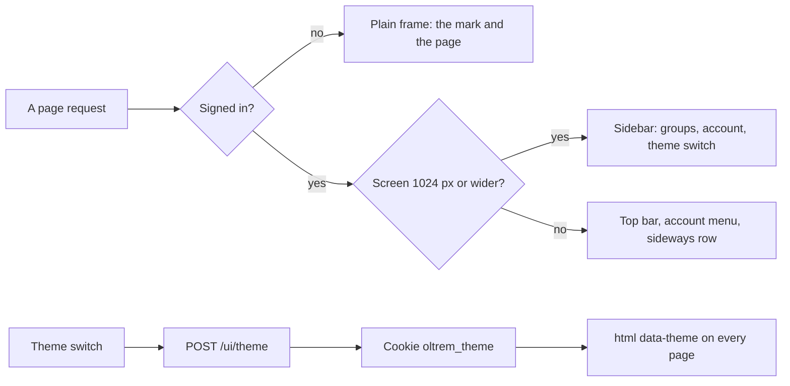
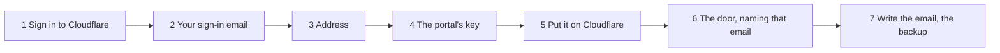

# The portal's frame and the sign-in email

> **In plain words.** The portal worked, but it looked bare: a name, a row of buttons and a page.
> Now a computer shows a sidebar on the left, as the owner asked: the portal's mark
> at the top, every section in its group (People, Messages, Operations, Administration), and at
> the bottom who is signed in, a Light, Dark or Device colour switch, and Sign out. A phone keeps
> the sideways row of sections and gets an account button at the top with the same three things.
> Each page says in one line what it is for, and Home shows its cards with a coloured icon each.
> `npm run deploy` now asks for the email you sign in with second, right after signing in to
> Cloudflare, and uses that same address in the door's steps, so the two can no longer differ.

## What changed, and why

| What | Why |
|---|---|
| A sidebar from 1024 px wide: the mark, the sections in four groups, the account at the bottom | The owner asked for the header's options on the left, as in the first client's portal; the idea only, no code |
| On a phone: a top bar with the mark and an account menu, the sideways row under it | Every section stays visible in a row on a phone (R-12); the menu needs no script (`details`) |
| A colour theme the person chooses: `POST /ui/theme` keeps it in a cookie; Device follows the phone | The theme already had dark values but no way to pick them |
| One line under each section's title; a coloured tile per group on the sidebar and the cards | The pages said nothing about what they were for |
| The signed-in person's role beside their email: Vendor, Owner or Member | Who you are signed in as was easy to miss |
| The Vendor's first page is titled Welcome, its form in a panel; the sign-in page likewise | They read as the start of the portal, not as an empty Home |
| `npm run deploy` has seven steps: the sign-in email is step 2, and step 6 names it | The owner's first run stored an email the door did not let in, so nobody could sign in |

## How it works

Before, every page had the same header: the portal's name, the email, Sign out on this computer
only, and the sideways row of sections on every screen size.

Before, the email was asked last, after the door, and the door's steps said "add yours".

## How it was verified

The screens' stylesheet test (fresh, under 64 KiB, the classes present); the client template's
screen test (every page opens with its section marked and Sign out; the groups, the role and a
summary on People; the theme chosen, kept, shown as pressed, and a way back off the portal sent
Home); `@oltrem/cli`'s deploy test (seven titled steps, the email asked first and named in the
door's steps, written after the deploy; a run before the database exists asks it; a wrong email
stops before anything is written); headless screenshots of Home at 390 and 1280 px, light and
dark; the twelve gates pass. Not verified: the look on the owner's phone and computer.
