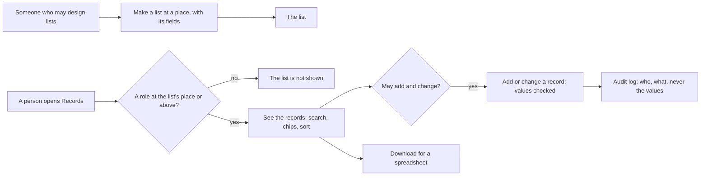
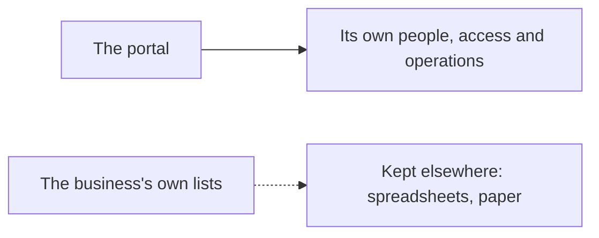

# Your own records

> **In plain words.** A company can now keep its own lists in the portal, with no code: contacts,
> tasks, stock, orders, equipment, or anything else it tracks. Whoever may design lists makes one,
> names its fields (text, a number, a date, yes or no, a choice, an email, a phone, a web link)
> and chooses the place of the company it belongs to. The roles held at that place decide who
> sees the list, who adds and changes its records, and who removes them, so North's stock list is
> North's. Records are searched, narrowed with a row of chips, sorted, opened, changed, removed,
> and downloaded for a spreadsheet. Nothing in it is about one kind of business: the owner asked
> for features any business can use (2026-10-22), and picked this one first on a card.

## What changed, and why

| What | Why |
|---|---|
| **`@oltrem/records`**, a new module: lists, their fields and their records in three tables (migration `0017`), fourteen routes, four capabilities on bit plane `10`, error codes `KIT-E-2201` to `2204` ([its README](../../modules/records/README.md)) | Every business keeps lists; a portal that only manages itself has nothing for the business to do in it |
| A list sits at a place of the company, and every call checks the capability at that place; a list the person may not see is not found | The permission model already has places and roles; reusing them gives each list its own audience with no new machinery |
| Nine kinds of field, each value checked on every save; a web link only as http or https | A value becomes text or a link on the page, so it is checked before it is kept |
| The CSV download defuses a value that a spreadsheet would run as a formula | A record's text is typed by people; a cell starting with `=` must not run when opened |
| Every change audited with ids and names, never a record's values | The audit log is read by more people than the list may be |
| No card on Home | Home reads a card without the person, and a count of every list would tell someone about lists they cannot see |
| The screens: a **Records** section under a new **Work** group; the lists; a new list started blank or from contacts, tasks, stock, orders or equipment; a list's records with a search box, a row of chips per choice and a row to sort; a record with its change form; the designer with each field's up, down and Remove | Every option sits in a sideways row (R-12); removing a record, a field or a list asks first in the one dialog system |
| The client template mounts it after the users module; `0017_records.sql` is copied into its migrations | A new portal has it from its first deploy |

## How it works

Before, the portal managed only itself: its people, access, providers, email, backups, deploys,
health, alerts, audit and settings. A business had nowhere to keep its own information in it.

## How it was verified

The records module's eight tests inside the Workers runtime (the manifest; a list with seven
kinds of field; the name taken and the one-choice field refused; lists seen only where a role
reaches their place, and a list elsewhere not found; values checked per kind; search, a choice
and a yes or no filter, sort and paging; a change replacing values; fields added, moved and
removed with their values; a list moved; the CSV with a formula defused; a list with records
kept; every change audited without a value). The client template's screen test: the Records page
on first run, the Work group, and one flow from a new list started from Contacts through a refused
value kept in the form, a record added, searched, narrowed, downloaded, opened and changed, a
field added, a one-choice field refused, a field moved and removed, the record removed, and the
empty list removed. Screenshots of a list, a record and the designer at 390 px, and the lists and
a list at 1280 px. The twelve gates pass. Not verified: the owner's phone, and a real deploy.
