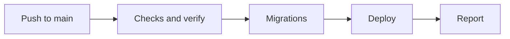
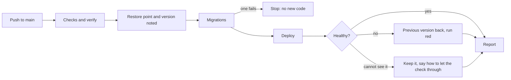

# The automatic release

> **In plain words.** When a change reaches a client's portal, nobody types a command any more.
> The deploy workflow first notes a restore point of the database, then applies the database
> changes, deploys the new version, and asks the portal whether it is healthy. If the new version
> does not answer, the workflow puts the previous version back by itself, within a minute, and the
> run turns red so the owner sees it. A database restore is never automatic: it waits for the
> owner's yes. This is step 2 of the build order in the plan's research 18, for the path that does
> not depend on the owner's open card (whether his and Claude's changes go straight to `main`).

## What changed, and why

| What | Why |
|---|---|
| **`oltrem release [dir]`**: a restore point (the database's Time Travel bookmark), the version running now, the migrations, the deploy, the health check on `/healthz`, and the step back with `wrangler rollback` to the version noted | The owner asked for a release no client or person runs by hand; one command in the tool can be tested, where steps in a workflow cannot ([the tool's README](../../packages/cli/README.md)) |
| A failed migration stops the release before any code deploys | wrangler undoes the failed migration itself; the code that needs it never runs |
| The step back leaves the database as it is | Safe because a client's migrations only add, which `oltrem check modules` enforces ([part one](2026-10-24-client-code-checks.md)) |
| When the door or a bot challenge answers in the Worker's place, the new version stays and the run says how to let `/healthz` through | Stepping back from a healthy version because the check could not see it would undo good work; the release says plainly that it could not check |
| The template's deploy workflow runs `oltrem release` on `main` in place of its two steps (the migrations, then wrangler-action's deploy) | One step, and the version upload on a branch is unchanged |
| `oltrem deploy`'s door step now names a second path, `healthz`, beside `hooks` | The health check must reach the Worker past the door, as a website's forms do |
| The deploy token's registry rows say it is used by `oltrem release` on `main` | Its Workers Scripts and D1 permissions already cover every step, so no new key |

## Before and after

## Impact on each part

| Part | Impact |
|---|---|
| `@oltrem/cli` | The new `release` command; the door step's text |
| The client template | The deploy workflow's release step; its README; the token rows |
| Clients already deployed | The owner's trial portals need the `healthz` path added to the door's bypass application, or each release keeps its new version unchecked and says so |

## How it was verified

The tool's tests stand in for wrangler and the network: the restore point and the version noted
before the migrations, the deploy after them, a first read failing then one passing; six failed
reads and the step back to the version that carried most traffic; a failed migration with no
deploy; a failed deploy reported with the version still running; the door's redirect, a bot
challenge, a body without `ok`, and a network error; a first deploy with no restore point and
nothing to step back to, read on the portal's own address. The wrangler commands and flags were
read from the installed wrangler's own help and source. `pnpm verify` ran green with its twelve
gates.

Not verified: a real release on a Cloudflare account, which waits on the sandbox repository; the
door's bypass of a second path, which the owner sets by hand.

## What is left of step 2

The rehearsal of the migrations on a copy before a kit major or a removal step; the plain-words
summary of a change (check 2) and, if the owner chooses proposals on his card, the proposal's
checks and the merge step.
