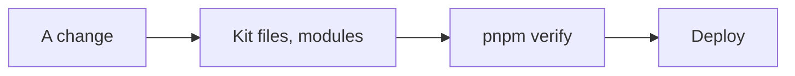
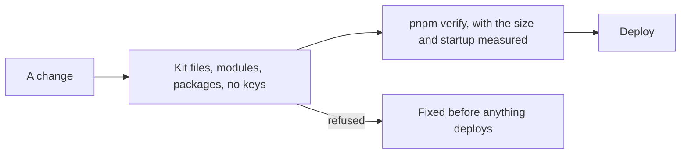

# Checks on a client's code, part two

> **In plain words.** Three more checks now run on every change to a client's portal, after the
> two of [part one](2026-10-24-client-code-checks.md). A portal may only use the outside
> software the kit has approved, each piece with its written reason. No password, key or account
> number may be written into its files, where anyone with the code would see it. And the portal
> must stay small and quick to start, measured on every change instead of only when the kit is
> upgraded. Each refuses the change before anything is deployed.

## What changed, and why

| What | Why |
|---|---|
| **`oltrem check packages [dir]`**: every package a client's `package.json` names is a kit package or one in the kit's dependency registry, which carries each one's reason; the list travels in `kit-files.json` | AI tools suggest packages that do not exist or are not vetted; a client takes only what the kit vetted (research 18, check 6) |
| **`oltrem check secrets [dir]`**: no UUID, long hex id, Cloudflare account token, GitHub, AWS, Slack or Stripe key, or private key in any file Git would commit; the files Git ignores, such as the keys file, are left alone | A Worker finds its resources by name and keeps its keys as secrets, so any of these written down is a leak; private repositories on GitHub's free plan have no secret scanning of their own (research 18, check 8) |
| **`oltrem check budgets [dir]`**: the upgrade's measure of the bundle's size and its startup time, now on every verify, in place of the plain dry-run build | A feature that grows the Worker past its limits should be refused when it is written, not at the next upgrade (research 18, check 7) |
| The template's deploy workflow runs `check packages` and `check secrets` in its own step beside part one's two; `verify` runs all five | `package.json`, which holds `verify`, is the client's file; the workflow is the kit's. The budget check needs a build, and Cloudflare refuses an oversized Worker at deploy anyway |

## Before and after

## Impact on each part

| Part | Impact |
|---|---|
| `@oltrem/cli` | Three new `check` commands; `kit-files.json` also lists the allowed packages |
| The client template | `verify` and the deploy workflow run the new checks; `ai.md` and the README say so |
| Client repositories | None exist yet beyond the owner's trials; each gets the checks with its next kit version |

## How it was verified

The tool's tests run each check on the client template, which passes all five, and on copies of
it: a package the kit did not register refused and another kit package accepted; an id, a hex
key, a Cloudflare token and a private key refused by file and line, built at run time so this
repository's own identifier gate stays clean; the keys file and `.dev.vars` left alone both
outside Git and inside a new repository; the budgets with wrangler stood in for, within the
limits, past 70 % and past the limit. All five checks also ran on the template with the real
wrangler. `pnpm verify` ran green with its twelve gates.

Not verified: a real client repository's workflow; GitHub's runner using `git ls-files` for
the secret check, which it should, as the workflow checks the repository out with Git.

## What is left of step 1

Check 2, a plain-words summary of what a change adds, belongs with the proposal of step 2. Check
5, tests generated from a module's manifest, and the 50-queries-per-request count of check 7
need the kit's test harness to count queries; they come next. The daily drift watch is step 6.
