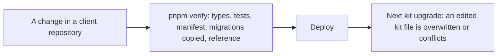
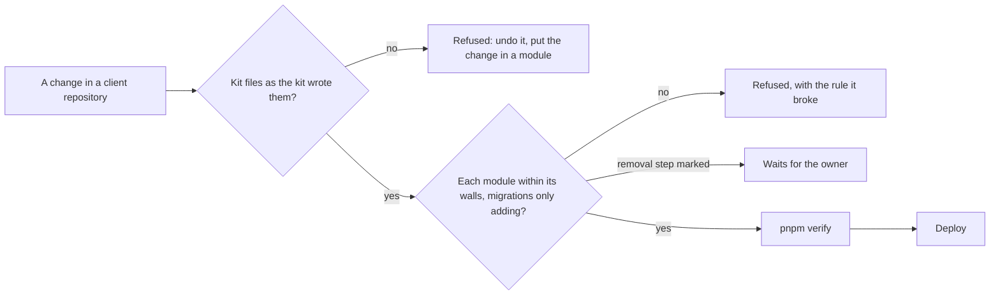

# Checks on a client's code

> **In plain words.** A client's portal is the kit plus the client's own features. Until now
> nothing stopped someone, a developer or an AI, from editing the kit's own files inside a
> client's repository, or from writing a database change that the previous version of the portal
> could not live with. Both would surface only later, at the next upgrade or when an automatic
> step back failed. Two new checks now refuse them on every verify and in the deploy workflow,
> before anything reaches the client: the kit's files must be exactly as the kit wrote them, and
> each client feature must stay inside its own walls. Claude Code is also told, in the client
> repository's own settings, never to edit the kit's files. This is step 1 of the build order the
> owner accepted on 2026-10-24 (research 18 in the plan, section 6).

## What changed, and why

| What | Why |
|---|---|
| **`oltrem check files [dir]`**: every kit file in a client repository (the workflow, `src/index.ts`, the kit's tests and configuration, `ai.md` and the pointer files, the Claude Code settings) equals the copy of the installed kit version, by checksum | An edited kit file is drift. Found at the next upgrade it is lost or breaks; refused at once it is never written (research 18, check 1) |
| The list of kit files and their checksums, `packages/cli/kit-files.json`, is generated from the client template by `pnpm docs:build` and travels with the tool | A client is checked against the kit version it installed; the docs gate refuses a stale list in the kit (R-06) |
| **`oltrem check modules [dir]`**: each module under `modules/` has a name of its own, never a kit module's, and declares it; `src/modules.ts` lists exactly those modules; a module imports nothing outside its folder, only packages `package.json` lists, and a kit package only through its public entry points; its error codes stay in one hundred of its own from 5000 | A client feature that reaches into the kit, or collides with another feature, breaks on an upgrade (research 18, check 3) |
| The same check reads the client's migrations (5000 and up): each is named for a module and listed in its manifest, and only creates that module's tables and indexes, adds a column that is nullable or has a default, or inserts rows. Anything else must be marked `-- contract:` and is reported as a removal step waiting for the owner | The automatic step back after a failed release runs the previous code on the new database; that is safe only if every migration adds (research 18, check 4; the owner's answer 9.2: removal steps wait for him) |
| `templates/client/.claude/settings.json` denies Claude Code any edit of the kit files, `src/modules.ts`, the generated reference and the kit's migrations | Claude Code enforces these rules itself, whatever the prompt says (research 18, check 9) |
| The template's `verify` and its deploy workflow run both checks; the workflow runs them as a step of its own | `package.json`, which holds `verify`, is the client's file; the workflow is the kit's |
| The template's health test now expects the client's own modules after the kit's | That test is a kit file a client cannot edit, so adding a module must not break it |
| `forms`, `records` and `settings` are now reserved module names | They are kit modules since 2026-10-22, and `oltrem new module` still accepted them |
| An answer's notes written in the same instant show in the order they were written (`@oltrem/forms`) | They were ordered by their random ids, so the forms test, whose clock stands still, failed about half its runs; this run's verify caught it |

## Before and after

Before, an edit to a kit file or a migration that removes something went straight to the deploy:

After, both are refused before the deploy, and a removal step is flagged for the owner:

## Impact on each part

| Part | Impact |
|---|---|
| `@oltrem/cli` | Two new `check` commands; `integrityOf`, `NAME` exported for them; three more reserved names |
| The client template | The Claude Code settings file, the two checks in `verify` and in the workflow, the health test, a line in `ai.md` and a row in the generated map |
| The kit repository | `pnpm docs:build` now also writes `packages/cli/kit-files.json`; the docs gate holds it current |
| Client repositories | None exist yet beyond the owner's trials; each gets the checks with its next kit version |

## How it was verified

The tool's new tests run both checks on the client template and on copies of it with two modules
made by `oltrem new module`: an edited and a missing kit file; a client's own files changed
freely; a reserved name, a bad name, a folder with no manifest, a wrong id and a hand-edited
module list; an import outside the folder, past a package's entry points and of an unlisted
package; a kit error code and a shared hundred; migrations not named for a module or missing
from its manifest; every kind of adding step accepted and six kinds of other step refused, then
accepted as a removal step once marked; and the Claude Code settings covering every kit file.
`pnpm verify` ran green with its twelve gates.

Not verified: a real client repository on GitHub running the workflow's new step, which waits
on the sandbox repository; Claude Code honouring the deny rules in a client repository, which
its own documentation states but nobody has tried here.

## What is left of step 1

Research 18 lists nine checks. These are checks 1, 3, 4 and the Claude Code part of 9. Still to
build: the change summary on a proposal (2), tests generated from a module's manifest (5),
dependencies from an allowed list (6), size, startup and query budgets on every change (7), the
scanner in client repositories (8), and the daily drift watch (9). The CSV exports of forms and records order rows
written in the same instant by their random ids too; harmless, and left as they are.
