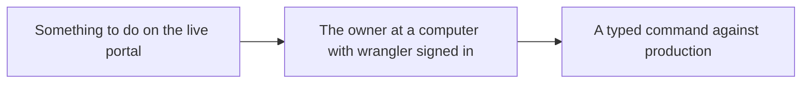
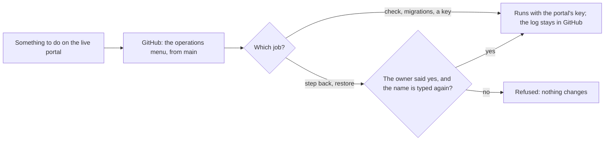

# The operations menu

> **In plain words.** Some jobs on a live portal are not code changes: checking that it is set up
> right, applying a database change that is waiting, putting in a new key, going back to the
> previous version, or returning the database to an earlier moment. Until now each needed someone
> at a command line with the right access, which clients do not have and the owner wants to
> avoid. Every client repository now has an operations menu in GitHub: pick one of five jobs from
> a list, and GitHub runs it with the portal's own key and keeps its log. Claude can start a job
> by name and read the result. The two jobs that replace what runs (going back a version,
> restoring the database) start only after the owner says yes, and ask for their name typed again
> so a wrong tap does nothing. This is step 3 of the build order the owner accepted on 2026-10-24
> (research 18 in the plan, section 6).

## What changed, and why

| What | Why |
|---|---|
| **`templates/client/.github/workflows/operations.yml`**, a kit file: a manual workflow with one list of five jobs, a target box and a confirmation box; it runs from `main` only and waits behind a release in progress | The answer to "command execution" in research 18 §3.5: an operation is a fixed, named job with a log, never a free command with a production key |
| **`oltrem operate <operation>`**: the five jobs, the list the workflow offers (a test holds them equal) | One place says what each job does, tested with wrangler stood in for |
| `check the setup` only reads: the version running, the five latest versions, the restore point now, waiting migrations, the secrets set, `/healthz` | The first thing to run when something looks wrong, and safe for Claude to start at any time |
| `apply waiting migrations` runs them without a deploy | A client's migrations only add, so they can go ahead of the code |
| `replace a Worker secret` takes the value from a repository secret of the same name and hands it to wrangler on standard input | The value never appears in an argument, an input box or a log; a key rotation (the KEK's recipe, a provider's key) no longer needs a command line |
| `step back the code` and `restore the database` refuse to run without their name typed again | They replace what runs; the owner's yes in the thread comes first (research 18 §3.5) |
| The inputs reach the command as environment values, never pasted into the script | A target box holding shell text cannot run it |
| The release's restore-point line now says where a restore runs from | The bookmark in a release's log is what `restore the database` takes |
| The tool's wrangler runner can write to wrangler's standard input | For the secret's value |
| The token registry rows of the two repository secrets name the menu as a user | R-05: every use of a credential is listed |

The workflow reads the new secret by a name chosen at run time, which makes GitHub give the run
every repository secret. A client repository holds only the release key and the account id, and
this step has both anyway, so nothing more is exposed; a fixed name for the new value would have
been a new credential name, which needs the owner's yes (R-05).

## Before and after

Before, a job on a live portal needed someone at a command line with the account's access:

After, it is a choice from a list, with a log, and the two replacing jobs wait for the owner:

## Impact on each part

| Part | Impact |
|---|---|
| `@oltrem/cli` | The `operate` command; the wrangler runner's standard input; `jsonOf` exported from the release |
| The client template | The operations workflow, a kit file that `check files` holds and Claude Code may not edit; rows in `ai.md`, the README and the generated map |
| The kit repository | `pnpm docs:build` lists the new kit file in `packages/cli/kit-files.json` |
| Client repositories | None exist yet beyond the owner's trials; each gets the menu with its next kit version |

## How it was verified

The tool's new tests run every job on the client template with wrangler and the network stood in
for: `check the setup` reading only, then reporting a waiting migration, missing secrets, no
version, and a portal that does not answer; the migrations applied without a deploy; a secret
name that is not the Worker's, a missing value, and the value passed on standard input; a step
back refused without its name, then to the version before and to a chosen one; a restore refused
without its name or a point, then to a bookmark and to a time; each failure leaving things as they
were; the command line passing the target, the confirmation and the value; and the workflow's
choices equal to the tool's list, from `main` only, with no input pasted into its script.
wrangler's commands and their JSON were read from its own help and source (4.151).
`pnpm verify` ran green with its twelve gates.

Not verified: a real run on a Cloudflare account, which waits on the sandbox repository; GitHub
reading a secret by a name chosen at run time, which its expressions allow but nobody has run
here.

## What is left

Steps 4 to 6 of the build order (automatic first setup, the fleet step, the daily drift watch),
and from steps 1 and 2 the change summary, the tests generated from a manifest, the query count
and the rehearsal on a copy.
