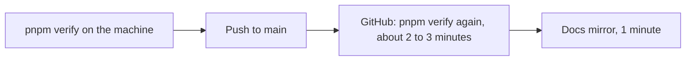
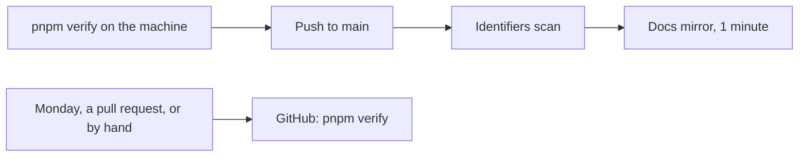

# The full verify stops repeating on every push

> **In plain words.** GitHub ran the whole `pnpm verify` again after every push to `main`, though
> R-02 already has it pass on the machine that pushes. Each run cost about three of the
> account's 2,000 free minutes a month, and the kit's first six days spent 291 of them. Now the
> full check runs on pull requests, once a week and by hand. A push still publishes the
> documentation to the public mirror, after the identifiers scan, for about one minute.

## What changed, and why

The owner asked on 2026-10-25 to stop repeated checks: "if we do re runs, cicd checks, code
check etc on same thing we may have bigger problem in long run". Reading every run of this
repository through the GitHub Actions API (each job's start and end, rounded up to a minute the
way GitHub bills) gave 78 runs on push from 2026-10-19 to 2026-10-24, 291 minutes, none a
re-run. At that pace the account would spend about 1,450 minutes a month on this repository
alone.

- `.github/workflows/verify.yml` adds a weekly schedule (Monday 05:17 UTC). The `verify` job is
  skipped on push (`if: github.event_name != 'push'`).
- The `mirror-docs` job no longer waits for `verify`. It runs the identifiers gate itself
  (`node scripts/check-identifiers.mjs`: Node and git only, no install) before it checks out the
  mirror, so nothing reaches the public mirror that the scanner did not pass (R-04).
- `scripts/workflows.test.mjs` asserts both: the triggers, the `if`, and the gate before the
  mirror checkout. Removing either fails it.
- R-01 and R-02 in rules.md name their enforcement as it now is: `pnpm verify` before the push
  (ai.md section 7 asks for its summary line), the weekly run, and the pre-push hook still to
  come. The token registry's `PERSONAL_PAT` row and docs/reference/verify.md say the same.

A client repository is not changed: its deploy workflow still runs verify before every deploy.

## Before and after

Before: every push paid for the full check a second time, then the mirror.

After: a push costs about one billed minute, and the full check runs weekly, on pull requests and
by hand. A push that skipped the local verify shows within a week instead of within minutes.

## Impact on each part

| Part | Before | After |
|---|---|---|
| This repository on GitHub | verify and the mirror on every push | the mirror after the identifiers scan on a push; verify weekly, on pull requests, by hand |
| The public docs mirror | published after a green verify | published after the identifiers scan |
| Client repositories | not touched | not touched |

## How it was verified

| Check | Result |
|---|---|
| `pnpm verify` | exit 0 (this record's commit) |
| `node --test scripts/workflows.test.mjs` with the `if` removed, then with the identifiers step removed | each fails one test |
| The GitHub Actions API, every run since 2026-10-19 | 78 push runs, 291 minutes, 76 green, 2 red, no re-runs |

Not checked: the first weekly run (Monday 2026-10-26).

## What is left

- Batching the mirror to once a day would save about one minute a push more (about 390 a month
  at last week's pace); the public copy would lag up to a day. It is the owner's choice.
- The pre-push hook (R-02) arrives with the command-line tool.
