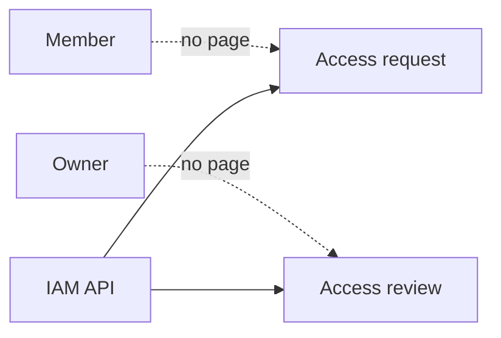
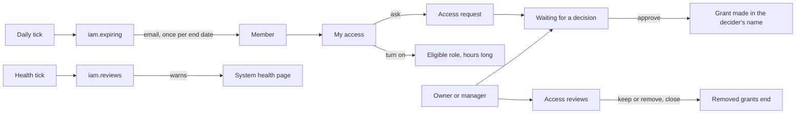

# Access screens and access care

> **In plain words.** The rules for who may do what were already in the portal (requests,
> second-person approvals, access reviews, roles that are off until needed), but only a program
> could use them: there was no page. Now everyone has a **My access** page, linked under their
> name in the sidebar: what they hold and until when, a button to turn on a role that is off until
> needed, and a form to ask for a role at a place. Whoever may give that role sees the request on
> **Waiting for a decision** and approves or refuses it with one tap. **Access reviews** can be
> started at a place, each grant marked keep or remove, and closed. Two things now happen on
> their own: a person whose access ends within the week is emailed once, and the health page
> warns when no access review was opened for ninety days or one is past due. The owner asked for
> "a better permission system" and "an auto check, auto run system" on 2026-10-27.

## What changed, and why

| What | Why |
|---|---|
| My access (`/access/mine`): held roles, turn one on, ask for one, the requests | A member could not see what they hold or ask for more without an Owner doing it for them |
| `GET /api/iam/me/options`: the roles (not the Owner's) and places by name | A member without `iam.read` must still know what to ask for; names only, nothing else |
| Waiting for a decision (`/access/decisions`): requests and approvals with Approve and Refuse | Requests and the second-person rule worked only through the API |
| Access reviews (`/access/reviews`): start one, keep or remove each grant, close it with a dialog | Periodic review is what auditors ask for (SOC 2 CC6, ISO 27001 A.5.18); it had no page |
| Groups (`/access/groups/:id`): members by address, the group's roles, rename, remove | A role for a team was given person by person; a group gives it once and follows its members |
| Vendor access (`/access/vendor`): when the Vendor may enter, a window with a reason | The company's say over the Vendor's door had no page |
| Giving a role: for 30 days, 90 or a year, and optionally off until turned on | Short and just-in-time access are the safer defaults; the form now offers them |
| Job `iam.expiring`, daily: an email when one's own grant ends within 7 days | Nobody is surprised by a role ending; renewing is asked for in time |
| Check `iam.reviews`: a warning when a review is past due or none was opened for 90 days | The review is remembered by the portal, not by a person |
| One `mail` option for the IAM module's messages (invitations and notices) | One sender, one plain template (`iam.message`), instead of one option per kind |

## Before and after

Before, every rule was enforced, but only a call to the API could reach the requests, approvals
and reviews; nothing reminded anyone:

After, each step has a page, and the tick keeps two rules on its own:

Explanation: every page calls the IAM API as the signed-in person, so the same rules decide: a
request is approved only by someone who could have given the role there, never by the person
who asked; an approval needs someone else who holds the same power; a review's grant is kept or
removed only by someone with standing over it. The pages show the buttons and the API refuses
with its reason.

## Impact on each part

| Part | Impact |
|---|---|
| `@oltrem/iam` | one new route (58 in all), one job, one health check; the `sendInvitation` option is now `mail`; no migration, no error code |
| `@oltrem/screens` | seven pages and their forms in `src/access.tsx`, links in the Access page's row, My access in the account area, the grant form's length and eligible choice |
| The client template | `mail` wired to the email module as the `iam.message` template; the tests extended |
| Clients | the pages and the reminder from their next deploy; no new table, binding, secret or variable |

## How it was verified

`pnpm verify` passes. The IAM care tests run on the rows (which grants are noticed, a refused
message, the review check's states); the routes test reads `GET /me/options`. The client template
drives a member's request through the pages to the Owner's approval, refuses the member deciding
it, opens a review, keeps every grant and closes it, makes a group with a role that is off until
turned on and has the member turn it on, opens and closes the Vendor's window, and queues one expiry notice on the tick
twice without a second message. Not yet tried on a deployed portal or a phone.
